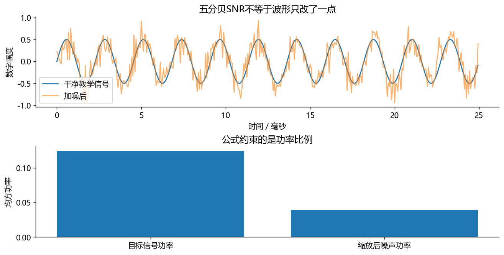
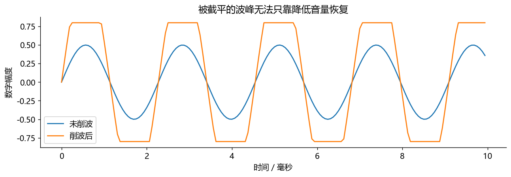

# 使用说明
从上到下逐格运行。每格下方已有本次实际执行输出，不需要先运行也能读。
改参数后请重新运行后续格。图中数字幅度没有校准成声压，不代表耳机声压大小。
仅使用 NumPy、SciPy、Matplotlib；不录音、不自动播放、不下载模型。
图形显示由本机已安装的中文字体决定；本次生成使用微软雅黑。


# 练习本二：RMS、分贝与配噪

目标：理解为什么幅度翻倍是约6 dB，而0 dB SNR不是静音。


```python
import numpy as np
import matplotlib.pyplot as plt
fs = 16000
t = np.arange(fs)/fs
s = 0.5*np.sin(2*np.pi*440*t)
def rms(x):
    x = np.asarray(x, dtype=np.float64)  # 避免整数平方溢出
    return np.sqrt(np.mean(x**2))        # 平方、平均、开根号
level = 20*np.log10(rms(s)/1.0)         # 明确参考为数值1，不是20微帕
print('RMS =', rms(s), '本课RMS dBFS =', level)
print('幅度乘2增加：', 20*np.log10(2), 'dB')
```

实际运行输出：

```text
RMS = 0.3535533905932735 本课RMS dBFS = -9.030899869919441
幅度乘2增加： 6.020599913279624 dB
```

下一步不是随意给噪声乘0.1，而是先量功率，再算需要的噪声比例。每次固定随机种子，是为了让两次实验可比较。


```python
rng = np.random.default_rng(17)
n = rng.normal(size=len(s))            # 原始噪声，还没按目标SNR缩放
target_db = 5.0
ps = np.mean(s**2)                     # 目标信号的均方功率
pn = np.mean(n**2)                     # 原始噪声的均方功率
scale = np.sqrt(ps/(pn*10**(target_db/10)))  # 功率比，所以指数除以10
scaled_noise = scale*n
y = s + scaled_noise
measured = 10*np.log10(ps/np.mean(scaled_noise**2))
print('目标/重测SNR：', target_db, measured)
assert abs(measured-target_db) < 1e-10
fig, axes = plt.subplots(2, 1, figsize=(10, 5), layout='constrained')
axes[0].plot(t[:400]*1000, s[:400], label='干净教学信号')
axes[0].plot(t[:400]*1000, y[:400], alpha=.6, label='加噪后')
axes[0].set(xlabel='时间／毫秒', ylabel='数字幅度', title='五分贝SNR不等于波形只改了一点')
axes[0].legend()
axes[1].bar(['目标信号功率','缩放后噪声功率'], [ps, np.mean(scaled_noise**2)])
axes[1].set(ylabel='均方功率', title='公式约束的是功率比例')
```

实际运行输出：

```text
目标/重测SNR： 5.0 5.000000000000001
```



图中波形更乱不是唯一指标，底部功率柱形图才直接对应 SNR 计算。接着演示削波：削波不是等比例缩小，会产生新谐波。


```python
clipped = np.clip(3*s, -0.8, 0.8)      # 模拟过载后的非线性截断
fig, ax = plt.subplots(figsize=(10, 3.6))
ax.plot(t[:160]*1000, s[:160], label='未削波')
ax.plot(t[:160]*1000, clipped[:160], label='削波后')
ax.set(xlabel='时间／毫秒', ylabel='数字幅度', title='被截平的波峰无法只靠降低音量恢复')
ax.legend(); fig.tight_layout()
print('削波影响样本比例：', np.mean(np.abs(3*s)>0.8))
```

实际运行输出：

```text
削波影响样本比例： 0.645
```



练习：把 target_db 改成0、10。答案：0 dB时两者功率相同；10 dB时目标功率是噪声的10倍，RMS比是根号10。保存WAV前若整体缩放，应对参考和混合保持一致；若发生削波，原配噪公式不再充分描述失真。

