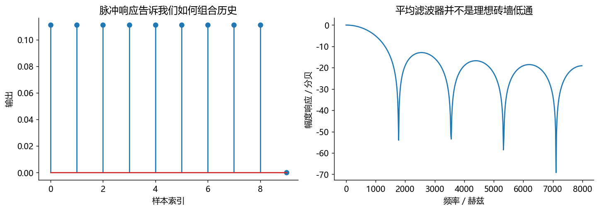
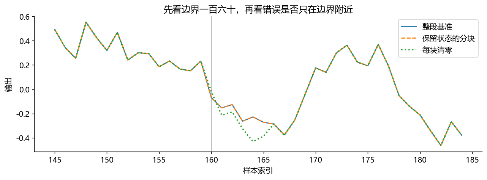

# 使用说明
从上到下逐格运行。每格下方已有本次实际执行输出，不需要先运行也能读。
改参数后请重新运行后续格。图中数字幅度没有校准成声压，不代表耳机声压大小。
仅使用 NumPy、SciPy、Matplotlib；不录音、不自动播放、不下载模型。
图形显示由本机已安装的中文字体决定；本次生成使用微软雅黑。


# 练习本三：为什么分块后声音变了

目标：从九点滑动平均理解FIR、历史状态、离线与流式的一致性。


```python
import numpy as np
import matplotlib.pyplot as plt
from scipy.signal import lfilter, freqz
b = np.ones(9)/9                        # 当前及前8个样本，等权平均
sample = np.array([1., 0., 0., 0., 0., 0., 0., 0., 0., 0.])
response = lfilter(b, [1.], sample)      # 输入一个脉冲，输出就是FIR系数
print('脉冲响应：', np.round(response, 4))
frequency, h = freqz(b, fs=16000)
fig, axes = plt.subplots(1, 2, figsize=(11, 3.8), layout='constrained')
axes[0].stem(range(len(response)), response)
axes[0].set(xlabel='样本索引', ylabel='输出', title='脉冲响应告诉我们如何组合历史')
axes[1].plot(frequency, 20*np.log10(np.maximum(np.abs(h), 1e-8)))
axes[1].set(xlabel='频率／赫兹', ylabel='幅度响应／分贝', title='平均滤波器并不是理想砖墙低通')
```

实际运行输出：

```text
脉冲响应： [0.1111 0.1111 0.1111 0.1111 0.1111 0.1111 0.1111 0.1111 0.1111 0.    ]
```



接收设备可能每次只交160点。若每块都假装前面没有声音，滤波器就会反复“刚启动”。保持 zi 才能记住过去。


```python
rng = np.random.default_rng(22)
x = rng.normal(size=1031)               # 故意不整除160，测试最后短块
offline = lfilter(b, [1.], x)
state = np.zeros(len(b)-1)              # FIR内部状态长度为抽头数减一
good, bad = [], []
for start in range(0, len(x), 160):
    block = x[start:start+160]
    filtered, state = lfilter(b, [1.], block, zi=state)  # 下一块继承新状态
    good.append(filtered)
    bad.append(lfilter(b, [1.], block))   # 错误对照：每次从零状态开始
streamed = np.concatenate(good)
reset = np.concatenate(bad)
print('正确保留状态最大误差：', np.max(np.abs(streamed-offline)))
print('错误清零状态最大误差：', np.max(np.abs(reset-offline)))
assert np.allclose(streamed, offline, atol=1e-12)
```

实际运行输出：

```text
正确保留状态最大误差： 1.1102230246251565e-16
错误清零状态最大误差： 0.2930536804716581
```

```python
fig, ax = plt.subplots(figsize=(10, 3.8))
indices = np.arange(145, 185)
ax.plot(indices, offline[145:185], label='整段基准')
ax.plot(indices, streamed[145:185], '--', label='保留状态的分块')
ax.plot(indices, reset[145:185], ':', linewidth=2, label='每块清零')
ax.axvline(160, color='gray', alpha=.5)
ax.set(xlabel='样本索引', ylabel='输出', title='先看边界一百六十，再看错误是否只在边界附近')
ax.legend(); fig.tight_layout()
```



练习：把块长改为127、256，正确流式仍应与整段一致。这里验证的是线性FIR状态，不代表所有神经模型直接分块都等价。模型若依赖未来帧、整句归一化或全局注意力，还要额外设计缓存和边界策略。

