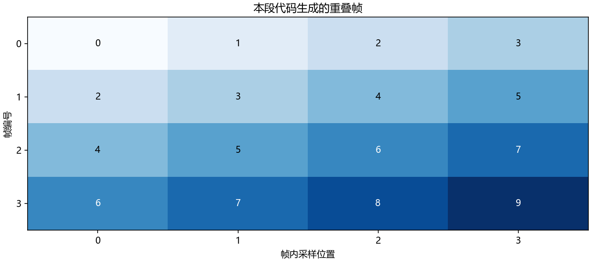

# 第 4 课：用 NumPy 真正读懂一段音频

[上一课：分贝与响度](03_decibels.md) · [返回教程目录](../README.md) · [下一课：频谱、卷积与 STFT](05_spectrum.md)

> 前置要求：会打开 Python 脚本并运行，会使用变量和简单四则运算。目标：一眼看懂 `[时间,声道]`、`[帧,采样]` 的区别；会安全计算 RMS、分帧和按声道增益；遇到报错能从形状与数据类型定位。建议 2 次各 60 分钟，不要只看代码不运行。

## 1. 数组不是声音本身，它是一张带规则的数字表

单声道波形可以用 `[0.1, 0.2, -0.1, ...]` 表示。数组保存这些值，但它本身通常不保存采样率。相同 16000 个数字，按 16 kHz 解释是 1 秒，按 8 kHz 解释是 2 秒。因此，一个音频输入通常至少需要“采样数组＋采样率”两个部分。

把二维数组想成表格很有帮助：行可以表示时间，列可以表示声道。例如 `audio.shape == (16000, 2)`，在本课约定下就是 16000 个时刻、两个声道。注意这只是约定，不是 NumPy 自动识别出的物理意义。若某个库返回 `(2,16000)`，你必须按它的规则解释，不能因为第一维小就擅自改动。

`shape` 告诉你每个维度有多长；`ndim` 告诉你有多少个维度；`dtype` 告诉你每个数字怎么存。`len(audio)` 只返回第一维长度，不是数组总元素数。`audio.size` 才是总元素数。对 `(16000,2)`，前者为 16000，后者为 32000。

## 2. 轴和归约：你想保留什么，就不要把它平均掉

`axis=0` 指第一维，`axis=1` 指第二维。设数据形状 `[时间,声道]`：沿 `axis=0` 求均值，会把所有时刻合并，得到每个声道的一个均值，形状 `[声道]`；沿 `axis=1` 求均值，会把声道合并，得到每个时刻的一个值，形状 `[时间]`。

先手算一张小表：`[[1,3],[5,7]]`。沿时间轴平均是 `[3,5]`，沿声道轴平均是 `[2,6]`。两者都能运行，都没有语法错误，但回答的是完全不同的问题。音频代码最危险的错误经常不是程序报错，而是维度错了还照样给出数字。

广播（broadcasting）是让兼容形状做逐元素运算的规则。`[时间,声道]` 乘 `[声道]` 可以给各声道分别加增益，因为从最后一维对齐时对应。若要给每个时间点一个增益，可用 `[时间,1]`。缺少这个 1，可能无法匹配，也可能在某些巧合长度下算错而不报错。NumPy 的正式规则是从末维向前比较，维度长度相同或其中之一为 1 才兼容。[官方广播说明](https://numpy.org/doc/stable/user/basics.broadcasting.html)可用于核对边界情况。

## 3. 第一段核心代码：两声道，不要写两套循环

```python
import numpy as np

# 行是时间，列是声道；这里只放 4 个时刻，方便手算。
audio = np.array([[0.1, 0.2], [0.2, 0.4],
                  [-0.1, -0.2], [-0.2, -0.4]], dtype=np.float64)
gains = np.array([1.0, 0.5])       # 左声道不变，右声道幅度减半
adjusted = audio * gains          # (4,2) 乘 (2,)，按末维广播
channel_rms = np.sqrt(np.mean(adjusted ** 2, axis=0))
mono = adjusted.mean(axis=1)      # 仅在允许混音时合并声道
print("输入/输出形状:", audio.shape, adjusted.shape, mono.shape)
print("每声道 RMS:", channel_rms)
print("混音结果:", mono)

# 单个数与切片的维度不同，接口对接时要主动检查。
print("第一列:", audio[:, 0].shape)    # (4,)
print("保留第二维:", audio[:, :1].shape)  # (4,1)
```

代码中先平方、再沿时间平均、再开根号，所以得到“每声道 RMS”，不是整个数组的一个 RMS。预期两个声道处理后相同，各自 RMS 约 `0.158114`，混音为 `[0.1,0.2,-0.1,-0.2]`。一维 `(4,)` 和二维 `(4,1)` 都只有四个数，却可能与后续数组产生完全不同的广播结果。把 `shape` 打印出来不丢人，省下一次错误训练才重要。

这段是数值与形状练习，没有生成图文件；下一段会把相同的“行列规则”用已运行的分帧图展示，避免把不对应的图片冒充这四个采样的运行结果。

## 4. 从长波形切出短帧：为什么同一个点会出现多次

语音随时间变化，我们常每隔一小段时间看一个短窗口。窗口长度 $L$ 表示每帧有多少采样，帧移 $H$ 表示下一帧从哪里开始。若 $H<L$，相邻帧重叠。重叠不是复制出新的信息，而是让不同窗口观察同一部分数据。

例如 16 kHz 下，25 ms 对应 $0.025\,\mathrm{s}\times16000\,\mathrm{Hz}=400$ 点，10 ms 帧移对应 160 点。不补零、只保留完整帧，且满足 $N\geq L>0$、$H>0$ 时，信号的帧数为：

$$
N_{\mathrm{frames}}=1+\left\lfloor\frac{N-L}{H}\right\rfloor.
$$

1 秒 16000 点对应 $1+\left\lfloor\frac{15600}{160}\right\rfloor=98$ 帧。使用中心补零的库可能返回不同帧数，所以看到“别人是 101 帧”应先查规则。

```python
import numpy as np

x = np.arange(10)                 # 原始波形：编号 0 到 9
length, hop = 4, 2                # 每帧 4 点，下一帧前进 2 点
starts = range(0, len(x) - length + 1, hop)
frames = np.stack([x[i:i + length] for i in starts])
print("帧矩阵形状:", frames.shape)
print(frames)                     # 每行是一帧，每列是帧内位置
print("逐帧均值:", frames.mean(axis=1))

# 在课程根目录运行；把这一段实际计算的 frames 直接画出来。
from pathlib import Path
import matplotlib
matplotlib.use("Agg")
import matplotlib.pyplot as plt
plt.rcParams.update({"font.family": "Microsoft YaHei", "axes.unicode_minus": False})
assert Path("tutorial/chapters").is_dir(), "请在 audio-course-zh 根目录运行"
fig, ax = plt.subplots(figsize=(9, 4), layout="constrained")
ax.imshow(frames, cmap="Blues", aspect="auto", vmin=0, vmax=9)
for row in range(frames.shape[0]):
    for col in range(frames.shape[1]):
        ax.text(col, row, str(frames[row, col]), ha="center", va="center",
                color="white" if frames[row, col] > 5 else "black")
ax.set(xticks=range(length), yticks=range(len(frames)),
       xlabel="帧内采样位置", ylabel="帧编号", title="本段代码生成的重叠帧")
fig.savefig("tutorial/figures/ch04_frames.png", dpi=150)
plt.close(fig)
```



这张图来自紧挨着它的代码，不是预先手绘的矩阵。请用鼠标或手指从第二行第一格顺着读一遍，你读到的就是第二帧的四个采样。若改帧移，行间重复关系也会相应改变。绘图部分额外需要 Matplotlib，使用静态后端，不弹出窗口。

图中第一行是 `[0,1,2,3]`，第二行从 2 开始；数字 2、3 在两行出现，直观展示了重叠。列不是声道，而是帧内位置。预期矩阵形状 `(4,4)`，逐帧均值 `[1.5,3.5,5.5,7.5]`。[beginner_labs.py](../code/beginner_labs.py) 的 `frames_and_stream()` 使用同一组输入，运行记录见 [beginner_results.json](../results/beginner_results.json)；这里不再重复放第二张相同内容的图。

这个最小示例假设 `hop>0`，且输入至少有一帧长。真实数据如果短于 `length`，`starts` 会为空，`np.stack` 就会报错。工程实现应明确选择“补零形成一帧”或“跳过并记录”，而不是让异常数据悄悄进入训练；不同选择也会影响有效长度和损失掩码。

这里用 `stack` 是为了易读，长音频大量复制会增加内存。后续可以学习滑窗视图与批处理，但先不要为了优化写出自己无法验证的索引。更不能把每一帧都当成独立录音随机划分训练集和测试集，同一原始录音的相邻帧高度相关，会造成泄漏。

## 5. 整数、浮点和数值安全

音频文件可能返回 `int16`，而训练模型通常期望浮点。先转浮点再平方，避免整数溢出；先转浮点再取绝对值，也能避开最小负整数的边界问题。`float32` 常用于模型训练，`float64` 适合某些教学验证和高精度数值计算，但不是所有任务都需要后者。

```python
import numpy as np

pcm = np.array([-32768, 0, 16384, 32767], dtype=np.int16)
x = pcm.astype(np.float64) / 32768.0  # 先转换，随后才计算
if x.size == 0 or not np.isfinite(x).all():
    raise ValueError("音频必须是非空、有限数值")
peak = np.max(np.abs(x))              # 不直接对 int16 最小值取绝对值
rms = np.sqrt(np.mean(x ** 2))
print("归一化采样:", x)
print("峰值/RMS:", peak, rms)
```

预期归一化值为 `[-1,0,0.5,0.999969...]`，峰值为 1。`isfinite` 同时检查 NaN 和正负无穷。不要把报错的 NaN 全部替换成 0 就宣布修复：先找它为什么出现，例如 `log(0)`、除以零、空切片或训练溢出。本块是边界数值检查，无独立绘图结果。

## 6. 读取真实音频：接口、路径与报错

第 2 课的 `wave` 内存例子已经演示过完整读写。实际工程可以选支持目标格式的音频库，但每次读入后统一执行体检：形状、数据类型、采样率、时长、范围、有限性。文件路径应明确；工作目录不一定等于脚本所在目录。Windows 路径里反斜杠可能被当作转义，使用 `pathlib.Path` 或原始字符串可以减少错误。

`FileNotFoundError` 首先检查路径是否存在、当前工作目录在哪里；`ModuleNotFoundError` 首先检查安装库的 Python 是否就是当前解释器；`ValueError: operands could not be broadcast together` 先逐个打印参与运算的形状；`IndexError` 先核对维数以及下标范围。不要看到每个错误都先重装环境。

切片还存在“视图”问题：`part=x[:100]` 可能共享原数据，修改 `part` 会改到 `x`。想明确独立副本可用 `.copy()`。这在制作干净语音与带噪版本时很重要，否则可能原本打算只改噪声样本，结果把干净参考也污染了。

## 7. 跟着定位一次“不报错但结果不对”的问题

现在假设你要给左右两路分别计算音量，却写成 `np.sqrt(np.mean(audio**2))`。程序成功返回一个数，为什么不对？不要先去改 `sqrt`，先问最终应该保留几个数。双声道各一个，应该保留声道维；当前 `mean` 没写轴，把时间和声道一起平均掉了。补上正确的 `axis=0`，再检查输出是不是 `(2,)`。

下一步故意把 `audio` 转置，但保持原来的计算代码不变。程序仍可能跑通，这次输出变成了每个时刻的统计。正确做法不是看哪个结果“更像”，而是在接口处记录布局，必要时显式转换一次，然后让后续函数统一遵守约定。可以给函数命名 `rms_per_channel_time_first`，或者写清输入注释；清晰名称比在十处代码里猜维度有效。

最后检查测试是否太容易：若左右声道一模一样，许多错误不容易暴露。测试应故意让两路幅度不同，再用很短的数组手算答案。实际工程中的单元测试往往就这么小，但能很快抓住一大类形状错误。学会构造能“区分对错”的输入，比只拿随机长录音跑一遍更有价值。

## 8. 自测与参考答案

1. `(48000,2)` 的音频，48 kHz，时长、总元素数分别是多少？答：1 秒、96000。
2. 对 `[时间,声道]` 求每声道 RMS，应沿哪个轴平均？答：沿时间轴，也就是本课的 `axis=0`。
3. `(100,2)` 乘 `(100,)` 能否直接给每个时间点加增益？答：一般不能，应把增益改成 `(100,1)`，如 `gain[:,None]`。
4. 10 个采样、窗长 4、帧移 3，不补零时有几帧？答：3 帧，从 0、3、6 开始。
5. 为什么需要先 `astype(float)` 再平方？答：防止定长整数溢出，保证能得到所需的数值范围与精度。

## 9. 实习验收：能定位形状错误，比背函数名重要

请写一个 `describe_audio(samples, fs)`，拒绝空数组、非正采样率和非有限数值；输出时长、声道数、数据类型、峰值和 RMS。再给它测试单声道、双声道、空输入与 NaN 输入。你不需要第一天就搭完整训练框架，但需要证明“输入坏了时我能及时发现”。下一课把 `[帧,采样]` 转成 `[帧,频率]`，频谱就不再只是彩色图片。
