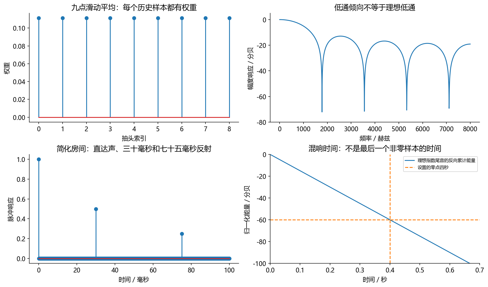
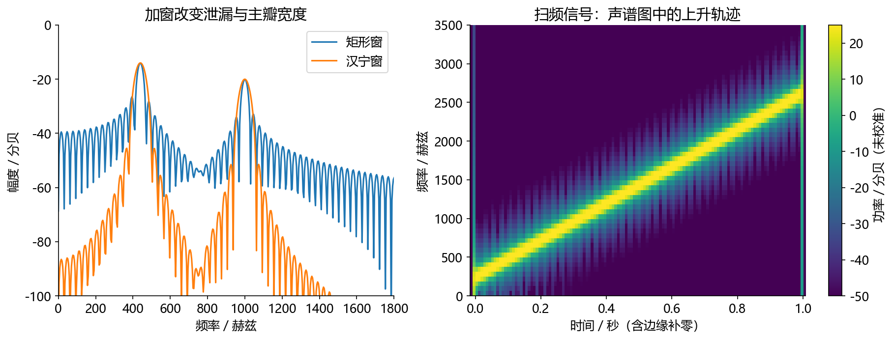
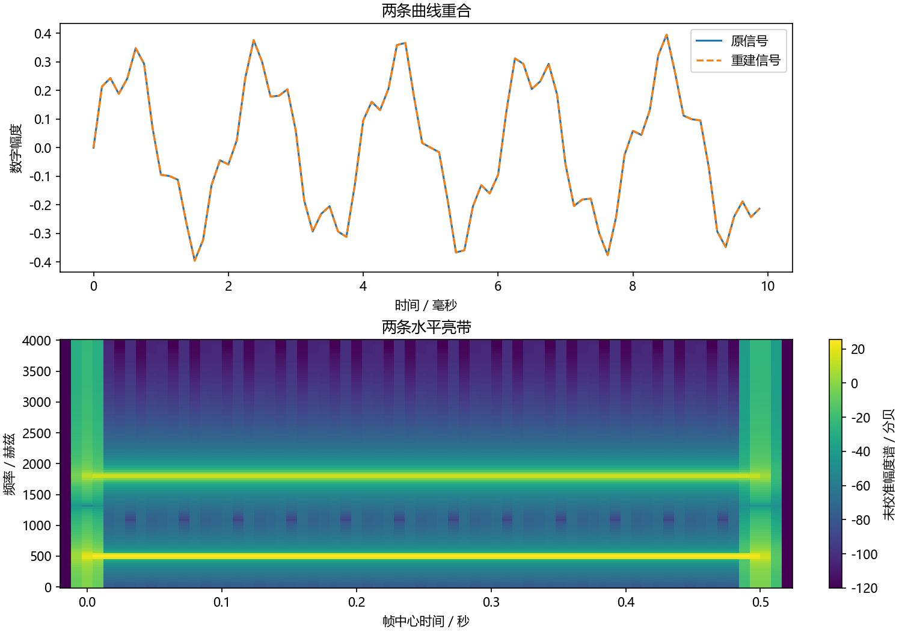

# 第 5 课：卷积、频谱、窗函数与 STFT——听见声音的内部结构

[上一课：NumPy](04_numpy.md) · [返回教程目录](../README.md) · [下一课：Mel、MFCC 与音高](06_features.md)

> 前置要求：知道频率、采样率、数组形状；做过上一课的分帧。目标：解释卷积的物理意义，识别 FFT 频率轴，理解加窗的代价，完成一次带相位的 STFT 重建。建议分两次学习，每次 90 分钟。公式不是背诵目标，能把它与代码对上才是。

## 1. 卷积：每个历史采样留下多大影响

假设房间会让一次拍手变成“立即一声＋稍后较小的一声”。用脉冲响应 $h[n]$ 表示这间房间对单个理想脉冲的响应，那么连续说话就是许多微小激励的响应叠加。线性时不变近似下：

\[
y[n]=\sum_k h[k]x[n-k].
\]

$x$ 是输入，$h$ 是脉冲响应，$y$ 是输出。$k$ 表示回看多少采样。直观上，输出是“当前及历史输入按权重相加”。像一道菜每次加入一勺原料，锅里的味道保留过去的影响；类比只强调记忆与叠加，真实系统若有削波、自动增益或时变路径，就不能完全用固定线性卷积描述。

手算 `x=[1,2,3]`，`h=[0.5,0.5]`，边界外输入视为 0，完整卷积为 `[0.5,1.5,2.5,1.5]`。例如第二个输出是 $0.5\times2+0.5\times1=1.5$。最后一个值不是 0，因为输入结束后系统还有历史影响。长度是 $3+2-1=4$，这会影响音频对齐和评测裁剪。

```python
import numpy as np

x = np.array([1.0, 2.0, 3.0])    # 三个输入采样
h = np.array([0.5, 0.5])         # 当前和前一采样各占一半
y = np.convolve(x, h, mode="full")  # 保留卷积尾巴
print("完整卷积:", y)
print("输出长度:", len(y))
```



上面的最小代码预期输出 `[0.5,1.5,2.5,1.5]`。图由 [beginner_labs.py](../code/beginner_labs.py) 的 `filter_and_room()` 生成，是同一原理的扩展实验，不是四个输出点的绘图：左上给出 9 个相等滤波权重；右上显示它对不同频率的影响并不相同；左下用三根脉冲表示直达声和两次反射；右下是另一个独立的理想指数衰减模型，不能把两幅下图误认为同一个房间的测量。

## 2. DFT 在问：“这段数据含有多少这种旋转节奏？”

傅里叶变换把信号表示为不同频率成分的组合。对长度 $N$ 的离散片段，DFT 为：

\[
X[k]=\sum_{n=0}^{N-1}x[n]e^{-j\frac{2\pi kn}{N}}.
\]

先不用害怕复数：它把“与余弦像不像”和“与正弦像不像”放在一起，保留了幅度和时间位置的信息。$\lvert X[k]\rvert$ 描述该频率系数大小，$\arg X[k]$ 描述相位。只存绝对值会丢相位，不能指望简单逆变换还原原波形。

FFT 是高效计算 DFT 的算法家族，不是另一种物理频谱。频率格点为 $f_k=\frac{k f_s}{N}$。16 kHz、512 点 DFT 的间隔为 31.25 Hz，索引 $k=32$ 对应 1000 Hz；这里从 $k=0$ 计数，所以它是数组的第33个元素。对实输入，`rfft` 利用共轭对称，只保留非负频率；512 点输入对应 257 个复数系数。[NumPy FFT 文档](https://numpy.org/doc/stable/reference/routines.fft.html)给出了实际的符号和归一化约定。

## 3. 为什么频谱会漏出一片，窗函数又牺牲了什么

你只截取了一段声音。DFT 计算相当于在特定意义上处理这个有限片段的周期延拓；若片段首尾接不上，就会出现额外的边界变化，频谱能量扩散到周围格点，叫谱泄漏。一个频率不正好落在格点上的正弦，尤其容易显出这种现象。

Hann 窗把两端逐渐压低，通常能降低远处旁瓣，但主瓣会更宽。所以加窗不是“使所有分辨率都变好”：想看旁边的小分量与想区分两个非常近的大分量，可能有不同取舍。窗长决定观察的时间范围；补零会让频率采样网格更密，却不会凭空增加原始观测时长。



这张图来自 [run_experiments.py](../../code/run_experiments.py) 的实际实验。左图同样两个频率分量，Hann 窗远处泄漏较低，峰附近却更宽；右图是频率随时间上升的合成扫频信号，亮色轨迹从左下走向右上。右图横轴是时间、纵轴是频率、颜色是未校准的功率 dB，不是声压级。它与下面的重建代码属于同类实验，但输入信号不同。

## 4. STFT：把“整段频谱”变成“每个短时刻的频谱”

一句话的前半段与后半段可能完全不同。短时傅里叶变换（STFT）先分帧、再加窗、再逐帧 FFT。结果是一个复数矩阵。本课约定 `[时间帧,频率格点]`，而某些库用 `[频率,时间]`；绘图时经常还要转置，别把显示方向当作储存方向。

以 16 kHz 为例，32 ms 窗长为 512 点，8 ms 帧移为 128 点。大窗通常给出更细的频率结构，但跨越更长时间；小窗更容易追踪突然变化，却更难分辨很近的频率。流式系统还要区分窗长、帧移、前瞻和计算耗时：帧移 8 ms 不代表整个算法延迟必然只有 8 ms。

## 5. 核心代码：保留相位，再把各帧加回去

下面是教学实现，使用对称 Hann 窗、两端补零，以及窗平方归一化。它不是实时处理器，因为提前访问了整段输入。请先预测 `frames` 和 `spec` 的形状，再运行。

```python
import numpy as np

fs = 8000
t = np.arange(4000) / fs
x = 0.3*np.sin(2*np.pi*500*t) + 0.1*np.sin(2*np.pi*1800*t)
length, hop = 256, 64
window = np.hanning(length)       # 窗在两端接近/等于零
padded = np.pad(x, (length, length))  # 让原信号两端也被有效窗覆盖
extra = (-(len(padded) - length)) % hop
padded = np.pad(padded, (0, extra))   # 补齐最后一个完整帧
starts = np.arange(0, len(padded) - length + 1, hop)
frames = np.stack([padded[s:s+length] for s in starts])
spec = np.fft.rfft(frames * window, axis=1)  # 保留复数，不只保留绝对值

# 每帧逆变换，再乘合成窗，放回原来的时间位置。
back_frames = np.fft.irfft(spec, n=length, axis=1)
output = np.zeros_like(padded)
weight = np.zeros_like(padded)
for start, frame in zip(starts, back_frames):
    output[start:start+length] += frame * window
    weight[start:start+length] += window ** 2

# 分析窗和合成窗各乘一次，所以累计的是窗的平方。
valid = weight > 1e-12
output[valid] /= weight[valid]
restored = output[length:length+len(x)]  # 去掉人为补的边界
print("分帧/STFT 形状:", frames.shape, spec.shape)
print("最大重建误差:", np.max(np.abs(restored-x)))

# 从本段实际 spec 和 restored 绘图；请在课程根目录运行。
from pathlib import Path
import matplotlib
matplotlib.use("Agg")
import matplotlib.pyplot as plt
plt.rcParams.update({"font.family": "Microsoft YaHei", "axes.unicode_minus": False})
assert Path("tutorial/chapters").is_dir(), "请在 audio-course-zh 根目录运行"
fig, axes = plt.subplots(2, 1, figsize=(10, 7), layout="constrained")
axes[0].plot(t[:80]*1000, x[:80], label="原信号")
axes[0].plot(t[:80]*1000, restored[:80], "--", label="重建信号")
axes[0].set(xlabel="时间／毫秒", ylabel="数字幅度", title="两条曲线重合")
axes[0].legend()
centers = (starts+length/2-length)/fs  # 减去前端补零对应的时间
frequencies = np.fft.rfftfreq(length, 1/fs)
image = axes[1].pcolormesh(centers, frequencies,
    20*np.log10(np.maximum(np.abs(spec.T), 1e-6)), shading="auto")
axes[1].set(xlabel="帧中心时间／秒", ylabel="频率／赫兹", title="两条水平亮带")
fig.colorbar(image, ax=axes[1], label="未校准幅度谱／分贝")
fig.savefig("tutorial/figures/ch05_stft_rebuild.png", dpi=150)
plt.close(fig)
```



上半图重建曲线与原波形几乎完全重合，不能仅凭肉眼证明完美，所以代码还打印最大误差；本地实际运行为约 `1.67×10⁻¹⁶`。下半图两条亮带对应 500 Hz 和 1800 Hz。两端略超出原始 0—0.5 秒范围，是边界补零及帧中心定义带来的，不是额外录到了声音。

预期形状为 `(68,256)` 和 `(68,129)`。重建误差应接近浮点精度，不要求精确等于 0。为什么分母是窗平方？分析时已经乘一次窗，合成时又乘一次；第 $m$ 帧在采样点 $n$ 的贡献为 $x[n]\,w[n-mH]^2$，其中 $H$ 是帧移。重叠位置按帧累加后，除以对应的窗平方权重和，才能回到 $x[n]$，前提是该权重和非零。如果合成采用不同窗口，则要按对应的乘积关系与重建条件处理，不能死记“任何 STFT 都除窗平方”。

这段绘图代码使用幅度谱的 $20\log_{10}$，颜色标注“未校准”，避免让它被误读为声压级。你也可以改画功率谱，但必须同时换成相应的 $10\log_{10}$ 与参考约定。形状和坐标正确，是让图具有解释价值的第一步。

## 6. 逐步故障实验：故意改错，比再读一遍有效

先把 `spec` 替换成 `abs(spec)` 再逆变换，重建数值会改变，因为所有复数相位信息丢了；本段代码没有播放步骤，先看误差与波形即可。再恢复相位，只注释掉代码中的 `output[valid] /= weight[valid]`，你会看到振幅随重叠权重变化。最后取消边界补零时，要同时调整 `starts` 和最终裁剪位置，再检查开头几个采样；Hann 窗端点为零时，边界可能没有足够信息可恢复。若只删除一行补零却保留旧裁剪规则，长度错位不能当作窗函数失效的证据。

做完这些反例，你就能回答为什么“把频谱弄回时域”不是只调用一次 IFFT。增强模型若修改了幅度、复数谱或相位，重建策略和损失设计都会受影响；很多“声音断断续续”问题来自分帧、窗与状态，而不是网络层数不够。

## 7. 不同图回答不同问题，别被颜色带走

波形适合定位爆音、停顿、削波和大致时序；整段频谱适合观察稳定的频率成分，但会混合不同时间的事件；声谱图同时展示时间和频率，却需要选择窗长等参数。同一段音频在这三种表示里不会长得一样，也不应该长得一样。检查一个短促点击声时，小时间窗很有用；研究两个靠得很近的稳定音调时，又可能需要更长观测。

颜色缩放也会影响判断。若两张图分别按自己的最大值归一化，弱信号可能看起来与强信号一样亮；若每张图自动设置颜色上下界，“降噪前后颜色都很鲜艳”也不能说明噪声没变。比较两个结果时，要明确是否使用同一单位、同一参考值、同一颜色范围。图题里写“各自归一化”与“共同参考”是两种不同实验。

一个实习报告里，图不应只是装饰。请在图下注明采样率、窗长、帧移、幅度或功率、颜色参考，然后用一句话指出读者应该看哪里。例如“观察 0.2 秒附近的宽带竖线，它对应一次短促冲击”，比“结果如图所示”更像一个真正做过分析的人。

## 8. 自测与参考答案

1. 16 kHz、400 点 DFT，频率间隔是多少？答：40 Hz。
2. 输入长 1000，FIR 长 65，完整卷积多长？答：1064。
3. 把 400 点片段补零到 1600 点，是否等于真实多录了四倍时长？答：不是，只是频谱取样更密。
4. 为什么只保存声谱图颜色一般不能精确恢复音频？答：常已丢相位，还可能做了对数、裁剪和量化。
5. STFT 窗长 32 ms、帧移 8 ms，算法延迟一定为 8 ms 吗？答：不一定，还取决于取窗方式、前瞻、缓存与计算。

## 9. 就业验收任务

录入或选择一条有使用许可的短音频，画波形和带正确坐标的声谱图；解释一段稳定元音、一次瞬态与一段静音在图中的差别。再做“STFT → 原样 ISTFT”回环测试，检查长度、误差和首尾样本。通过这一步再开始写频域降噪，会少掉大量难定位问题。
