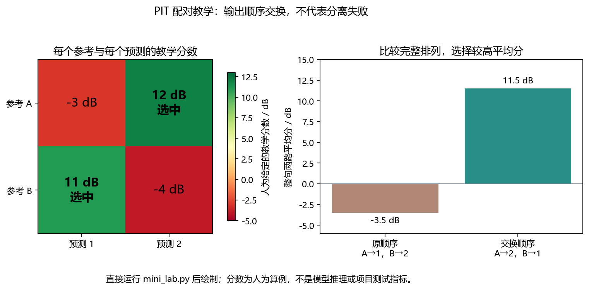
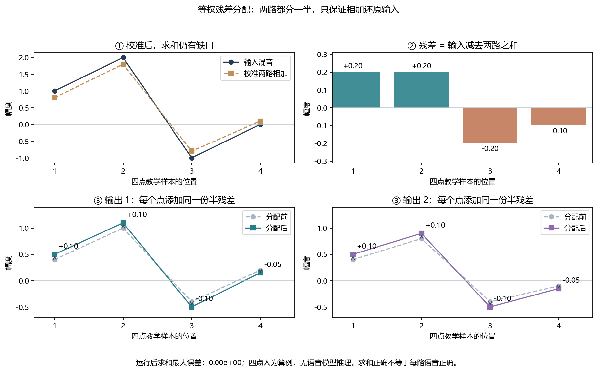

这不是“调用模型就算完成”的项目。你要能沿着一段音频解释每一步，也要能说清哪些结论还没有证据。

[学习网站首页](../../../index.html) · [观看中文讲解](video.html) · [本页核验范围](evidence.json)

本页基于私有仓库 `yang07-29/convtasnet-speech-separation`。核对分支为 `codex/reproduction`，提交为 `8e8bd3921ac39587d2407e86aa7204cba52ad77d`。读取日期为 2026-10-26。私有源码摘录仅用于这份本地教材，分享网站前请先检查权限。

## A 先知道自己要学会什么

### 一句话描述项目

输入一条两人同时说话的录音，输出两条尽量各含一人的录音。接着比较预训练模型、局部微调和三种后处理。它不是 ASR，不输出文字；也不是说话人识别，不给出姓名。

```flow LR
两位说话人 -> 一路混合波形: 叠加录音
一路混合波形 -> Conv-TasNet: 估计两路语音
Conv-TasNet -> 后处理: 公共增益与残差分配
后处理 -> 试听与评测: 有参考才能算SI-SDR
```

### 先修与验收

| 如果你不懂 | 先补哪一课 | 回来后检查什么 |
|---|---|---|
| 8 kHz、单声道、样本点 | [02 数字音频](../../chapters/02_digital.html) | 4 秒为什么有 32,000 点 |
| 数组维度、广播、矩阵乘法 | [04 NumPy](../../chapters/04_numpy.html) | `[None, None]` 添加了哪两维 |
| 分贝、功率比、对数 | [03 分贝](../../chapters/03_decibels.html) | 这里为何用功率比的对数 |
| 卷积、梯度、训练集和开发集 | [12 PyTorch](../../chapters/12_pytorch.html) | 推理为什么没有反向传播 |
| 降噪和分离的区别 | [09 语音前端](../../chapters/09_enhancement.html) | 为什么“两路相加正确”不等于分离正确 |

学完的最低验收不是“看完页面”，而是下面四项：

- 不看稿画出波形、编码器、掩码网络、解码器的链路。
- 手算两人 PIT 的两种排列，并解释输出顺序。
- 指出项目训练了哪些参数、冻结了哪些参数。
- 用一分钟讲出真实结果，同时说出不能下的结论。

建议在主时间表中安排一周精读。前 6 天各学 90 分钟，第 7 天复盘与补缺。第一天 A–B，第二天 C，第三天 D，第四天 E，第五天 F–G，第六天 H 验收。每次保留 15 分钟闭卷复述。

## B 沿着文件找到一段音频的旅行路线

### 先认入口，不要从几百行训练循环开始

```tree
项目阅读路线
  speechsep/audio.py | 读取输入、选择模型、推理和试听
  speechsep/models.py | 加载权重、选择可训练参数
  upstream/conv_tasnet.py | 官方网络结构
  speechsep/losses.py | 可微的 PIT SI-SDR
  speechsep/postprocess.py | 三种后处理
  speechsep/training.py | 训练、开发评测和断点恢复
  speechsep/evaluation.py | 冻结后的独立评测
  reports/final/report.json | 机器可读的实验结果
```

关键函数按调用顺序读：`read_wav` → `resolve_demo_model` → `load_model` → `ConvTasNet.forward` → `process` → `evaluate_separation` → `write_listening`。

| 步骤 | 实际行为 | 为什么要做 |
|---|---|---|
| `read_wav` | 检查 8 kHz、单声道、0.25–30 秒 WAV | 不让错误采样率静默进入模型 |
| `resolve_demo_model` | 有有效冻结开发选择时用该选择 | 避免根据测试分数挑演示模型 |
| `load_model` | 加载模型权重，严格匹配参数名 | 防止拿错误结构勉强加载 |
| `torch.inference_mode()` | 只计算前向，不记录梯度 | 推理不需要训练图 |
| `process` | 只读取混合与预测，不读取干净参考 | 部署时拿不到答案 |
| `evaluate_separation` | 有两路等长参考才评分 | 没有参考不能硬报 SI-SDR |
| `write_listening` | 所有试听轨道使用一个公共防削波增益 | 不用单独归一化掩盖音量差异 |

### 三个常见误解

第一，双声道 WAV 不等于两个干净说话人。左右声道是设备通道，两个说话人是声源。

第二，官方演示入口和自定义分离入口不完全相同。官方演示固定原始权重。已验收的自定义入口选择 seed 20261024 的第 19 轮 best 与 uniform。若本机缺少有效开发选择文件，代码会回退到预训练权重和 gain。查看本次 `report.json`，不要只凭按钮名称猜模型。

第三，网页里的“模型 RTF”是计算耗时除以音频时长。小于 1 不证明支持流式，也不证明端到端时延达标。读取文件、加载权重、后处理和播放缓冲可能不在同一计时范围内。

## C 看懂张量：每一个维度代表什么

### 先把符号对应到日常含义

$B$ 是一次处理的录音条数，$T$ 是每条录音的样本点数。$F$ 是编码特征通道数，$M$ 是编码后的时间步数。$S$ 是输出声源数，本项目固定为 2。特征通道不是麦克风通道。

4 秒、8 kHz、单条混音是本项目的主要评测配置。根据已读取的网络参数，可推导出下面的 shape；这张表是结构推导，不是本页重新运行模型的日志。

| 变量或模块 | 一般 shape | 这个 4 秒例子的 shape |
|---|---|---|
| NumPy 混合 `mixture` | `(T,)` | `(32000,)` |
| 输入 `tensor` | `(B, 1, T)` | `(1, 1, 32000)` |
| 编码特征 `feats` | `(B, F, M)` | `(1, 512, 4001)` |
| 两套掩码 | `(B, S, F, M)` | `(1, 2, 512, 4001)` |
| 掩码后的特征 | `(B, S, F, M)` | `(1, 2, 512, 4001)` |
| 合并批次与声源维 | `(B*S, F, M)` | `(2, 512, 4001)` |
| 解码后整理 | `(B, S, T)` | `(1, 2, 32000)` |
| 去掉批次维的最终波形 | `(S, T)` | `(2, 32000)` |

编码卷积的核长为 16，步长为 8，两端 padding 为 8。因此编码时间步数为：

$$
M=\left\lfloor\frac{T+2p-k}{s}\right\rfloor+1
$$

在这里，$T=32000$、$p=8$、$k=16$、$s=8$，所以 $M=4001$。若原长度不是步长的整数倍，模型先在末尾补零，最后裁掉新增点。

### 核心前向代码：照着每行写 shape

以下是仓库原代码快照，保留原注释。中文解释在表格中。

```python src=tutorial/projects/convtasnet/source_snapshots/conv_tasnet.py lines=295-305
```

| 关键行 | 中文解释 | 新手最容易错在哪里 |
|---|---|---|
| `self.encoder(padded)` | 把一条波形换成 512 路可学习特征 | 这不是固定 STFT 频点 |
| `feats.unsqueeze(1)` | 在声源位置添加长度为 1 的维度 | 不是复制新的录音 |
| 掩码乘特征 | 广播到两路声源，每路使用自己的掩码 | 同一特征可以同时影响两路 |
| `view(batch_size * self.num_sources, ...)` | 把每个声源当成一条待解码样本 | `view` 不是任意打乱数值 |
| `self.decoder(masked)` | 用可学习转置卷积重建波形 | 不是直接拿特征通道播放 |
| `output[..., :-num_pads]` | 去掉为了对齐而添加的末尾点 | 输出必须和参考等长 |

### TCN 在做什么

`MaskGenerator` 有 3 组，每组 8 个卷积块。每组的 dilation 依次是 1、2、4、8、16、32、64、128。膨胀卷积跳着取点，让较深层看到更长的时间范围。残差把信息传到下一块；skip 路径把各层结果汇入输出。

本项目的 `conv_tasnet_base()` 明确使用 ReLU 掩码。它保证掩码非负，却不保证掩码不大于 1，也不保证两路掩码相加等于 1。不要把所有“mask”都想成 0–1 概率。

卷积两侧 padding 和跨时间 GroupNorm 都使用整段上下文。这是离线非因果版本，不能只把音频切小就宣称成为可靠流式系统。

## D 评分和训练：为什么必须有 PIT

### 先理解 SI-SDR 的直觉

假设干净参考是向量 $\mathbf{s}$，模型输出是 $\hat{\mathbf{s}}$。先分别减掉均值。把输出投影到参考方向，沿参考方向的部分算目标；剩下的部分算失真。

$$
\alpha=\frac{\langle\hat{\mathbf{s}},\mathbf{s}\rangle}{\|\mathbf{s}\|_2^2}
$$

$$
\mathbf{s}_{\mathrm{target}}=\alpha\mathbf{s},\qquad
\mathbf{e}=\hat{\mathbf{s}}-\mathbf{s}_{\mathrm{target}}
$$

$$
\mathrm{SI\!-\!SDR}=10\log_{10}\frac{\|\mathbf{s}_{\mathrm{target}}\|_2^2}{\|\mathbf{e}\|_2^2}
$$

这是非退化情况下的数学定义。参考去均值后不能是零能量。仓库实现另做归一化和数值保护，将单路分数限制在 $[-120,120]$ dB。常数预测得到下界；常数参考被拒绝。

直觉上：只把预测整体放大，不会让说话人泄漏自动减少。因此这个指标不应仅因整体幅度变化而升高。它也不等于主观音质，更不能替代试听。

### 两个输出，先决定谁和谁比

下面是人为教学分数矩阵，不是项目测试结果。

| 参考与预测 | 预测 1 | 预测 2 |
|---|---:|---:|
| 参考 A | −3 dB | 12 dB |
| 参考 B | 11 dB | −4 dB |

按原顺序配对，平均为 −3.5 dB。交换后为 11.5 dB。显然预测 2 更像 A，预测 1 更像 B。PIT 就比较整句的两种合法排列，选择分数较高的一种。

设 $Q_{ij}$ 表示参考 $i$ 与预测 $j$ 的分数，则：

$$
Q_{\mathrm{PIT}}=\max\left(\frac{Q_{11}+Q_{22}}{2},\frac{Q_{12}+Q_{21}}{2}\right)
$$

训练最小化负分数，也就是最大化分离质量。批次中的各条录音分别匹配，再对批次求均值。不能每帧单独换排列，否则会掩盖一句话中途“换人”的问题。

原实现位于 `speechsep/losses.py`，与下面的教学算例对应。教学代码已经加上中文注释。

```python src=tutorial/projects/convtasnet/mini_lab.py lines=5-10
```



左图的行是参考，列是预测。“选中”的两个格子必须各占一行、一列，不能让两个参考都挑同一路输出。右图直接使用这次运行得到的两种排列平均分：原顺序 −3.5 dB，交换后 11.5 dB，所以返回 `[1, 0]`。这组分数是人为教学输入，不是对四点波形重新计算的 SI-SDR，更不是仓库性能结果。

### SI-SDR 和 SI-SDRi 不要混写

SI-SDR 是分离输出相对干净参考的分数。SI-SDRi 再减去原混音相对同一参考的分数：

$$
\mathrm{SI\!-\!SDRi}=\mathrm{SI\!-\!SDR}_{\mathrm{output}}-\mathrm{SI\!-\!SDR}_{\mathrm{mixture}}
$$

项目的 `metrics.evaluate_separation()` 只匹配声源顺序，不做时间平移，也不搜索“最好的一截”。拿错参考、长度不一致或人为错位，都会让分数失去比较意义。

## E 后处理：把“加起来正确”和“每路正确”分开

### 第一步：两路一起做公共增益校准

设混音为 $\mathbf{x}$，两路原始预测为 $\mathbf{y}_1,\mathbf{y}_2$。令 $\mathbf{u}=\mathbf{y}_1+\mathbf{y}_2$。非零重建情况下，最小二乘公共增益为：

$$
g=\frac{\langle\mathbf{x},\mathbf{u}\rangle}{\|\mathbf{u}\|_2^2},\qquad
\mathbf{z}_k=g\mathbf{y}_k
$$

这是一次整句标量校准，不是频点掩码，也不是学习参数。参考语音没有参与。若重建恰好为零，仓库明确回退为增益 1，并记录退化状态。

### 第二步：决定残差放在哪里

$$
\mathbf{r}=\mathbf{x}-\mathbf{z}_1-\mathbf{z}_2
$$

| 方法 | 操作 | 你应该观察什么 |
|---|---|---|
| `gain` | 只返回校准后的两路 | 给后续比较提供公共幅度控制 |
| `uniform` | 每路添加一半残差 | 两路相加应恢复混音 |
| `energy` | 按两路全句能量占比分配残差 | 权重不是每一帧单独估计 |

uniform 的输出为：

$$
\tilde{\mathbf{y}}_k=\mathbf{z}_k+\frac{\mathbf{r}}{2}
$$

energy 的权重是 $E_k=\|\mathbf{z}_k\|_2^2$、$a_k=\frac{E_k}{E_1+E_2}$，再添加 $a_k\mathbf{r}$。总能量为零时采用等权。实际代码先缩放再算能量，避免任意大幅度造成溢出。

### 一个已经运行过的四点教学算例

```python src=tutorial/projects/convtasnet/mini_lab.py lines=13-19
```



按左上、右上、下排的顺序读图。先比较输入与校准两路之和，再算缺口。最后给每一路添加同一个“半残差”。图中的箭头和数字直接来自运行输出：前三点分别加 0.10、0.10、−0.10，第四点加 −0.05。正残差要加，负残差相当于减；不能把残差当作总是非负的噪声强度。

两图由[带中文注释的绘图脚本](plot_teaching.py)实际运行生成。脚本直接执行本页的 `mini_lab.py` 并使用它的变量，未加载 Conv-TasNet、未训练、未伪造语音实验图。在安装了 Matplotlib 的环境中运行 `python tutorial/projects/convtasnet/plot_teaching.py` 可重画。

运行结果来自本地 `mini_lab.py`，不加载模型，不代表语音分离实验。

| 样本位置 | 混音 | 校准输出 1 | 校准输出 2 | 残差 | uniform 输出 1 | uniform 输出 2 |
|---|---:|---:|---:|---:|---:|---:|
| 1 | 1.00 | 0.40 | 0.40 | 0.20 | 0.50 | 0.50 |
| 2 | 2.00 | 1.00 | 0.80 | 0.20 | 1.10 | 0.90 |
| 3 | −1.00 | −0.40 | −0.40 | −0.20 | −0.50 | −0.50 |
| 4 | 0.00 | 0.20 | −0.10 | −0.10 | 0.15 | −0.15 |

本次算例的求和误差小于 $10^{-12}$。但把混音全给第一路、第二路全设为零，也能满足求和约束！所以“混合一致性”只是约束，不是分离正确的充分条件。

噪声混音还有一个坑：如果输入含噪声，而两路输出必须加起来等于输入，噪声也会被分配回输出。不能用这个约束宣称解决了降噪。

## F 你的仓库到底训练了什么

### 区分三件事

| 行为 | 参数从哪里来 | 是否更新参数 | 本项目证据 |
|---|---|---|---|
| 预训练推理 | 官方 Libri2Mix 权重 | 否 | 官方样例与预训练基线 |
| 局部微调 | 先加载同一预训练权重 | 只更新选定层 | 三个种子各 20 轮 |
| 从头训练 | 随机初始化 | 训练完整模型 | 本项目没有做 |

`configure_trainable()` 选择三个前缀：`mask_generator.output_prelu.`、`mask_generator.output_conv.`、`decoder.`。可训练参数为 140,289，总参数为 4,984,881，约 2.81%。编码器和 TCN 主体冻结。冻结层仍参与前向计算，只是不更新参数。

### 一次更新，不等于看一次样本

```flow LR
读入4条训练混音 -> 分别前向计算: 每条获得两路预测
分别前向计算 -> PIT损失: 每条除以累积条数
PIT损失 -> 梯度累积: 连续反向传播
梯度累积 -> 裁剪与Adam更新: 更新一次参数
裁剪与Adam更新 -> 开发集选择: 完整轮次后评测
```

每轮 1,200 个训练组合，梯度累积 4 条后更新一次。所以每轮 300 次更新，20 轮共 6,000 次。梯度累积是在显存或内存较小时累加梯度，不是把同一条数据复制四份。

训练配置使用 Adam，初始学习率为 $10^{-4}$，梯度范数裁剪阈值为 5。不要把这些数字当成普适最优值，它们是这个受控实验的固定设置。

### 数据为什么先分说话人

仓库记录的 VCTK 子集按说话人分成训练 30 人、开发 10 人、测试 40 人、备用 20 人。先划分，再构造混合，避免同一个人的声音跨集合出现。测试有 200 个源组合，每个组合三个干净能量比条件，共 600 行；另外有 200 个白噪声条件。

600 行不是 600 个完全独立的实验对象。相同源组合的不同能量比仍共享说话人和录音。报告按 20 个互不共享说话人的配对组做 bootstrap，三种子与同组变体一起保留。

不同说话人的文本也可能相同。报告指出测试源中 183/400 条与其他划分有相同规范化文本。没有同一源录音泄漏，不等于语言内容完全独立。现有区间没有涵盖全部跨组文本依赖。

### 恢复训练必须恢复什么

`last.pt` 不只有模型参数。还保存优化器、学习率调度器、随机状态、当前顺序和进度。只恢复权重再从任意数据位置训练，不等于严格续跑。`best.pt` 则按开发集分数保存选中的模型，不能用“最后一轮”自动替代。

测试前冻结数据、代码与 checkpoint 哈希。`evaluation.py` 对测试访问有显式检查。为了学习损失函数，不要改掉这些保护后反复试测试集。

## G 读真实结果：能说什么，不能说什么

以下值来自仓库 `reports/final/report.json`，不是这次建网站重跑的结果。与文字结果分析交叉核对过，但本页没有重新执行完整证据审计。

### 固定后处理，比较三种子平均微调效应

| 后处理 | clean 配对增量 | 95% 区间 | 10 dB 白噪声配对增量 | 95% 区间 |
|---|---:|---|---:|---|
| gain | +0.092934 dB | [−0.009001, +0.188460] | +0.023579 dB | [−0.002412, +0.048071] |
| uniform | +0.102811 dB | [+0.000617, +0.198541] | +0.043680 dB | [+0.019014, +0.066262] |
| energy | +0.113386 dB | [+0.015209, +0.207256] | +0.043368 dB | [+0.018994, +0.065991] |

每一行都在同一种后处理下比较微调与预训练。主要 gain 控制的区间跨零，不能断言稳定改善。uniform 的 clean 下界仅略大于零，而且多重比较未校正。不能把它包装成“大幅提升”。

### 演示默认方案的绝对分数

冻结开发选择是 seed 20261024 的 best 加 uniform。该方案 clean 测试 SI-SDR 为 13.833776 dB，SI-SDRi 为 13.824552 dB；白噪声条件分别为 7.473336 dB 和 8.257711 dB。

这些是一个固定方案的绝对分数，不是“三种子平均微调提升”。拿 13.824552 dB 当成“我优化了 13.8 dB”会把预训练模型的能力也算成自己的优化。

### 有平均正增量，也有失败

结果分析记录：seed 20261024、uniform 对比同后处理的预训练模型，有 187/600 个 clean 条件退化。这个比例描述相关观测，不应套用独立伯努利试验来算置信区间。

失败分析应该问：两个说话人是否音色相似？弱源是否被吞掉？背景噪声是否被分到某一路？本页未试听这些案例，因此不根据分数编造具体听感。

### 一段诚实的面试介绍

“我基于官方 Conv-TasNet 预训练模型，研究了 CPU 局部适配与混合一致性后处理。实验固定了数据划分和评测协议，比较三个种子及三种后处理。主要 gain 控制的微调增量区间跨零，因此我没有声称稳定提升。我重点分析了说话人分组评测、失败案例和断点恢复。官方结构和权重来自上游，AI 协作实现的部分与我能独立解释、修改和验证的部分分开说明。”

只有你实际能完成下面的练习，才能把对应能力写成个人掌握。不建议只把这段介绍背下来。

证据原件：[模型代码](https://github.com/yang07-29/convtasnet-speech-separation/blob/8e8bd3921ac39587d2407e86aa7204cba52ad77d/upstream/conv_tasnet.py) · [损失代码](https://github.com/yang07-29/convtasnet-speech-separation/blob/8e8bd3921ac39587d2407e86aa7204cba52ad77d/speechsep/losses.py) · [后处理代码](https://github.com/yang07-29/convtasnet-speech-separation/blob/8e8bd3921ac39587d2407e86aa7204cba52ad77d/speechsep/postprocess.py) · [结果原始 JSON](https://github.com/yang07-29/convtasnet-speech-separation/blob/8e8bd3921ac39587d2407e86aa7204cba52ad77d/reports/final/report.json)。链接需要有该私有仓库的访问权。

## H 七次学习安排与闭卷自测

| 次数 | 90 分钟安排 | 需要留下的产物 |
|---|---|---|
| 1 | 15 分钟看讲解；30 分钟读 A–B；30 分钟画调用链；15 分钟复述 | 一张不看稿的项目流程图 |
| 2 | 15 分钟复习采样；30 分钟读 C；30 分钟逐行写 shape；15 分钟检查 | 完整 shape 表，解释 4001 的来源 |
| 3 | 20 分钟读 D；25 分钟手算 PIT；30 分钟读损失代码；15 分钟自测 | 一张配对分数矩阵和一段指标解释 |
| 4 | 20 分钟读 E；25 分钟手算残差；30 分钟运行教学算例；15 分钟总结 | 输出表和“约束不等于正确”的反例 |
| 5 | 20 分钟读 F；25 分钟画数据划分；30 分钟读 G；15 分钟复述 | 一张实验对照表，区分绝对值与增量 |
| 6 | 20 分钟闭卷作答；30 分钟查错；25 分钟整理失败分析问题；15 分钟录一段项目介绍 | 2 分钟介绍＋不会的问题清单 |
| 7 | 20 分钟回听介绍；30 分钟补最弱一节；25 分钟对比 GTCRN；15 分钟周总结 | 说明分离与降噪的输入、输出和指标差别 |

### 先答，再往下看答案

1. 一条 4 秒、8 kHz 的混音，模型输入是什么 shape？
2. 编码后的 512 是 512 个麦克风吗？
3. ReLU 掩码一定落在 0 到 1 吗？
4. 为什么 PIT 不能逐帧任意交换输出？
5. 两路输出相加等于混音，能证明分离正确吗？
6. gain 的平均微调增量为正，为什么仍不能声称稳定提升？
7. 600 个 clean 条件为什么只按 20 个组重采样？
8. 你有模型文件，没有优化器和随机状态，算严格恢复训练吗？

### 答案与纠错方向

| 题号 | 答案 | 错了回哪里 |
|---|---|---|
| 1 | `(1, 1, 32000)`，依次为批次、输入通道、样本 | C |
| 2 | 不是，是学习得到的编码特征通道 | C |
| 3 | 不是，只保证非负 | C |
| 4 | 一句话中输出身份应一致，逐帧换人会掩盖身份跳变 | D |
| 5 | 不能。把混音全给一路也是满足约束的错误分离 | E |
| 6 | 主要配对区间包含零，现有证据不足以排除无改善 | G |
| 7 | 同组共享说话人和源组合，条件行不是独立样本 | F |
| 8 | 不算，还缺优化器、调度器、随机状态和数据进度等 | F |

### 安全的第一条练习命令

在学习网站根目录运行下面的教学算例。它只用 Python 标准库，不下载数据、不加载权重、不训练。

```powershell title="教学算例 · 不运行项目训练"
python tutorial/projects/convtasnet/mini_lab.py
```

看到 `assignment` 为 `[1, 0]`，求和误差检查为 `true`，只能说明这个小算例通过。下一步才是在原项目环境阅读状态、核对模型身份，并按已有操作说明运行一次短音频推理。

完成本页后，继续学习[工程评测与部署](../../chapters/16_engineering.html)和[项目整理](../../chapters/17_project.html)。若要接到语音识别，先读[ASR 入门](../../chapters/13_asr.html)：分离是否改善识别，要用下游 CER 或 WER 另做实验，不能从 SI-SDR 直接推断。
