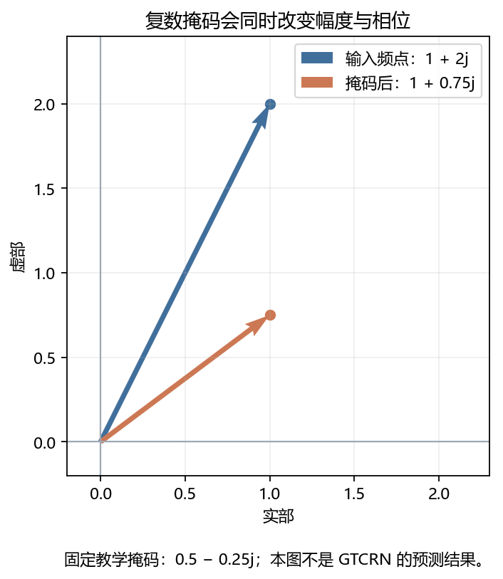
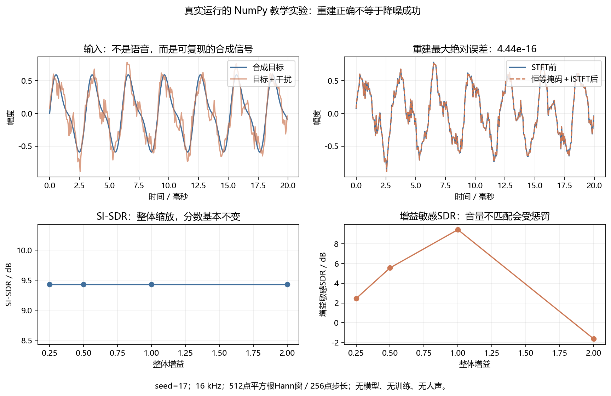

这不是一个“调用模型就结束”的项目。你的仓库已有从零训练、场景适配、三种子复验和软件流式部署。本课帮你把这些工程结果变成自己能解释、能验证的知识。先懂数据怎样流动，再学网络，再判断结果是否可信。

[返回学习首页](../../../index.html) · [播放本项目中文讲解](video.html) · [本课证据清单](evidence.json)

核验日期：2026-10-26。固定仓库版本为 `688d5ca4407e7ea941736ede1bf0b5d767dbc94c`。项目成绩来自已提交代码和报告，本轮没有重新训练或重新测模型速度。另运行了两个明确标注的纯NumPy教学图。仓库是私有的；本课含其结构与少量教学改写，分享网站前请先检查内容范围。

## A 先知道这个项目解决什么问题

想象你戴耳机开会，旁边有人敲键盘。麦克风录到语音，也录到键盘声。语音增强希望保留目标语音、减小噪声。它的输出仍然是声音，不是文字。ASR 才负责“声音变文字”，TTS 则负责“文字变声音”。

```flow LR
带噪WAV -> STFT: 分帧并分析频率
STFT -> GTCRN: 预测复数掩码
GTCRN -> iSTFT: 恢复增强波形
iSTFT -> 指标与试听: 检查抑噪和语音损伤
```

GTCRN 网络来自 Rong Xiaobin 的开源实现；本项目的工作是复现、训练协议、场景适配、公平消融和部署验证。不要把网络架构写成自己的原创，也不要把现有代码完成等同于自己已经掌握。

第一次学习按下面顺序补基础，不必先看整篇论文。

| 需要的知识 | 为什么项目需要它 | 站内入口 |
|---|---|---|
| 采样率、单声道、样本数 | 识别输入格式与时长 | [第02课](../../chapters/02_digital.html) |
| 分贝与 SNR | 理解怎样控制噪声强弱 | [第03课](../../chapters/03_decibels.html) |
| 数组轴与广播 | 看懂 batch、频点、时间帧、复数分量 | [第04课](../../chapters/04_numpy.html) |
| STFT、窗、重叠相加 | 解释波形与频谱来回转换 | [第05课](../../chapters/05_spectrum.html) |
| 降噪与语音损伤 | 知道“更安静”不等于“更好” | [第09课](../../chapters/09_enhancement.html) |
| 训练、验证、测试 | 识别数据泄漏和不公平对比 | [第12课](../../chapters/12_pytorch.html) |

**本课完成标准：**不看稿画出推理链，说明 E2/E3c/E4/E5 的区别，解释一项正结果、一项负结果，以及“16毫秒步长不是总时延”。

## B 一个 WAV 在代码里怎样变成张量

读代码先找入口。离线入口 `scripts/infer.py` 调用 `src/gtcrn_project/inference.py` 中的 `Enhancer`。核心方法 `tensor()` 依次调用 `analysis()`、模型、`synthesis()`。文件方法还检查采样率与声道。

```tree
一次离线推理
  inference.py / Enhancer.file | 检查16 kHz单声道并读WAV
  inference.py / Enhancer.tensor | 增加batch轴并运行网络
  audio.py / analysis | 平方根Hann窗与STFT
  vendor/gtcrn/gtcrn.py / GTCRN.forward | 生成掩码并作用于输入
  audio.py / synthesis | iSTFT并显式保持原长度
```

### 从单位理解参数

采样率为 $f_s=16000\ \mathrm{Hz}$。窗长 $N=512$ 点，相邻窗移动 $H=256$ 点。窗覆盖32毫秒，步长对应16毫秒。实值信号用单边频谱，因此频点数为：

$$
F=\frac{N}{2}+1=257
$$

原始输入为二维 `[B,L]`：`B` 是同时处理的音频条数，`L` 是每条音频的样本数。`analysis()` 返回 `[B,257,T,2]`：最后的2是实部与虚部，不是双声道。这里启用 `center=True`，时间帧数为：

$$
T=\left\lfloor\frac{L}{256}\right\rfloor+1
$$

例如2秒音频包含32000点，得到126帧。这是参数手算，不是本轮新运行的模型成绩。短音频不超过256点时，源码用零填充；更长输入用反射填充。

| 步骤 | shape | 把它读成一句话 |
|---|---|---|
| 单条音频增加 batch 轴 | `[1,32000]` | 一条2秒音频 |
| STFT | `[1,257,126,2]` | 每帧257个复数频点 |
| 网络输入特征 | `[1,3,126,257]` | 幅度、实部、虚部三组特征 |
| 网络增强频谱 | `[1,257,126,2]` | 轴顺序恢复为前端约定 |
| iSTFT | `[1,32000]` | 指定原长度，不能随意丢尾巴 |

下面是 `Enhancer.tensor()` 主流程的教学改写，不是原文件逐字摘录。省略设备与异常检查，帮助你先抓住主干；不要拿它替换正式实现。

```python title="教学改写 · 理解推理链，不替换正式代码"
# wave：一条浮点单声道音频，shape 为 [L]
x = torch.as_tensor(wave, dtype=torch.float32)[None, :]
# 增加 batch 轴后是 [1, L]；最后一轴始终是时间样本
spec = analysis(x)               # [1, 257, T, 2]
# 模型参数已加载；推理阶段不求梯度、不更新权重
with torch.inference_mode():
    enhanced = model(spec)      # [1, 257, T, 2]
# 必须传原长度，防止合成波形的末尾样本数变化
y = synthesis(enhanced, length=x.shape[-1])
assert y.shape == x.shape        # 只检查shape，不代表听感合格
```

为什么 `model.eval()` 和 `torch.inference_mode()` 两个都要懂？前者切换 BatchNorm 等模块的行为；后者关闭推理所需以外的梯度记录。二者不是同一件事。源码加载模型后调用 `eval()`，并给 `tensor()` 加推理模式装饰器。

原始依据：[audio.py](https://github.com/yang07-29/gtcrn-headset-enhancement/blob/688d5ca4407e7ea941736ede1bf0b5d767dbc94c/src/gtcrn_project/audio.py)、[inference.py](https://github.com/yang07-29/gtcrn-headset-enhancement/blob/688d5ca4407e7ea941736ede1bf0b5d767dbc94c/src/gtcrn_project/inference.py)。

## C GTCRN 内部：先看数据形状，再记模块名

### 1. 复数掩码究竟是什么

设输入频谱为 $Y=Y_r+jY_i$，网络预测掩码 $M=M_r+jM_i$。复数相乘得到增强频谱：

$$
\hat S_r=M_rY_r-M_iY_i
$$

$$
\hat S_i=M_rY_i+M_iY_r
$$

它不只是“把幅度调小”。因为两个分量交叉相乘，输出的幅度与相位都可能变化。源码的 `Mask.forward()` 正在做这两行运算。掩码不是干净语音真值，而是模型根据输入估计的修正量。

### 已运行的最小算例：看见复数乘法

输入频点取 $1+2j$，教学掩码取 $0.5-0.25j$。本页的NumPy脚本实际算得输出 $1+0.75j$。图里的箭头表示复平面向量，不是声波传播方向。



蓝箭头代表输入，橙箭头代表输出。箭头长度变了，对应幅度变化；夹角变了，对应相位变化。这里是固定教学掩码，不是网络学出的掩码。

```python src=tutorial/projects/gtcrn/mini_lab.py lines=20-24
```

代码只保留复数乘法的四个分量，关键计算旁有中文注释。图由[可复跑脚本](mini_lab.py)生成，数值见[本次运行结果](mini_lab_result.json)。

### 2. 网络并不是直接吞一个长音频向量

```flow
三通道频谱特征 -> ERB压缩: 257频点变129
ERB压缩 -> 邻频展开SFE: 3通道变9通道
邻频展开SFE -> 编码器: 频率129变65再变33
编码器 -> 两层DPGRNN: 频率内关系与时间记忆
两层DPGRNN -> 解码器: 与编码器跳连相加
解码器 -> 复数掩码: 129频带映射回257频点
```

| 源码对象 | 你可以怎样理解 | 真实实现中的关键点 |
|---|---|---|
| `ERB(65,64)` | 低频保留细节，高频合并表示 | 前65个频点保留，高频映射为64维；权重固定不训练 |
| `SFE(3,1)` | 看一个频点时，也看左右邻居 | `Unfold` 展开邻频，3组特征变9通道 |
| `GTConvBlock` | 只变换部分通道，再交换信息 | 分组、逐点卷积、深度卷积、左侧时间填充、shuffle |
| `TRA` | 根据时间上下文调节通道重要性 | 对频率求能量均值，再经 GRU、线性层、Sigmoid |
| `DPGRNN` | 一条路径看同帧各频率，一条看跨帧时间 | 频率路径双向，时间路径单向；不能见“双向”就断定读了未来音频 |
| `Decoder` | 恢复频率分辨率并利用早期细节 | 与对应编码器特征相加，不是通道拼接 |

`ERB.bs()` 使用固定转置滤波映射，把掩码从129维映射回257维。它不是压缩操作的严格数学逆，不要说“无损还原了全部高频信息”。

下面把 `GTCRN.forward()` 前半段改写成带中文注释的教学版本。`spec` 的轴顺序必须与上一节一致。

```python title="教学改写 · 追踪特征轴与频率维"
real = spec[..., 0].permute(0, 2, 1)  # [B, T, 257]
imag = spec[..., 1].permute(0, 2, 1)  # [B, T, 257]
# 极小正数用于稳定平方根；幅度不是实部与虚部直接相加
mag = torch.sqrt(real.square() + imag.square() + 1e-12)
feat = torch.stack([mag, real, imag], dim=1)  # [B, 3, T, 257]
feat = self.erb.bm(feat)                    # [B, 3, T, 129]
feat = self.sfe(feat)                       # [B, 9, T, 129]
feat, skips = self.encoder(feat)            # [B, 16, T, 33]
feat = self.dpgrnn1(feat)                   # shape不变，信息被更新
feat = self.dpgrnn2(feat)                   # 再建模频率与时间关系
```

你不必第一天推完全部 GRU 公式。先能说明：输入是什么、改变哪个轴、缓存什么、输出怎样回到波形。这比背十个模块缩写更适合入门。

原始依据：[GTCRN 模型源码](https://github.com/yang07-29/gtcrn-headset-enhancement/blob/688d5ca4407e7ea941736ede1bf0b5d767dbc94c/vendor/gtcrn/gtcrn.py)。

## D 训练和推理不是一回事：读懂 E0 到 E5

**推理**是加载已有权重，把输入变成输出。**训练**是用带噪/干净成对样本计算损失，再反向传播更新权重。你的项目两者都有，但一次默认推理不等于运行了自己的最终模型。

| 编号 | 具体是什么 | 应该怎样使用 |
|---|---|---|
| E0 | 原始带噪音频 | 不处理基线 |
| E1 | 传统谱减 | 简单可解释基线 |
| E2 | 作者官方 DNS3 权重 | 外部参照；不是本项目训练成绩 |
| E3 | 使用本项目协议从零训练 | 分支实验的共同父模型 |
| E3c | 从同一父状态续训5000步，使用原配对数据 | 控制额外训练预算 |
| E4 | 同样续训5000步，混入键盘/碰撞代理场景 | 检查目标场景适配 |
| E5 | 与 E4 输入、目标、顺序相同，只移除波形损失项 | 检查该续训阶段的波形项作用 |

```flow
E3共同父状态 -> E3c: 原数据加完整损失
E3共同父状态 -> E4: 目标增广加完整损失
E3共同父状态 -> E5: 与E4同输入但移除波形项
```

为什么不能只比较 E4 与 E3？因为 E4 又训练了5000步，改善可能来自多训练，而不全来自目标噪声。E3c 是“额外预算相同”的对照。E4 与 E5 只检验共同父点之后的续训损失，不代表从零开始移除波形项的完整实验。

### HybridLoss 用三种视角检查输出

`HybridObjective.forward()` 组合压缩复数项、压缩幅度项与波形项：

$$
\mathcal L=30\mathcal L_{\mathrm{complex}}+70\mathcal L_{\mathrm{magnitude}}+\lambda\mathcal L_{\mathrm{wave}}
$$

完整损失使用 $\lambda=1$，E5 使用 $\lambda=0$。源码里的幅度指数是0.3，实部/虚部除以幅度的0.7次幂。幅度有小正数保护；别在静音频点直接除零。

要特别注意：**训练波形项不等于报告里的 SI-SDR。**波形损失保留上游定义，不去均值，且没有评测公式前面的10倍因子；`metrics.si_sdr()` 会去均值，并用 $10\log_{10}$。名字相似不代表数值能直接互换。

```python title="教学改写 · 一次训练更新做了什么"
model.train()                         # 训练模式，与推理模式不同
optimizer.zero_grad(set_to_none=True) # 清除上一批梯度
pred = model(analysis(noisy))         # 带噪波形转频谱后送入模型
true = analysis(clean)               # 干净目标使用同一前端
loss = objective(pred, true, length=clean.shape[-1])
loss.backward()                      # 反向传播：计算参数的梯度
torch.nn.utils.clip_grad_norm_(parameters, 5.0)  # 抑制过大梯度
optimizer.step()                     # 只有这一步真正更新参数
```

项目还保留模型、Adam 状态、随机数状态和数据计划，检查恢复训练。只保存模型权重能继续推理，但不等于精确恢复训练。

原始依据：[分支协议](https://github.com/yang07-29/gtcrn-headset-enhancement/blob/688d5ca4407e7ea941736ede1bf0b5d767dbc94c/configs/branch_protocol_seed17.json)、[训练器](https://github.com/yang07-29/gtcrn-headset-enhancement/blob/688d5ca4407e7ea941736ede1bf0b5d767dbc94c/src/gtcrn_project/trainer.py)、[目标函数](https://github.com/yang07-29/gtcrn-headset-enhancement/blob/688d5ca4407e7ea941736ede1bf0b5d767dbc94c/src/gtcrn_project/objective.py)。

## E 怎样读成绩：看正结果，也看退化

### 指标回答的不是同一个问题

| 指标或动作 | 检查什么 | 不能据此推出什么 |
|---|---|---|
| SI-SDR | 输出与参考在尺度不敏感意义下的匹配 | 不能单独证明响度正确或主观更好 |
| STOI | 有参考的语音可懂度代理指标 | 不是人工准确率，也不是人工 MOS |
| 增益敏感 SDR / RMS增益 | 是否改变整体增益或带来波形误差 | 不能替代语音内容与听感评测 |
| DNSMOS | 无参考质量预测，作为辅助信息 | 不是真人打分，不能伪称听过 |
| 试听 | 检查金属音、吞字、残余噪声等问题 | 少数好样例不能代表整体 |

设去均值参考为 $s$，输出为 $\hat s$。先把输出投影到参考方向，再比较目标能量与残差能量。非退化条件下：

$$
s_{\mathrm{target}}=\frac{\langle\hat s,s\rangle}{\lVert s\rVert^2}s
$$

$$
\mathrm{SI\!\text{-}\!SDR}=10\log_{10}\frac{\lVert s_{\mathrm{target}}\rVert^2}{\lVert\hat s-s_{\mathrm{target}}\rVert^2}
$$

这要求参考有非零能量，分母不能为零。正式代码另有极小数、上下限和无效标记。静音参考不能硬算出一个“很好看”的分数；没有干净参考的真实通话也不能算有参考 SI-SDR/STOI。

### 已运行的合成信号实验：为什么还要看增益

下面不是项目测试集，也没有运行GTCRN。脚本构造了330Hz与660Hz的谐波目标，加上1100Hz干扰和固定种子的随机噪声。先用恒等掩码检查STFT重建，再对同一混合信号整体缩放。



按左上、右上、左下、右下的顺序读图：

1. 左上说明合成目标与带干扰输入不同，这不是人声。
2. 右上两条线几乎重合，重建最大误差为 $4.44\times10^{-16}$。
3. 左下整体增益取0.25、0.5、1、2，SI-SDR均约9.4341dB。
4. 右下增益敏感SDR分别约2.4457、5.5559、9.4293、−1.6387dB。

重建误差小只说明这一前后端组合能还原输入。它把原噪声也原样还原，不能据此说“降噪成功”。同理，整体放大或缩小没有改变信噪比，却改变了响度与增益敏感误差。

教学实验的指标函数如下。它只处理本实验的非退化样本，不能代替正式评测器完整的静音、零残差和异常保护。

```python src=tutorial/projects/gtcrn/mini_lab.py lines=49-62
```

本实验的频谱shape为 `[63,257]`，轴顺序是“时间帧、频率”。仓库接口是 `[B,257,T,2]`，因此不能把教学频谱原样传给模型。shape相似不等于接口兼容。

### 已提交的真实结果，不是本轮新跑

固定目标集对三个训练种子分别计算同样本配对差，再求均值与样本标准差。下表来自 `replications/reports/three_seed_results.csv`。

| E4 对比 E3c 的范围 | SI-SDR差值 / dB | STOI差值 | 应怎样理解 |
|---|---:|---:|---|
| 固定目标噪声，三种子 | $+6.143\pm0.432$ | $+0.055707\pm0.002394$ | 目标适配在这些固定测试上有收益 |
| 官方全文件测试，三种子 | $-0.239\pm0.055$ | $-0.002719\pm0.001117$ | 原域整体有退化，必须保留 |
| 干净输入，三种子 | $+3.008\pm0.266$ | $-0.003384\pm0.001816$ | 不同指标方向可不同，不能只选一个讲 |

这里的 $\pm$ 是三个训练结果的样本标准差，不是置信区间或显著性证明。三次训练不增加独立噪声录音数量。

后来增加12个新噪声来源，仅使用 seed17 权重。每类3个来源，先在来源内平均，再对来源等权平均。结果来自 `robustness/results/external_noise_v1/summary.json`。

| 新噪声类别 | SI-SDR差值 / dB | STOI差值 |
|---|---:|---:|
| 键盘 | +6.3377 | +0.109811 |
| 木门敲击 | +2.9838 | +0.028791 |
| 发动机 | +0.3177 | −0.003143 |
| 环境风声 | −0.0032 | −0.007961 |
| 12来源等权平均 | +2.4090 | +0.031874 |

平均改善不代表每条都好：SI-SDR 有8个来源改善，STOI 只有5个来源改善。384条混音由12条原噪声、4条既有语音、时长与 SNR 组合得到，不能说“384个独立新场景”。这也不是全新说话人的盲测。

### 为什么“混回一点原音”不是免费提升

$$
y_{\alpha}=(1-\alpha)x+\alpha f(x),\qquad 0\leq\alpha\leq1
$$

这里 $x$ 是带噪输入，$f(x)$ 是 E4 输出。较小的 $\alpha$ 可能少损伤语音，但也把噪声加回来。仓库做的是固定强度推理对照，没有训练新网络，也没有用测试成绩选一个最好值替换默认值。

原始依据：[三种子结果表](https://github.com/yang07-29/gtcrn-headset-enhancement/blob/688d5ca4407e7ea941736ede1bf0b5d767dbc94c/replications/reports/three_seed_results.csv)、[新来源汇总](https://github.com/yang07-29/gtcrn-headset-enhancement/blob/688d5ca4407e7ea941736ede1bf0b5d767dbc94c/robustness/results/external_noise_v1/summary.json)、[评测代码](https://github.com/yang07-29/gtcrn-headset-enhancement/blob/688d5ca4407e7ea941736ede1bf0b5d767dbc94c/src/gtcrn_project/metrics.py)。

## F 流式不是把整段切块后各自跑一遍

离线处理可以一次读完整个文件。流式处理要持续接收块、维护状态、及时输出。每块都重新初始化网络，会丢掉跨块时间记忆，也可能产生边界伪影。

```sequence
调用方 -> StreamingDSP: push输入音频块
StreamingDSP -> 环形缓存: 保存有限历史并凑帧
StreamingDSP -> OnnxFrameProcessor: 单帧频谱和旧网络状态
OnnxFrameProcessor --> StreamingDSP: 增强频谱和新网络状态
StreamingDSP --> 调用方: 重叠相加后的可用样本
调用方 -> StreamingDSP: 文件结束时flush
StreamingDSP --> 调用方: 补齐尾部并关闭本次会话
```

目前最轻便的实现位于 `portable/gtcrn_portable/engine.py`，使用 NumPy 做 DSP，用 ONNX Runtime 运行网络。正常推理不导入 PyTorch，不需要 GPU。旧版流式链仍用 PyTorch 做 DSP；两个版本的测时范围不能混在一起。

| 状态 | 实际 shape 或大小 | 为什么存在 |
|---|---|---|
| 单帧输入 | `[1,257,1,2]` | 固定 batch 为1，每次只输入一帧 |
| 卷积状态 `conv` | `[2,1,16,16,33]` | 保留时间卷积所需历史 |
| 注意力状态 `tra` | `[2,3,1,1,16]` | 继承时间注意力的循环状态 |
| 时间RNN状态 `inter` | `[2,1,33,16]` | 继承跨帧记忆 |
| 三个DSP可变缓存 | 6144字节 | 输入环形缓存、OLA分子、OLA分母 |
| 网络可变状态 | 72192字节 | 仅上述状态，不是整个进程内存 |

**不能把“缓存只有约78KB”写成“程序只用78KB内存”。**模型权重、常量、临时数组和运行时都还占内存。

一个256点块对应16毫秒输入。该分块模式下，第一次完整输出需要收到512点，即32毫秒输入量。计算耗时、声卡缓冲、驱动、播放等还要另外考虑。

$$
\mathrm{RTF}=\frac{\text{处理耗时}}{\text{音频时长}}
$$

RTF小于1说明平均处理速度快于播放速度，不保证每次回调不超时。应同时看 P95、P99、最大值与超预算次数。

已提交便携验收在 i7-14650HX、CPU单线程、10秒音频的短微基准中报告：平均0.863762毫秒，P99为1.537024毫秒，平均RTF为0.053985。它不含文件I/O、模型初始化，不是旧30分钟测试的替代，也不是耳机芯片或真实声卡闭环验收。192个数值用例中与参考的最大绝对误差为 $5.13345\times10^{-6}$；数值接近不等于逐比特相同。

正式便携程序的状态规则很值得面试时讲清楚：空块可返回空；第二次 `flush()` 返回空；`flush()` 后必须 `reset()` 才能继续；不同会话要隔离状态。

原始依据：[便携引擎](https://github.com/yang07-29/gtcrn-headset-enhancement/blob/688d5ca4407e7ea941736ede1bf0b5d767dbc94c/portable/gtcrn_portable/engine.py)、[便携验收](https://github.com/yang07-29/gtcrn-headset-enhancement/blob/688d5ca4407e7ea941736ede1bf0b5d767dbc94c/portable/reports/portable_acceptance_v1.json)。更多工程基础见[第16课](../../chapters/16_engineering.html)。

## G 七次90分钟学习：每次都留下一个可检查的产物

先完成本页阅读和纸笔练习，再在项目已配置环境里运行命令。不要为了学习自动重启已经结束的训练，也不要覆盖历史结果。

| 次数 | 前15分钟 | 中间45分钟 | 后20分钟 | 最后10分钟与验收 |
|---|---|---|---|---|
| 1 | 看项目视频 | 读A、B节，补采样与STFT | 手画shape链 | 闭卷解释最后一轴的2 |
| 2 | 复习shape | 读C节并对照模型源码 | 手算一次复数掩码 | 说清频率双向不等于时间双向 |
| 3 | 复述推理与训练 | 读D节，画三分支对照 | 为每组写“只改变了什么” | 解释为何比较E4与E3c |
| 4 | 看指标表 | 读E节和负结果 | 写一张不夸大的结果卡 | 解释384条为何不是384来源 |
| 5 | 复习窗与hop | 读F节和状态规则 | 画push/flush/reset时序 | 解释16ms、32ms、RTF区别 |
| 6 | 确认项目环境 | 按下面步骤运行一次便携推理 | 检查收据和输入输出长度 | 记录真实命令与报错，不编结果 |
| 7 | 回答自测题 | 对照答案补弱点 | 录一段3分钟项目讲解 | 不看稿说出局限与下一步 |

第6次分成两个层次：本站教学实验不需要模型；项目推理使用GTCRN仓库。不要混用两个工作目录。先使用已有已配置环境；项目推理依赖未安装时，按仓库 `portable/README.md` 准备。

若今天只想先复跑本站教学图，可在学习网站根目录运行下面的命令。它仅依赖NumPy与Matplotlib，不需要模型或真实音频；输出限于本课的两张教学图和JSON结果。

```powershell title="本站教学实验 · 不是GTCRN模型评测"
python tutorial/projects/gtcrn/mini_lab.py
```

以下才是GTCRN项目环境的便携推理命令：

```powershell title="项目复跑入口 · 使用新输出名，避免覆盖历史"
# 使用仓库公开演示输入；输出名请按本次日期或编号改成新的
python portable/enhance.py portable/samples/noisy.wav outputs/study_gtcrn_001.wav
# 在同一输入上改变分块；应使用另一个新输出名
python portable/enhance.py portable/samples/noisy.wav outputs/study_gtcrn_002.wav --chunk-samples 160,256,480,17
# 运行已有测试，不会重新训练模型
python -m unittest discover -s portable/tests -v
```

运行后查看同名JSON收据，核对模型SHA、输入输出样本数、分块方式。试听时同时比较残余噪声、吞字、金属音和音量；不应仅用“更安静”下结论。测试报告若失败，要记录环境和完整错误，不能直接复制仓库旧成绩当成本机成绩。

### 自测与答案：先遮住右列

| 问题 | 参考答案 |
|---|---|
| 32000点、16kHz是多少秒？本项目STFT有几帧？ | 2秒；中心填充下126帧。最后的2表示实部/虚部 |
| 输入频谱为1加2j，掩码为0.5减0.25j，输出是什么？ | 实部1，虚部0.75；这是复数相乘，不是逐分量相乘 |
| 为什么不把采样率标签从48k改成16k就直接用？ | 改标签会改变解释的时长与音高；需要真正重采样并考虑抗混叠 |
| 默认scripts/infer.py代表最终E4吗？ | 不代表，默认是官方E2；必须显式选择对应E4检查点 |
| 网络见到未来时间帧了吗？ | 时间路径单向、时间卷积左填充；频率内双向不读取未来时间。但前端启动缓存仍产生延迟 |
| E4平均提升，能说各种噪声都更好吗？ | 不能，外部风声和发动机STOI有退化，且来源数有限 |
| 数据集有干净参考，评测前能随意对齐输出吗？ | 不能偷偷做最优对齐；本项目按既定样本对齐协议，异常应定位 |
| 两段会话用同一引擎，之间只停止push够吗？ | 不够，结束要flush，新会话要reset，或建立独立实例 |
| 三个训练种子的标准差和12来源标准差一样吗？ | 不一样：前者描述训练随机性，后者描述来源差异 |

## H 把项目讲清楚，而不是只背一个分数

### 一段可练习的讲解

“我复现了GTCRN语音增强，使用固定前端把16kHz单声道变成复数频谱。网络预测复数掩码，再合成等长波形。我用同一父模型与相同更新预算比较原数据续训、目标噪声增广和波形损失消融。固定目标集三种子改善约6.14dB，但官方全文件测试有小幅退化，所以不能声称普遍更优。我又检查12个新噪声来源，发现收益主要集中在键盘和敲击。部署上实现了保留网络状态的NumPy/ONNX软件流式链，验证分块、尾部和数值一致性；尚未做真实声卡或耳机芯片验收。”

这是一段练习模板，不代表你已经亲自完成或掌握其中全部工作。简历要据实区分自己独立完成、借助工具完成、已有仓库提供的部分；面试前必须能解释每个模块并复查结果。

### 下一步别急着换更大模型

1. 先把错误分析做清楚：哪些噪声改善，哪些语音受损。
2. 再设计新评估：新录音来源、新说话人、不同设备条件。
3. 学会完整测量：初始化、I/O、回调尾延迟和缓存边界。
4. 最后研究联合链路：增强后ASR是否真的更准。

第4点是后续学习问题，不是本项目已经证明的结论。增强质量指标提高，并不自动意味着识别错误率降低。接着学习[第13课：ASR](../../chapters/13_asr.html)，再回到[第17课：项目与复盘](../../chapters/17_project.html)。

本课事实来源都固定到同一提交。[证据清单](evidence.json)列出了读取文件、文件身份、结果摘录与未知事项；不需要跳到外部网站也能完成本页的概念学习。外部链接用于进一步核对原始代码和报告。
