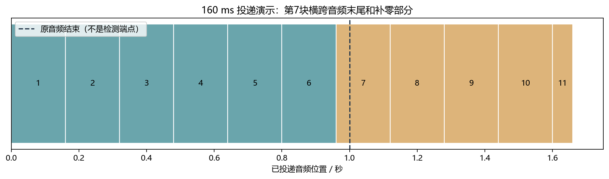
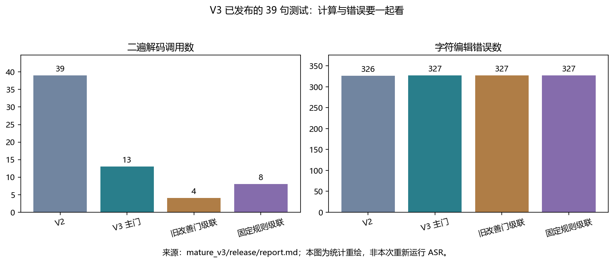

[回到学习首页](../../../index.html) · [配套中文分镜讲解](video.html) · [核验清单](evidence.json)

你要掌握的不是“运行一个识别按钮”。你要解释：录音怎样进入模型，热词怎样改变搜索，为什么第二遍可能更差，以及如何用证据决定是否接受结果。本页已把核心知识写进站内；GitHub 链接用于核验，不是必读外部资料。

## A 先分清：这个项目到底做了哪几件事

仓库当前版本已经有三轮算法实验。最初的 10 条录音对照，只是基础工程实验。后面的热词筛选器、结果接受器和变化门，才是新增的可训练模块。

| 层次 | 已实现什么 | 你应该怎样描述 |
|---|---|---|
| 声学基线 | 上游中文 Zipformer v1，标称 14M 参数，ONNX CPU 推理 | 复用预训练模型；没有重新训练或微调声学权重 |
| 基础实验 | FP32 / 混合 INT8、贪心 / 束搜索、40 / 160 / 640 ms 输入分块 | 比较表示、搜索和输入方式；不是修改模型内部块长 |
| V1 | 首遍检索候选，训练 11 维筛选器，决定加哪些热词 | 先判断“候选是否值得尝试” |
| V2 | 单候选二遍，再用 17 维线性接受器选择完整结果 | 已经看过二遍输出，再判断“要不要采用” |
| V3 | 用 12 维变化门提前决定要不要跑二遍，再复用 V2 接受器 | 先节省计算，再检查变化是否值得接受 |

```flow
录音文件 -> 流式首遍: 冻结的 Zipformer
流式首遍 -> 首位热词候选: 固定词表与拼音检索
首位热词候选 -> 变化门: 只读首遍信息
变化门 -> 返回首遍: 不值得尝试
变化门 -> 单热词二遍: 值得尝试
单热词二遍 -> 结果接受器: 只有文字变化时
结果接受器 -> 最终文字: 接受二遍或退回首遍
```

这里的“二遍”是重新处理同一录音，不是在首遍文字里直接替换一个词。它等文件结束才启动，所以整条系统不能被描述为“所有纠错都在即时流式完成”。

建议在总时间表安排的 Zipformer 精读周，用 7 次、每次约 90 分钟读本页。第一天只到 C 节。读不懂声学特征时回看[第06章](../../chapters/06_features.html)；读不懂张量时回看[第04章](../../chapters/04_numpy.html)；读不懂 CTC 与 RNN-T 时回看[第13章](../../chapters/13_asr.html)。

## B 从一个 WAV 追到字幕：数据和形状

源码入口是 `run_experiment.py` 的 `load_audio()`、`make_recognizer()`、`decode()`。成熟版对应 `mature/decoder.py` 的 `Decoder.decode()`。先不读神经网络内部，先把接口读懂。

| 对象 | 实际形状或结构 | 解释 |
|---|---|---|
| `sf.read(..., always_2d=True)` | `[样点数, 声道数]` | 项目只接受一个声道；立体声直接报错 |
| `samples[:, 0]` | `[样点数]`，`float32` | 单声道一维连续数组，不是 `[帧数, 特征数]` |
| `feed[offset:end]` | `[当前块样点数]` | 16 kHz、160 ms 时通常是 2560 点，末块可更短 |
| 内部声学特征 | 每帧 80 维；帧数依赖前端 | 配置明确 `feature_dim=80`；此 Python 包装没有直接暴露特征张量 |
| `tokens / log_probs / timestamps` | 三个等长列表，长度为输出 token 数 | 对齐检查在 `Decoder.decode()` 末尾；一个 token 不必等于一个汉字 |
| V3 单候选特征 | `[12]` | 十一个首遍候选特征，加一个 token 对齐有效标记 |
| V3 训练输入 | `[400, 12]` | 400 个 rank0 候选，40 个变化、360 个未变化 |
| V2 训练输入 | `[90, 17]` | 90 个已变化候选，来自 82 个句子，不是 90 个独立句子 |

一秒 16 kHz 音频有 16000 点。按 160 ms 投递，每块 2560 点。原音频最后一块不足 2560 点也应送入。仓库额外补 0.66 秒零样点，让模型处理尾部；补尾不应加入 RTF 的原音频时长分母。

编码器提取声学信息，预测网络利用已输出 token 历史，Joiner 合并两路表示后参与 Transducer 搜索。Zipformer 是编码器架构，RNN-T 是序列建模框架，二者不是同一个概念。

```callout warn 不凭名字猜内部结构
这次核验的是 Python 包装、配置与报告，没有加载 ONNX 图。隐藏维数、每层缓存 shape、导出模型内部 chunk 和 lookahead，不能凭名称填写。要精确讨论这些尺寸，需要另读实际 ONNX 输入元数据与对应导出配置。
```

## C 流式状态为什么不能每块重建

把 `stream` 想成一个持续工作的记事本：已经接收的特征、模型跨块状态、解码搜索状态都跟这段语音关联。每条独立录音创建一次 stream；同一录音的后续块继续送给它。识别器可复用，但不要把不同录音当成一个未清理的连续流。

下面是按真实 `decode()` 调用顺序写的教学化简代码。它不是独立可运行程序：`recognizer`、`rate`、`feed`、`chunk` 要由项目准备。为便于理解加入了中文注释，省略了结果事件和输入检查。

```python title="流式解码核心 · 教学化简，非原样源码"
# 每条录音只创建一个流，不要放到 for 循环内部。
stream = recognizer.create_stream()
decoded = False
for offset in range(0, len(feed), chunk):
    # 送入一块波形，末尾不够一整块也保留。
    stream.accept_waveform(rate, feed[offset:offset + chunk])
    # 输入一次后，可能需要执行零次、一次或多次内部解码。
    while recognizer.is_ready(stream):
        recognizer.decode_stream(stream)
        decoded = True
    # 该运行时在尚未完成首个编码块时不应读取 beam 结果。
    partial = recognizer.get_result(stream) if decoded else ""
# 告知输入结束，再消费仍然可处理的尾部。
stream.input_finished()
while recognizer.is_ready(stream):
    recognizer.decode_stream(stream)
```

`accept_waveform` 是投递，`is_ready` 是询问是否已有足够输入，`decode_stream` 才实际推进解码。投递 40 ms 不等于每 40 ms 必须生成新字。`get_result` 读到的是当前假设，前面的字也可能被后续上下文改写。

| 名词 | 本项目含义 | 常见误解 |
|---|---|---|
| 输入块长 | 每次交给接口的波形时长 | 误认为等于模型内部编码块长 |
| 首个 partial 的音频位置 | 首次非空字幕时已投递多少秒音频 | 误认为真实用户等待的墙钟时间 |
| RTF | 原音频一秒需要多少计算秒 | 误认为就是首字延迟或句末延迟 |
| 端点 endpoint | 判断一句话是否结束的机制 | 误认为读完文件已经验证麦克风端点 |

本项目设置 `enable_endpoint_detection=False`，以文件末尾作为句末。代码以最快速度投递，没有按真实采集节奏等待。首个字幕可能在 0.66 秒补尾中出现，项目用 `first_partial_in_padding` 标记。真实端到端测试还需要采集时间戳、队列、端点决策和界面显示时间戳。



图只展示波形切块的位置，未执行识别模型。黑色竖线位于第 7 块内部，标出原音频结束位置，不是由 VAD 检测出的端点。

绘图与断言来自[已运行的中文注释脚本](make_teaching_figures.py)，数值保存在[教学运行结果](teaching_results.json)。把原音频改成两秒后再算一次，需要改的是输入长度，不是凭空增大模型缓存。

## D 热词、标签和两级决策：为什么要分三轮

热词偏置是在解码搜索中奖励相应 token 前缀，不是“保证输出这个词”。本项目成熟版采用 modified beam search，最多保留 4 条活跃路径；Encoder / Joiner 用 INT8，Decoder 仍用 FP32。不要写成整模型全 INT8。

V1 的词表来自 1500 个训练句子的文本，固定 512 词。只有其中 400 条录音用于构造门控标签。拼音检索从首遍输出找近似发音窗口，最多提 4 个候选。正确词若不在词表，或根本没进候选列表，后面的分类器就无法补救。

假设首遍把“德国”识别成“得过”。这是报告里实际出现的改善例。候选检索提出“德国”后，带热词重新识别可能纠正它；但“公元”也可能被“公园”误导。这也是报告里的真实误伤机制。

V1 用人工参考只构造训练标签。记首遍整句编辑错误数为 $E_0$，单热词二遍错误数为 $E_1$：

$$
y_{\mathrm{improve}}=\mathbf{1}[E_1<E_0]
$$

读法：只有整句错误严格减少，标签才是 1。候选词出现在参考里，不保证整句结果变好。推理时没有人工参考，所以特征不能偷看 $E_0$、$E_1$ 或标签。

V2 把决策移到二遍之后。它比较首遍与二遍：改了多少字、是否新增候选词、改动是否跑到候选窗口外、token 分数怎样变化。`mature_v2/acceptor.py::proposal_features()` 输出 17 维特征。只用实际变化的 90 个候选训练，未变化的 1505 个候选由确定规则直接回退。

V3 则在花钱之前再设一关。`mature_v3/gate.py::training_rows()` 每条录音只取原检索顺序的 rank0 候选。标签只问规范化文字有没有变化：

$$
y_{\mathrm{change}}=\mathbf{1}[\operatorname{norm}(h_0)\ne\operatorname{norm}(h_1)]
$$

这里的 $h_0$ 和 $h_1$ 是首遍与二遍假设。**变化不等于改善。** 预测可能变化只是决定是否值得支付二遍成本，真正接受结果仍由冻结 V2 接受器负责。

```flow
首遍与候选 -> 变化门分数
变化门分数 -> 返回首遍: 低于阈值，不调用二遍
变化门分数 -> 单候选二遍: 达到阈值
单候选二遍 -> 返回首遍: 规范化文字未变
单候选二遍 -> 接受器分数: 文字有变
接受器分数 -> 返回二遍: 达到接受阈值
接受器分数 -> 返回首遍: 低于接受阈值
```

去读 `mature_v3/policy.py::execute()` 时，先找 `if attempt:`。昂贵的 `decode_second(...)` 必须在它里面，才能真的节省计算。先跑完二遍再丢弃，不叫提前跳过。已跑过但被拒绝的二遍，也必须计入成本。

## E 真正训练的小模型：把形状和损失看明白

V3 并不训练数千万参数的声学模型。它训练 12 个线性权重和 1 个偏置，一共 13 个参数。训练只在 CPU 上完成。标准化均值和标准差仅用训练部分计算，验证和测试不能重新拟合。

$$
\widetilde{x}_j=\frac{x_j-\mu_j}{\max(\sigma_j,10^{-6})}
$$

$$
z=\mathbf{w}^{\mathsf T}\widetilde{\mathbf{x}}+b,\qquad s=\frac{1}{1+\exp(-z)}
$$

$x_j$ 是某个候选的第 $j$ 个特征；$\mu_j$、$\sigma_j$ 是训练统计。分母下限避免几乎不变化的特征造成除零。$s$ 是筛选分数，不是经过校准的“识别正确率”。

V3 的真实配置是全批次、400 epoch、Adam 学习率 0.03、L2 系数 0.1。训练有 40 个变化和 360 个未变化，正类权重为 3。对应目标可写为：

$$
\mathcal{L}=-\frac{1}{M}\sum_{i=1}^{M}\left[3y_i\log s_i+(1-y_i)\log(1-s_i)\right]+\frac{0.1}{2}\lVert\mathbf{w}\rVert_2^2
$$

这是数学表达；代码使用 `BCEWithLogitsLoss`，直接输入 $z$，避免手算 sigmoid 后再取对数的数值风险。偏置不受 L2 惩罚；Adam 的 `weight_decay=0`，避免重复惩罚权重。

下面是训练步骤的教学片段，不是独立数据加载脚本。`inputs` 与 `targets` 需由项目的数据准备流程提供；前者是标准化特征，后者是浮点的0/1标签。不要复制后用随机数据产生的loss充当项目结果。

```python title="V3 损失的形状解释 · 对应 fit_gate 的教学化简"
import torch
# inputs: [400, 12]；targets: [400]。
network = torch.nn.Linear(12, 1)
optimizer = torch.optim.Adam(network.parameters(), lr=0.03, weight_decay=0)
# [400, 1] -> [400]，保证每行一个标签对应一个 logit。
logits = network(inputs).squeeze(1)
criterion = torch.nn.BCEWithLogitsLoss(pos_weight=torch.tensor([3.0]))
bce = criterion(logits, targets)
# 只惩罚 weight，不惩罚 bias。
loss = bce + 0.05 * network.weight.square().sum()
optimizer.zero_grad(set_to_none=True)  # 清除上一轮梯度
loss.backward()                      # 计算梯度，不更新参数
optimizer.step()                     # 根据梯度更新参数
```

V2 为什么按句子加权？一句话可能产生多个候选。如果某句生成 4 个变化候选，另一句只有 1 个，直接平均会让前一句影响变成 4 倍。`fit_acceptor()` 给每个候选分配“该句变化候选数的倒数”，让每句的总权重一致。交叉验证也按 `sentence_id` 分组，避免同一句不同候选同时进入训练折和验证折。

token log-softmax 分数只能当特征。它会受温度、搜索偏置和 token 化影响，不能直接念成“这个字有百分之多少概率正确”。同理，训练损失下降只说明更好拟合训练目标，不证明新录音表现更好。

## F 用真实结果学习：别把微小改善包装成确定成功

下面数字来自仓库已发布报告，本次建站没有重新运行声学模型。各轮测试句子不同，不能把三轮 CER 横着当作版本升级排行榜。

| 同一轮内比较 | 数据规模 | 已发布结果 | 能得出的结论 |
|---|---:|---|---|
| V1 主模型 vs 无热词 | 200 句 | CER 均为 19.175% | 没有整体净改善；全词表误报减少不等于优于无热词 |
| V2 主模型 vs 无热词 | 新 100 句 | 19.2287% → 19.0669%，净少 6 字错误 | 配对区间跨 0；计算成本增加 110.30%，不能宣称稳定提升 |
| V3 主门 vs 同批 V2 | 新 39 句 | 326 → 327 字错误，二遍 39 → 13 次 | 有节省计算的机制，但多 1 字错误；不支持非劣保证 |

V3 还必须面对更简单的对照：旧改善门和固定规则门都得到 327 个错误，却分别只跑 4 次和 8 次二遍。新训练的变化门没有在这批样本上胜过这些方案。



读图时同时看两侧：少算不一定更准，更准也可能需要更多算力。颜色相同表示同一个方法。图中使用的是整数错误数，避免百分比小数掩盖“实际上只差一字”。

这张图也由上面的绘图脚本生成：`names`、`calls`、`errors` 三个列表必须同序；同一索引对应同一方法。柱状图从零开始，避免把一字差异画成巨大退化。

CER 要先固定归一化，再累积替换、删除、插入。`metrics.py` 做 NFKC、小写化、去 Unicode 标点和空白；保留数字和符号，不统一“十二”和“12”。语料 CER 不是每句 CER 的简单平均：

$$
\mathrm{CER}=\frac{\sum_i(S_i+D_i+I_i)}{\sum_i N_i}
$$

分母需要大于零。空参考录音的插入仍应记录，不能伪造一个参考长度。RTF 则是总计算秒数除以原音频总秒数；不同测量协议下的 RTF 不直接比较。

V3 的 31.45% 节省来自复用单次解码计时的离线成本估计，区间是按句子重采样，不是多轮硬件测速置信区间。未验证的范围包括麦克风延迟、真实领域术语、说话人独立性，以及声学模型预训练数据是否重叠。

最后看实验顺序：训练、开发集选阈值、冻结、全部预测、最后读参考评分。测试一旦用于分析，就不能继续冒充“未看过的新测试”。这比把主结果写得漂亮更能体现算法实验能力。

## G 七次 90 分钟练习：每天交付一件可检查的东西

每天建议“复习 10 分钟＋读图与代码 25 分钟＋动手 40 分钟＋总结 15 分钟”。遇到环境问题超过 15 分钟，记录报错并改做手算或代码追踪，不让安装占掉整天。

| 次数 | 重点与站内入口 | 当日交付 | 通过标准 |
|---|---|---|---|
| 1 | 本页 A—C；[采样与数字音频](../../chapters/02_digital.html) | 手绘 WAV 到字幕的 6 步流程 | 能说出样点、帧、token 的区别 |
| 2 | `decode()`；[NumPy](../../chapters/04_numpy.html) | 计算 40 / 160 / 640 ms 对应点数 | 16 kHz 时为 640 / 2560 / 10240 点 |
| 3 | 本页 F；[ASR 评测](../../chapters/13_asr.html) | 手算两句的总 CER | 不简单平均句子 CER，能处理插入 |
| 4 | 本页 D | 一张 V1 / V2 / V3 对比表 | 分清改善标签、变化标签和接受决策 |
| 5 | 本页 E；[PyTorch 基础](../../chapters/12_pytorch.html) | 标注 12→1 线性模型每步 shape | 能解释 13 参数、梯度与参数更新 |
| 6 | 本页 F；[工程与评测](../../chapters/16_engineering.html) | 写 200 字结果分析 | 同时写收益、代价、简单对照与限制 |
| 7 | 本页 H；[项目交付](../../chapters/17_project.html) | 录制 2 分钟口述或写逐字稿 | 不声称声学训练、端点实测或稳定提升 |

项目已克隆且依赖齐备时，可在项目目录执行下面只读检查。不要在网站目录运行，也不要为了通过检查删除冻结文件。

```powershell title="已有项目环境中的检查命令"
# 检查基础环境和资源，不安装、不下载、不执行推理。
.\run_project.cmd -VerifyOnly
# 指标单元测试不需要重新训练声学模型。
.\.venv\Scripts\python.exe -m unittest -v test_metrics
# V3 完整环境检查；缺数据时先读错误，不绕过校验。
.\run_research_v3.cmd -VerifyOnly
```

第一次只读网页也能完成前六次的理解任务。真正想把项目写进简历，仍需要亲手运行、修改一个小实验、保存结果，并能解释代码。本页不承诺“只看过教程就等于掌握项目”。

## H 自测、答案与面试表述

先遮住答案，用自己的话答，不要复制定义。

| 问题 | 参考答案 |
|---|---|
| 每输入一块音频重新 `create_stream()` 会怎样？ | 把连续语音当成彼此独立输入，丢掉跨块上下文与搜索状态；应每条录音创建一次 |
| 输入块从 160 ms 改成 40 ms，模型 lookahead 是否也变了？ | 没有；只改 Python 投递粒度，未改导出模型配置 |
| V3 分数高，是否表示二遍一定更准确？ | 不是；训练目标只是文字是否变化，仍需 V2 接受器与整体评测 |
| 二遍被接受器拒绝，成本可以不算吗？ | 不可以；计算已经发生，必须计费 |
| 一句 100 字错 10 字，另一句 10 字错 5 字，总 CER？ | $\frac{15}{110}\approx13.64\%$，不是 30% |
| 12 维 Logistic 有几个参数？ | 12 个权重加 1 个偏置，共 13 个 |
| 为什么新门不应宣称最优？ | V3 同批测试中，简单门同为 327 错而二遍更少；样本也仅 39 句 |
| 候选词不在训练词表里，接受器能补救吗？ | 无法沿这条候选流程补救；应先分析词表覆盖和检索召回 |

可诚实采用的项目介绍：“我基于冻结的 Zipformer 流式模型，研究热词二遍解码的决策。先做候选筛选，再学习结果接受，最后用首遍变化门节省计算。我实现了候选特征、轻量训练、分组验证和冻结评测。在 39 句探索测试中，主门减少二遍调用，但比 V2 多一个字错误，且没有胜过简单门，因此保留基线和全部对照。”

其中“我实现了”只适用于你能独立解释、复现并确认自己贡献的部分。如果代码主要由工具协助生成，应说清自己负责的设计、修改、测试与分析，不把上游模型或尚未理解的模块算作独立研发。

本页依据 [固定提交](https://github.com/yang07-29/streaming-asr-zipformer/commit/a9e8d394c4f671956d1afa3be30037d510234cf4) 的 README、推理包装、指标实现、V2 接受器、V3 变化门与三轮发布报告编写。文件级 SHA 与来源见[核验清单](evidence.json)。原项目仓库的隐私设置保持不变；本教程展示的项目结构和实验结果已经授权随课程公开。
