# 音频算法新手教程

第四版 · 2026-10-23 内容审查与课程化排版

主入口是[学习网站](../index.html)。本文件是文字备份，课堂实验按网站内的配套顺序学习。


---

# 第00课：学习准备与使用方法

[返回目录](README.md)

## 你在这门教程里要做到什么

这是一节准备课，不是另一套“新手第一课”。读完本页后，继续第01课“声音本身”，再按第02、03课顺序学习。四份动手实验是正文的配套练习，不是四门平行课程；页面里遇到对应实验再打开即可。

假设你现在会一点 Python，学过大学数学，但没有处理过音频。第一目标不是训练大模型，而是回答三个问题：声音在电脑中是什么？算法改变了它的什么？我怎样判断改得好不好？

音频算法岗位不是一个统一工种。做耳机前端的同学会关心回声、风噪、麦克风和时延；做语音识别的同学会关心转写错误、训练数据与流式解码；做合成的同学会关心发音、韵律、音色和首包。共同底座是信号表示、编程、实验和评测。

你的电子信息与水声背景并不是无用的绕路。采样、滤波、阵列、传播、统计估计、实验设计能够迁移；但水声数据不等于人类语音，完成水下定位也不自动代表会做识别。学习时主动区分“能迁移的数学”与“还要补的任务知识”。

本教程先搭共同底座，再分方向。第01—06课是识字阶段；第07—11课让你看懂传统音频与声学；第12课学习训练；第13—16课按任务深入；第17课把这些变成可展示的项目。

## 一讲应该怎样读

不要连续看完十讲再准备动手。每一小节按以下顺序走：先遮住答案，猜运行结果；再运行；再比较预测和观察；最后改一个参数，说明为什么发生变化。

例如你看到 `x = 0.5 * sin(...)`，先问自己：0.5控制的是频率还是振幅？改成0.25以后数组长度会不会变？把这两个问题说清，比背“采样定理、傅里叶变换、信噪比”三个名词更有用。

遇到公式，先看每个字母的意思、单位、数组形状。公式可以先用数字代入理解，再推一般形式。遇到代码，先看输入与输出，不要从某个复杂库的参数列表开始背。

本课的类比只帮助入门。例如把采样比作拍照，能解释时间上只记录若干点；但并不意味着采样必然损失所有连续信息。满足带宽限制及采样条件时，理想理论允许重建。每个类比都要知道何处失效。

## 网页正文、配套实验和下载附件怎么用

主入口是学习网站：先读本课正文，遇到核心代码就看它下面的输出与运行图，最后完成自测并进入下一课。浏览网页不需要安装 Python；只有想改参数、重新运行时，才需要编程环境。网页本身不会执行 Python。

配套实验按相同方式展示“代码—输出—图—解释”。学完第01、02课后，再做[声音成为数组](01_声音成为数组.md)。还不熟悉数组切片和广播时，可以先读代码注释、预测输出；第04课会系统讲这些写法，不要求第一天就独立写完整程序。

下载区的 `.py` 是可运行的 Python 程序；`.ipynb` 是可逐格运行的 Jupyter 练习本；Markdown 是文字备份。它们服务于同一套教程，不是额外的学习顺序。图片由保存的程序实际生成，既不是手画的“应该如此”，也不表示网页正在实时计算。

一份实验有四种不同证据：代码说明做法，配置说明条件，结果文件保存数字，图帮助发现规律。漂亮的图不能替代配置，低损失也不能替代未知数据评测。

## 第一次运行：先查环境，不盲目重装

在终端输入以下命令，它们只查看环境，不安装软件：

```text
python --version
python -c "import numpy, scipy, matplotlib; print(numpy.__version__, scipy.__version__, matplotlib.__version__)"
```

2026-10-22 的基础实验记录使用 Python 3.13.9、NumPy 2.4.4、SciPy 1.16.3、Matplotlib 3.10.6。这些是当时的测试版本，不是必须照搬的安装清单，也不保证今天终端仍指向同一个环境。神经训练的实际版本见原课程训练记录。

如果出现 `ModuleNotFoundError`，含义通常是“当前这个 Python 环境没有找到库”，不代表你所有环境都没装。先确认 VS Code/Jupyter 选择的解释器是否和终端相同。不要同时切换解释器、重装依赖、改代码，这样很难知道哪个变化解决了问题。

先确认上面的导入命令能成功，再从课程根目录运行基础脚本。下面使用本机课程路径；如果你把课程放到了别处，只改第一行的路径：

```powershell
Set-Location 'F:\codex\调研\outputs\audio-course-zh'
python -X utf8 tutorial/code/beginner_labs.py
```

这条命令在课程内生成基础图、合成 WAV 与结果 JSON，不会录音或自动播放。若使用 Anaconda 或虚拟环境，先激活目标环境，再确认 `python` 就是该环境的解释器。不要把上述课程路径当成任何电脑都存在。

运行完看 `tutorial/results/beginner_results.json`：一秒16 kHz单声道有16000点，0.5幅度正弦的RMS约0.3536。图在 `tutorial/figures/`。你也可以先读已经生成的结果，完全不急着运行所有脚本。

## 第一个图：该看什么

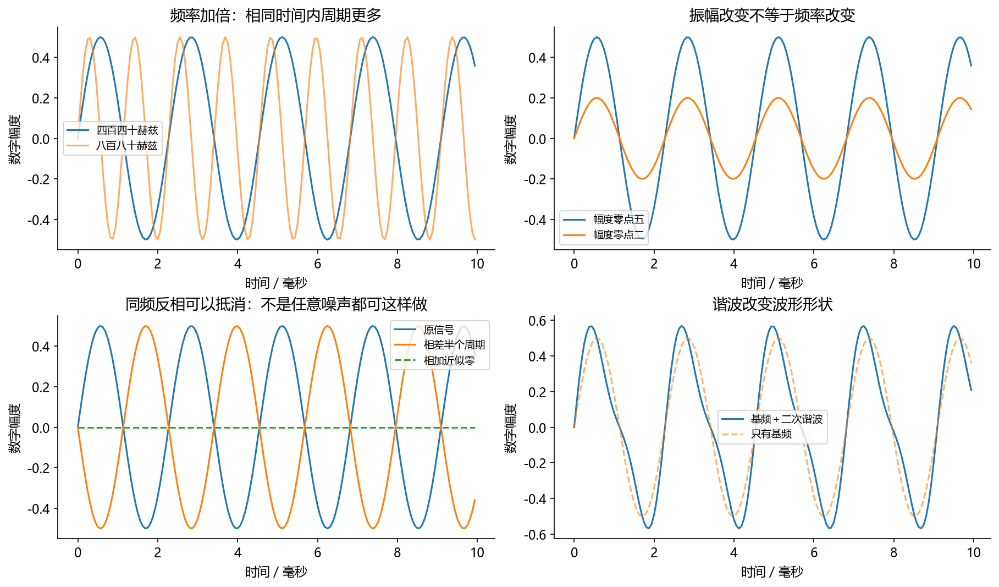

这张图由 `tutorial/code/beginner_labs.py` 的 `first_wave()` 实际生成。左上只改变频率，所以周期数量不同；右上只改变振幅，所以高度不同；左下展示理想同频反相相加；右下加入谐波，波形形状发生变化。

不要由左下推出“把麦克风噪声乘负一就能做耳机降噪”。真实控制声还要经过扬声器与传播路径，并且需要满足因果性。第11课和原ANC实战会解释这个差别。

## 代码出错时按什么顺序查

先看异常最后一行，识别是找不到文件、找不到库、形状不匹配还是数值异常。然后定位你自己文件中的行号。最后打印最小必要信息，不要一次输出几百万个样本。

音频程序的最小诊断信息是：采样率、`shape`、`dtype`、长度、峰值、是否存在 NaN/Inf。读到 `shape=(48000,2)`，先确认是样本×声道，不要默认二维就代表频谱。

若图像空白，检查数组是否全零、横轴单位是否混成秒/毫秒、纵轴范围是否把曲线裁掉。若听起来变调，检查采样率和文件头；若指标突然特别好，先检查有没有把干净答案混进输入或测试集。

## 本周只交三样东西

第一，读完第01—03课后，用自己的话解释“16 kHz不是16 kHz音调”“0 dB SNR不是没声音”“数字幅度不等于声压”。第二，运行第一份练习本，改一次频率和一次幅度，保存两张图。第三，写一页实验记录：输入、改动、观察、解释、尚未理解的一个问题。

检查题：把一秒16 kHz录音的文件头改成8 kHz，但不改16000个样本，会怎样？参考答案：按新采样率播放会变成两秒，音调也降低；这不是正确的重采样。若你能解释原因，就已经开始用“数据是什么”来思考，而不是只记函数名。


---

# 第 1 课：先认识声音，再认识音频数组

[返回教程目录](README.md) · [下一课：声音怎样变成数字](chapters/02_digital.md)

> 适合谁：还没有学过音频、看到波形不知道在看什么的同学。先不用背模型名。本课结束后，你应能解释频率、幅度、相位分别改变了什么，并说清“麦克风录到的声音”为什么不等于“嘴巴发出的声音”。建议用 60—90 分钟阅读、手算和改代码。

本课先读第1—4节的声音概念，再看第5节代码与图。暂时不认识 `np.arange`、数组切片等写法也没关系：先按旁边注释理解输入和结果，第04课会系统讲 NumPy。第一次的过关标准是解释图上发生了什么，而不是默写全部绘图代码。

## 1. 声音到底是什么？

想象一排同学站着传递轻推：第一个人向前动一点，旁边的人也跟着动，扰动一路传下去，但每个人并没有从队首跑到队尾。声音传播也可以借助这个类比理解：介质中的局部振动让压力等物理量发生变化，扰动传播出去。它不是“一团空气从嘴巴飞到耳朵”。这个类比只帮助理解传播，不代表空气真的由一排只会前后移动的人组成；现实还有三维传播、反射、吸收和边界效应。

麦克风把声学变化变为电信号，后续电路再把它变为数字。画音频波形时，横轴通常是时间，纵轴可能是帕斯卡、电压，或者无物理单位的归一化数字。第一件事应当是读坐标轴，而不是看到纵轴 0.5 就说“0.5 分贝”。

一个最简单的声音模型是正弦：

\[
x(t)=A\sin(2\pi f t+\varphi).
\]

这里的 $t$ 是时间，单位秒；$A$ 是幅度，单位随信号而定；$f$ 是频率，单位 Hz，也就是每秒振动次数；$\varphi$ 是初相位，单位弧度。$2\pi$ 弧度代表一整圈。正弦是理解声音的“积木”，不是说人的声音都是一条正弦。

## 2. 三个旋钮：高低、大小和时间位置

把频率从 200 Hz 改为 400 Hz，波形在同样一秒里多振动一倍。对于简单纯音，听起来通常更高。把幅度从 0.1 改为 0.2，振动的数值范围增大，但频率不变。主观响度还受频率、持续时间、播放设备和听觉状态影响，因此“幅度两倍”不等于“听起来恰好响两倍”。

周期 $T=\frac{1}{f}$。1000 Hz 纯音的周期是 $0.001\,\mathrm{s}=1\,\mathrm{ms}$。如果把整个波形向后挪 $0.25\,\mathrm{ms}$，就挪了四分之一周期，对应相位变化 $-\frac{\pi}{2}$。这里的负号来自写法 $x(t-\tau)$：正延时 $\tau$ 表示信号更晚到达。

相位对单个稳定纯音的听感可能不明显，对多个信号相加却非常重要。两条完全相同的正弦相加，幅度变为两倍；一条与另一条恰好反相，相加可以为零。实际房间里有多条路径，往往不会对所有频率同时抵消，而是在某些频率变强、某些频率变弱。这是理解梳状滤波、阵列波束形成和 ANC 的起点。

## 3. 音高、谐波、音色：它们不是一回事

如果周期性声源的基频是 $f_0=200\,\mathrm{Hz}$，常见谐波位置就是 400、600、800 Hz 等整数倍。基频对应基本重复节奏，各谐波强弱分布会改变波形和音色。小提琴和口哨可以发出相同音高，却因频谱包络、起音、衰减和噪声成分不同而容易区分。

人声可以先用“声源—滤波器”模型理解：声带振动提供带谐波的激励，声道形状对不同频率进行不同的增强和衰减。被声道增强的共振区域称为共振峰（formant），与基频不是同一概念。唱同一个音，可以换不同元音；说同一个元音，也可以升高或降低音高。实际发声比这个线性模型复杂，但它足够解释很多 TTS 和语音分析现象。

还有不明显周期性的声音，例如摩擦音、风声和部分机械噪声。对这些声音强行输出一个“精确音高”常常没有意义。算法需要同时判断有声/无声、置信度和适用条件。

## 4. 从时间走到空间：声速、波长、距离

波长 $\lambda=\frac{c}{f}$。这里 $c$ 是声速，单位 m/s；$\lambda$ 单位 m。教学计算可以取室温空气中约 $343\,\mathrm{m/s}$，但声速会随温度等条件变化；水下不能照搬这个数。

手算一次：空气中 1000 Hz 的波长约为 $\frac{343\,\mathrm{m/s}}{1000\,\mathrm{Hz}}=0.343\,\mathrm{m}$，即 34.3 cm；4000 Hz 的波长约为 8.58 cm。同样 8 cm 的麦克风间距，对低频可能很小，对高频却已经接近一个波长。因此，阵列设计不能只看“麦克风多不多”，还要看间距与工作频段。

声音多走 0.343 m，传播时间约多 1 ms。若采样率为 16 kHz，1 ms 对应 16 个采样点。注意这是路径差，不是“任意两个麦克风永远相差 16 点”；来向改变时，两个麦克风之间的实际路径差也会改变。

水声中的传播、多径、阵列和检测经验可以迁移到音频，但传播介质、速度、频段、传感器和数据分布都要重新写清。把“我会研究声学信号”转成“我能明确建模与验证声学系统”，才是对实习有价值的迁移。

## 5. 第一段代码：制造一小段声音，不需要声卡

先确保 Python 环境能够导入 NumPy 和 Matplotlib。以下代码计算并保存图，不播放声音，也不下载数据。请在课程根目录 `audio-course-zh` 下运行整段，图写入其中的 `tutorial/figures`；若从其他目录运行，先切换目录，不要随意删掉路径检查。

```python
import numpy as np

fs = 8000                 # 每秒 8000 个采样点
duration = 0.01           # 10 毫秒
n = np.arange(round(fs * duration))  # 整数编号，不是秒
t = n / fs                         # 除以采样率，得到秒
f = 1000.0                         # 纯音频率为 1000 Hz

# 同频反相：相位加 π，而不是把频率变成两倍。
tone = 0.4 * np.sin(2 * np.pi * f * t)
opposite = 0.4 * np.sin(2 * np.pi * f * t + np.pi)
# 加入第三谐波：频率变成 3*f，幅度单独设为 0.2。
rich = tone + 0.2 * np.sin(2 * np.pi * 3 * f * t)

print("数组形状:", tone.shape)
print("每周期采样点:", fs / f)
print("前 8 个数:", np.round(tone[:8], 3))
print("反相相加的最大绝对值:", np.max(np.abs(tone + opposite)))
print("复合声与纯音是否相同:", np.allclose(rich, tone))

# 同参数绘图：使用静态后端，不弹窗、不自动播放音频。
from pathlib import Path
import matplotlib
matplotlib.use("Agg")
import matplotlib.pyplot as plt
plt.rcParams.update({"font.family": "Microsoft YaHei", "axes.unicode_minus": False})
assert Path("tutorial/chapters").is_dir(), "请在 audio-course-zh 根目录运行"
fig, axes = plt.subplots(2, 1, figsize=(10, 6), layout="constrained")
axes[0].plot(t*1000, tone, label="一千赫兹纯音")
axes[0].plot(t*1000, opposite, "--", label="同频反相")
axes[1].plot(t*1000, tone+opposite, label="相加后接近零")
axes[1].plot(t*1000, rich, label="基频加第三谐波")
for ax in axes:
    ax.set(xlabel="时间／毫秒", ylabel="数字幅度")
    ax.legend()
fig.suptitle("本段代码实际结果：相位影响叠加，谐波改变形状")
fig.savefig("tutorial/figures/ch01_wave.png", dpi=150)
plt.close(fig)  # 释放图对象，不调用 show()
```

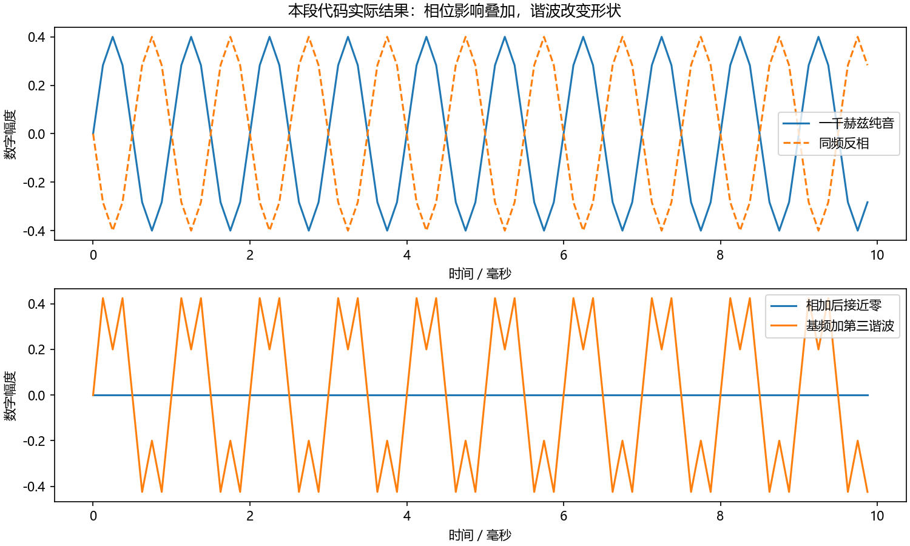

上图就是这段代码运行后保存的结果。先比较上半图两条线是否关于零线翻转，再看下半图相加曲线是否接近零。另一条复合曲线的弯折来自第三谐波，不是曲线绘制错误。你修改频率后重新运行，图文件会被新实验覆盖，建议在实验笔记中记录修改参数。

`n` 是形状 `(80,)` 的一维整数数组，表示编号 0 到 79。`t=n/fs` 把“第几个点”换成“多少秒”；它仍然是 `(80,)`。`np.sin` 对数组里的每个数分别运算，所以不用自己写 80 次循环。`tone[:8]` 取前 8 个点，正好是这里的一个周期。

预期形状为 `(80,)`，每周期 8 点，前 8 点约为 `[0, 0.283, 0.4, 0.283, 0, -0.283, -0.4, -0.283]`。反相相加应接近 0，但可能有 `1e-15` 量级的小残差，这是浮点数计算误差，不是“算法没有完全消噪”。最后一项应为 `False`：加入第三谐波后，波形确实变了。本次在本地 Python/NumPy 运行该代码，得到反相残差约 `1.47×10⁻¹⁵`，其余输出与上述预期一致。


这张图由 [beginner_labs.py](code/beginner_labs.py) 的 `first_wave()` 实际生成，是同一原理的扩展实验：基频取 440 Hz，比较 880 Hz，并加入二次谐波；不是把上面 1000 Hz、第三谐波的参数偷偷当成相同数据。读图时先找“横轴时间是否相同”。在相同时间窗口里数周期，判断频率；再比较最高点到零线的距离，判断幅度；最后看相同波峰有没有左右错位，判断相位。右下复合波形不再圆滑，不代表数据坏了，而可能只是多个频率成分相加。

现在只改一个参数：把 `f` 从 1000 改为 500。先预测每周期点数，再运行。不要同时改频率、幅度和采样率，否则很难判断现象由谁造成。

## 6. 麦克风链路与新手最常见的误判

一段录音可以近似理解为：声源 → 房间/传播路径 → 麦克风 → 前置放大 → 模数转换 → 软件处理 → 文件。每一级都可能改变结果。麦克风有频率响应、方向性、自噪声与动态范围；手机或会议软件还可能默认做 AGC、AEC 或降噪。你拿到的文件不一定是未经处理的原始声压。

如果你移动麦克风后音色变化，先考虑距离、方向、反射以及设备处理，不要立刻断言“模型漂移”。如果音频两端都被切平，可能发生削波；事后把整体音量调小，也不能把已经丢失的波峰找回来。如果左右声道一平均人声变小，可能与极性或时间对齐有关，不能盲目认为平均永远更好。

听音实验应从较低播放音量开始，特别是纯音和自己生成的测试信号。代码中的 0.4 不是对耳机声压的安全保证：播放设备和音量旋钮才会决定实际输出。

再补一个容易误用的概念：频率响应不是单个“好坏分数”，而是设备对各个频率幅度与相位的响应。一个麦克风可能低频衰减、某一高频段增强，因此同一说话人在不同设备上听起来不同。方向性则描述来自不同方向的声被怎样接收，不能仅凭“有两个麦克风”就认为它一定有很强的定向收音能力。

对远处声源，在一个足够小的阵列范围内，有时可以近似为平面波；近处声源往往需要考虑球面波和距离差。先把它理解为“到各个传感器的路径是否可以用一个简单方向来描述”。如果条件不满足，还硬套某个时延公式，错误来自模型假设，不是三角函数算错了。

## 7. 自测：先遮住答案

1. 250 Hz 的周期是多少？16 kHz 采样时，一个周期有多少点？
2. 两个同频正弦幅度都是 0.3，同相相加与反相相加分别会怎样？
3. 为什么同一个元音可以由不同音高的人说出来？
4. 0.686 m 的空气传播路径差，取声速 343 m/s，在 16 kHz 下约对应多少点？
5. 录音幅度比上一次大一倍，可以直接说声源声压大一倍吗？

参考答案：1）4 ms，64 点。2）同相时幅度 0.6，理想反相时为 0；实际还需幅度、延时完全匹配。3）基频描述激励重复节奏，共振峰主要描述声道共振，它们可以分别变化。4）2 ms，即 32 点。5）不可以，还可能是麦克风位置、增益或 AGC 变化，必须控制或校准测量链路。

## 8. 实习怎么用，学到哪里算过关

本课对应实习中的录音检查、阵列时延解释、数据增强和故障定位。你不必在第一天推导复杂声场，但应能拿到一段数据后问出四件事：这是什么传感器，纵轴是什么单位，采样率是多少，前面有没有做过处理。

过关任务：把代码里的频率、幅度、相位各改一次，用三句话分别解释变化；再写一张录音信息表，记录设备、采样率、声道、距离、环境和已知前处理。下一课我们把“声音数组”继续拆开，弄清采样、量化和文件格式。

延伸核验：[NPL 声学量与分贝单位说明](https://resource.npl.co.uk/acoustics/techguides/concepts/siunits.html)。这里的例子是原创教学计算，不是录音设备测量报告。

## 9. 今天怎样学，明天怎样回忆

第一次读完先不要继续刷十个术语。关掉页面，在纸上画一条正弦，再画“幅度减半、频率翻倍、延迟四分之一周期”三个版本。重新打开页面核对：你有没有把频率翻倍画成音量翻倍？有没有把延迟方向画反？把自己的错图留下来，它比复制一页定义更能提醒你。

第二天不看公式，重新从“每秒多少次”推出周期，再从“每秒采多少点”推出每周期点数。最后用一个工作场景串起来：两只麦克风录到了同一句话，一路晚了几个点，会怎样影响直接相加？你的回答应该提到延时和相位随频率的关系，而不是说“它们都是同一个人，所以可以直接平均”。能这样解释，就已经把本课用到了真实工程问题上。


---

# 第 2 课：采样、量化、PCM 和 WAV，终于不再混淆

[上一课：声音是什么](chapters/01_sound.md) · [返回教程目录](README.md) · [下一课：分贝与响度](chapters/03_decibels.md)

> 前置要求：知道频率的单位是 Hz，时间的单位是秒；能够运行一个 NumPy 脚本。目标：从采样率、位深、声道数算出时长和原始数据大小；发现“改采样率标签”和“真正重采样”的差别；知道读取音频时要检查什么。建议 90 分钟，至少实际运行一次代码。

## 1. 数字音频做了两次取舍

连续声音要放进计算机，可以先想成两步。第一步是采样（sampling）：隔固定时间看一次数值。第二步是量化（quantization）：把每个数值放到有限的刻度上。采样处理“横轴的时间有多密”，量化处理“纵轴有多少档”。

像用方格纸描曲线：横向格子影响你多久记一次，纵向格子影响你能记得多细。这个类比的局限是，真实采样系统还有模拟滤波、电路噪声和时钟误差，并非先得到一条完美曲线再随意读数。

采样率 $f_s=16000\,\mathrm{Hz}$ 表示每秒每声道 16000 个点，采样间隔 $\frac{1}{f_s}=62.5\,\mu\mathrm{s}$。它不表示“声音频率是 16000 Hz”。位深 16 bit 表示每个采样的编码位数，不表示一秒只有 16 个点。

## 2. 为什么不能只说“多采几个点就行”

理想采样定理针对带限信号：最高频率低于 $\frac{f_s}{2}$，并满足相关条件时，可以由均匀采样恢复。工程上还要给抗混叠滤波器留过渡带，因此不能把“刚好等于一半”当成万能安全边界。

以 $f_s=8000\,\mathrm{Hz}$ 为例，一条 5000 Hz 正弦采样后，会与某个 3000 Hz 正弦序列出现混叠对应。文件中的这些点已经无法告诉你原来究竟来自哪个连续频率。采样完成后再低通，并不能把混在一起的来源自动分开；应在降低采样率前抑制会折叠的高频。

只把 WAV 文件头从 48000 改成 16000，却不改变样本序列，等于让播放器用原来三倍的时间播放。时长变成三倍，各频率分量变为原来的三分之一，通常听起来更低。这不是保持原来声音的重采样。真正的 48 kHz → 16 kHz 重采样，需要低通等处理并减少点数，时长才基本保持不变。[SciPy 的 `resample_poly` 文档](https://docs.scipy.org/doc/scipy/reference/generated/scipy.signal.resample_poly.html)明确说明了上采样、低通和下采样的过程。

## 3. 16 位 PCM 到底存了什么

PCM（脉冲编码调制）在这里可以理解为直接存采样值的编码方式。常见有符号 16 位整数范围是 $-32768$ 到 $32767$，总共 65536 个整数码。记整数码为 $x_{\mathrm{PCM}}$，约定转换为浮点数的方式是：

$$
x_{\mathrm{float}}=\frac{x_{\mathrm{PCM}}}{32768}
$$

转换后的取值在 $[-1,1)$ 内；最大值为 $\frac{32767}{32768}$，不是严格的 1，这是两补码整数范围不对称造成的。

从浮点转回整数时，顺序很重要：先决定缩放规则，必要时限幅，再取整，最后转换类型。直接对超过范围的浮点数做 `astype(np.int16)`，不等于安全限幅。教学代码采用 `clip(round(x*32768), -32768, 32767)`，这是约定之一，使用别人的库时要核对其约定。

量化误差可写为 $e[n]=x_q[n]-x[n]$。在没有过载、使用最近舍入的均匀量化器内部区域，误差绝对值不超过半个量化步长。真实音频中误差可能与信号相关；“量化误差一定是独立白噪声”只是某些分析中的近似，不是天生定律。抖动（dither）是量化前有意加入的小噪声，可改变误差特性，但会增加噪声功率，初学阶段先知道它不是“随便加噪声能提高所有指标”。

## 4. 手算一次存储量与时长

不计文件头，未压缩 PCM 每秒字节数为：

\[
R=\frac{f_s C B}{8}.
\]

$C$ 是声道数，$B$ 是每采样位数。16 kHz、单声道、16 bit 的数据，每秒是 $16000\times1\times2=32000$ 字节；10 秒是 320000 字节。这里说的是十进制字节，不是把 KB 和 KiB 混在一起。

48 kHz、双声道、16 bit，每秒 192000 字节，10 秒 1920000 字节。双声道的一个“音频帧”（audio frame）通常包含同一时刻所有声道的采样，所以 48000 个音频帧/秒会含 96000 个声道采样数值。后面 STFT 里“帧”又表示一段时间窗口，两个术语同名，含义不同，要看上下文。

## 5. 不保存 WAV 文件，也能验证读写

这段程序使用 NumPy 和 Python 标准库，把 WAV 放在内存里，所以不会覆盖你的本地录音；末尾使用 Matplotlib 保存实验图。请在课程根目录 `audio-course-zh` 运行。它只演示常见的 16 位 PCM WAV，不声称读取所有 WAV 编码。Python 不同版本对 WAV 子格式的支持有差别，使用时可查[官方 `wave` 文档](https://docs.python.org/3/library/wave.html)。

```python
import io
import wave
import numpy as np

fs = 16000                  # 这里写入文件头的采样率
x = np.array([0.0, 0.25, -0.25, 0.999, -1.0])
# 先缩放、取整和限幅，最后转换成小端 16 位 PCM。
pcm = np.clip(np.rint(x * 32768), -32768, 32767).astype("<i2")
buffer = io.BytesIO()        # 内存文件，不覆盖磁盘上的录音
with wave.open(buffer, "wb") as w:
    w.setnchannels(1)
    w.setsampwidth(2)
    w.setframerate(fs)
    w.writeframes(pcm.tobytes())

buffer.seek(0)              # 读取前先把文件指针移回开头
with wave.open(buffer, "rb") as r:
    channels, width, rate, count = (
        r.getnchannels(), r.getsampwidth(), r.getframerate(), r.getnframes()
    )
    raw = r.readframes(count)  # 返回字节，而不是已经归一化的数组
# 按真实位宽解码，再转浮点恢复本课的幅度约定。
y = np.frombuffer(raw, dtype="<i2").astype(np.float64) / 32768
print("声道/字节宽/采样率/帧数:", channels, width, rate, count)
print("恢复浮点:", y)
print("最大误差:", np.max(np.abs(y - x)))
print("时长（秒）:", count / rate)

# 画出本次往返的真实数值与误差，不把 16 位误差夸大成粗台阶。
from pathlib import Path
import matplotlib
matplotlib.use("Agg")
import matplotlib.pyplot as plt
plt.rcParams.update({"font.family": "Microsoft YaHei", "axes.unicode_minus": False})
assert Path("tutorial/chapters").is_dir(), "请在 audio-course-zh 根目录运行"
fig, axes = plt.subplots(2, 1, figsize=(10, 6), layout="constrained")
indices = np.arange(len(x))
axes[0].plot(indices, x, "o", label="量化前")
axes[0].plot(indices, y, "x", markersize=10, label="写入再读出")
axes[0].set(xlabel="采样索引", ylabel="数字幅度", title="两组点几乎重合")
axes[0].legend()
axes[1].bar(indices, (y-x)*1e6)
axes[1].set(xlabel="采样索引", ylabel="误差乘一百万", title="单独放大误差才能看清")
fig.savefig("tutorial/figures/ch02_pcm_roundtrip.png", dpi=150)
plt.close(fig)
```

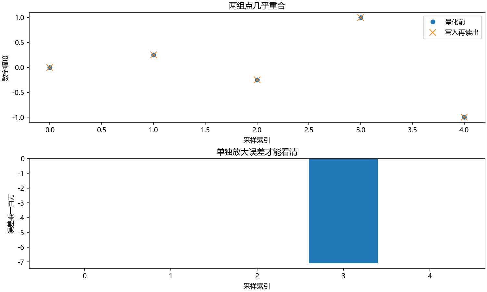

上图使用的就是 `[0,0.25,−0.25,0.999,−1]` 五个数。大部分点可精确表达，只有 0.999 对应明显非零误差；下图纵轴特意乘一百万显示微小差别，不代表实际播放增益放大了一百万倍。

`x` 和 `pcm` 都是 `(5,)`，区别是数据类型。`<i2` 表示小端、有符号、2 字节整数；小端说明多字节数在字节流中的排列顺序。`tobytes()` 变成字节流，文件头另外描述采样率、声道等信息。`frombuffer` 按给定类型解释字节，随后转浮点再除以 32768。

预期参数是 `1 2 16000 5`；时长为 $\frac{5}{16000\,\mathrm{Hz}}=0.0003125\,\mathrm{s}$。0.25 和 −0.25 可以精确落在这个量化网格上，0.999 通常不能。误差应在 $\frac{1}{65536}\approx0.00001526$ 以内。请注意我们没有在这个测试里使用正端 1.0：它会被限到 32767，不能套用内部区间的半步长误差结论。

本次实际运行上述内存读写代码，最大误差为 `7.080078125×10⁻⁶`，时长为 `0.0003125 s`；这验证了这个小例子的编码往返，不是音频设备的保真度测量。

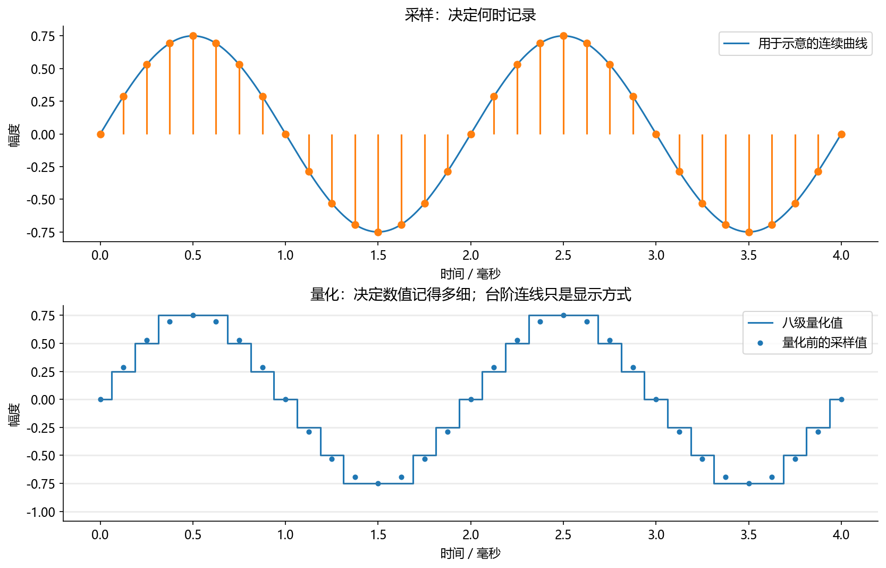

图由 [beginner_labs.py](code/beginner_labs.py) 的 `quantization()` 实际生成。为了让台阶肉眼可见，它使用 0.25 步长的八级量化，而不是上方 16 bit 的精细刻度。上图的连续曲线是数学函数画出的示意，散点才是采样位置；下图台阶是展示量化值的连接方式，不等于声波在空气中真的长成台阶。运行记录中本组样本最大误差约 0.0571，小于半步长 0.125。

## 6. WAV、PCM、MP3、FLAC：容器和编码别混了

WAV 是一种文件容器；PCM 是编码/表示方式。许多 WAV 文件装的是未压缩 PCM，但“扩展名是 .wav”不能证明内部必然是 16 位整数。MP3 通常是有损编码，FLAC 是无损音频压缩。无损的意思是能恢复其编码前的数字采样，不是能修复录音时已经发生的失真，也不是自动比所有 PCM 声音更清楚。

做训练数据时，要记录解码后的采样率、声道、长度和幅度范围；还应了解原始编码历史，因为有损压缩可能留下不同伪影。把 MP3 改名成 WAV 不会完成转换，把 16 bit 保存成 24 bit 也不会凭空增加原来丢失的信息。

对双声道，常见数组形状是 `[时间, 声道]`，也有库使用 `[声道, 时间]`。先看形状和文档，再决定在哪个轴上重采样。左右声道平均可以得到一种单声道混音，但若信号不同相或来自不同传感器，盲目平均可能损失信息；阵列任务尤其不能先把所有通道揉成一条。

## 7. 常见错误与处理顺序

声音播放变慢：先查文件头采样率和实际采集采样率，不要先调变速模型。重采样后音质很怪：检查是否直接使用 `x[::3]`，以及输入原本是否已有足够低通。读出波形数值很大：先检查整数 PCM 是否还没归一化。读取异常：检查真实格式、位宽、声道和库支持，而不是把所有文件都强行按 `int16` 解释。

一个可靠习惯是每次读入先打印：`shape`、`dtype`、`sample_rate`、`duration`、`min/max`、是否有 NaN/Inf。这张“入场体检单”比直接调用模型更能避免浪费时间。

## 8. 再运行一个反例：每三点取一点为什么不够

这段扩展实验需要 SciPy。我们故意放入 1 kHz 和 10 kHz 两个分量，再把 48 kHz 降到 16 kHz。新采样率不能无混叠地保留原来的 10 kHz，因此正确处理应先抑制它。把原来高频变成不存在的 6 kHz，比单纯丢掉高频更容易误导后续模型。

```python
import numpy as np
from scipy.signal import resample_poly

old_fs, new_fs = 48000, 16000
t = np.arange(old_fs) / old_fs       # 1 秒，形状 (48000,)
x = 0.35*np.sin(2*np.pi*1000*t) + 0.35*np.sin(2*np.pi*10000*t)
wrong = x[::3]                       # 错误示范：没有先抗混叠滤波
correct = resample_poly(x, up=1, down=3)  # 低通滤波与有理数重采样
print("两个输出的形状:", wrong.shape, correct.shape)
print("正确输出的时长:", len(correct)/new_fs)
```

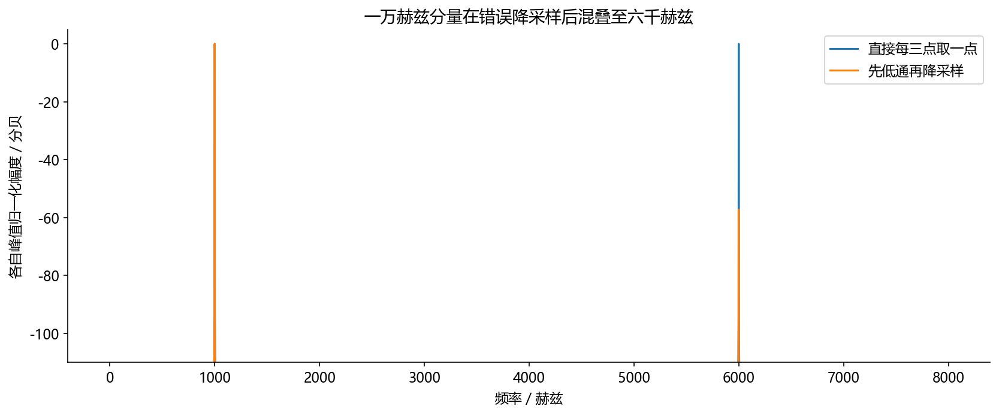

图由 `beginner_labs.py` 的 `resampling()` 运行上面同一信号和处理方式后，进一步计算频谱得到。两条曲线各自按峰值归一化，重点比较 6 kHz 位置：直接抽点保留明显伪分量，正确滤波后它大幅降低。脚本去除边界后测得该分量幅度约从 0.35 降至 0.000477；这个数字只描述本例和本滤波配置，不是所有重采样器的统一性能。

跟着做两步：先把 10 kHz 改成 3 kHz，预测它是否需要被滤掉；再把输入变成双声道，想清楚重采样应沿哪个轴。你会发现“音频长度看起来对了”只验证了时长，不能验证频谱内容正确。数据工程也需要小型信号测试。

## 9. 五道练习与参考答案

1. 32000 个单声道采样，采样率 16 kHz，时长是多少？答：2 秒。
2. 48 kHz、双声道、24 bit、1 分钟的原始 PCM 大小是多少？答：$48000\times2\times3\times60=17280000$ 字节，不含头。
3. 48 kHz 的 1 秒数据只改标签为 16 kHz，播放时长是多少？答：3 秒，不是 1 秒。
4. 为什么不能把所有 WAV 都用 `np.frombuffer(..., int16)`？答：可能是不同位深、浮点或其他子格式，必须依据真实元数据解释。
5. 把数组从 `(16000, 2)` 平均为 `(16000,)`，丢掉了什么？答：两个声道的独立信息，包括可用于定位或波束形成的通道间差异。

## 10. 与实习工作的联系

这节知识对应数据清洗、模型输入规范、格式转换和线上排障。过关不是背出 PCM 全称，而是拿到陌生录音能给出正确的规格报告，并能判断重采样是否改变了时长。请自己写一个 10 行以内的音频信息打印函数，并保留一份“错误采样率标签”的反例说明。下一课会解释为什么这些幅度数字还不能直接叫“响度”。


---

# 第 3 课：峰值、RMS、分贝、SNR 和响度分别是什么

[上一课：数字音频](chapters/02_digital.md) · [返回教程目录](README.md) · [下一课：NumPy 音频入门](chapters/04_numpy.md)

> 前置要求：会看一个波形数组，知道采样率和浮点幅度。目标：看到一个 dB 数值会先问参考量；能算 RMS、峰值和指定 SNR 混噪；不再把 dBFS 当成声压级。建议 90 分钟。与 AGC、降噪、音质测试直接相关。

## 1. 同样最高点的两段声音，平均能量可能不同

想象两盏灯，一盏一直亮，另一盏每秒只闪一下。它们最亮的瞬间可以一样，平均消耗却不同。音频也类似：一个很短的爆音和持续正弦可以有同样峰值，但整体均方值不同。这个类比只讨论“瞬间最大值”与“长期平均”，不能把灯光观感直接当成听觉响度模型。

对长度 $N$ 的浮点信号 $x[n]$，峰值、均方值与均方根 RMS 分别为：

$$
x_{\mathrm{peak}}=\max_{0\leq n<N}\lvert x[n]\rvert,\qquad
P=\frac{1}{N}\sum_{n=0}^{N-1}x[n]^2,\qquad
x_{\mathrm{RMS}}=\sqrt{\frac{1}{N}\sum_{n=0}^{N-1}x[n]^2}.
$$

在阻抗与比例关系固定的条件下，均方值可作为与功率相关的量。不能不写条件就说“任何电压平方就是瓦特”。

一个峰值为 $A$、覆盖整数周期的理想正弦，RMS 为 $\frac{A}{\sqrt{2}}$。所以峰值 0.5 的正弦 RMS 约 0.3536。常见语音不是完整稳定正弦，不能把任何录音的峰值都机械除以 $\sqrt{2}$ 来得到 RMS。

## 2. 分贝不是独立的神秘单位，而是一个比值的对数

功率比常用 $10\log_{10}\!\left(\frac{P_2}{P_1}\right)$。若比较条件相同、功率与幅度的平方成正比，则对应的幅度比可写为 $20\log_{10}\!\left(\frac{A_2}{A_1}\right)$。为什么一个是 10，一个是 20？因为对正幅度比 $a>0$，有 $\log(a^2)=2\log(a)$。不是因为音频喜欢 20、图像喜欢 10。

手算三组就能建立直觉：幅度乘 2，变化约 $+6.02\,\mathrm{dB}$；幅度乘 10，变化 $+20\,\mathrm{dB}$；功率乘 2，变化约 $+3.01\,\mathrm{dB}$。反过来，幅度要提高 6 dB，应乘 $10^{6/20}\approx1.995$，不是乘 6。$-20\,\mathrm{dB}$ 并不表示负能量，而表示幅度比参考值小到十分之一。

还有一个常见陷阱：两个声音各是 60 dB，不能直接相加得到 120 dB。若讨论不相关声源的平均功率，先换回线性功率相加，再转回 dB，等强两路约增加 3 dB。若是同相相干信号，压力/幅度相加会得到不同结果；如果反相，还可能抵消。相加之前先问“相干吗、比较什么量”。

## 3. dBFS：相对于数字满刻度，不是相对于人耳

本教程对归一化浮点数字使用参考幅度 1：

$$
L_{\mathrm{peak,dBFS}}=20\log_{10}\!\left(\frac{x_{\mathrm{peak}}}{1}\right),\qquad
L_{\mathrm{RMS,dBFS}}=20\log_{10}\!\left(\frac{x_{\mathrm{RMS}}}{1}\right).
$$

按这个明确约定，峰值为 1 的完整正弦，峰值是 0 dBFS，RMS 约为 −3.01 dBFS。部分仪表对正弦 RMS 的标定约定不同，所以跨工具比较时要先看定义。

静音的幅度为 0，对数数学上趋向负无穷。代码加 `eps` 只是防止数值报错，或人为设置显示下限，不意味着静音真的有某个固定物理声压。若用 `max(value,1e-12)`，它定义了显示地板，不应拿这个地板去声称设备动态范围。

整数 PCM 的满刻度是编码边界，浮点处理过程中可以出现绝对值超过 1 的数字。它们不一定在内存中立即截断，但输出到某些定点格式或播放链路时可能发生削波。保存前检查峰值是必要的，简单整体缩放也不等于真正的动态处理设计。

## 4. dB SPL：需要声压单位和测量校准

声压级一般写作 $L_p=20\log_{10}\!\left(\frac{p_{\mathrm{RMS}}}{p_{\mathrm{ref}}}\right)$。空气声常用参考声压 $20\,\mu\mathrm{Pa}$，水下常用 $1\,\mu\mathrm{Pa}$；因此水声报告与空气声报告不能只拿数字直接比较。参考量差异本身已是约 26 dB，介质阻抗等物理条件也不同。[英国国家物理实验室 NPL 的单位说明](https://resource.npl.co.uk/acoustics/techguides/concepts/siunits.html)列出了这些参考量。

手算：空气中若 RMS 声压为 $0.02\,\mathrm{Pa}$，与 $20\,\mu\mathrm{Pa}=0.00002\,\mathrm{Pa}$ 的比为 1000，声压级为 60 dB re 20 μPa。你录到的数组 RMS 为 0.02，却不能自动代入这个计算，因为 0.02 可能只是无单位数字。要从数字推声压，需要知道麦克风灵敏度、增益、ADC 标定，或用可靠校准方法建立对应关系。

对你这样的水声背景学生，这一点很关键：课题组里的“声源级”“接收声压级”和互联网语音数据中的“数字幅度”有联系，但不是同一个标签。简历可以写校准、建模和验证能力，不能把未校准的浮点值写成声压测量成绩。

## 5. SNR：先说明信号和噪声分别是哪一条

信噪比 $\mathrm{SNR}=10\log_{10}\!\left(\frac{P_s}{P_n}\right)$，其中 $P_s$ 是目标信号均方值，$P_n$ 是噪声均方值。合成带噪数据时，若希望 $s+\alpha n$ 达到目标 $S\,\mathrm{dB}$，可取：

\[
\alpha=\sqrt{\frac{\operatorname{mean}(s^2)}{\operatorname{mean}(n^2)\,10^{S/10}}}.
\]

上式用于有限目标 SNR，要求目标信号和原始噪声的均方值都大于零。全零噪声不能靠缩放变成所需噪声；全零目标信号也无法定义这里的有限信噪比。

例如目标语音均方值 0.01、原始噪声均方值 0.04，目标 10 dB，则 $\alpha=\sqrt{\frac{0.01}{0.04\times10}}\approx0.1581$。缩放后噪声均方值是 0.001，刚好是语音的十分之一。

这里使用整段均方值。语音有较长静音时，“整段 SNR”和“只在有效语音区域算的 SNR”会不同，论文、数据增强和评测必须保持口径一致。真实单通道录音只有混合波形时，通常没有干净参考，不能直接用一个公式准确知道真实 SNR。

## 6. 一段可运行代码，把四个量算出来

整段在课程根目录 `audio-course-zh` 下运行，依赖 NumPy 和 Matplotlib。末尾保存本段信号的电平图，不播放声音。

```python
import numpy as np

fs = 16000
t = np.arange(fs) / fs                 # 一秒，包含整数个纯音周期
s = 0.5 * np.sin(2 * np.pi * 1000 * t)
rng = np.random.default_rng(7)         # 固定随机种子，便于复现
n = rng.normal(size=s.shape)
target_snr = 10.0
# 用实际这段噪声的均方值缩放，而不是假设它恰好等于 1。
ps, pn = np.mean(s ** 2), np.mean(n ** 2)
alpha = np.sqrt(ps / (pn * 10 ** (target_snr / 10)))
noise = alpha * n                     # 单独保存实际加入的噪声
y = s + noise

# 峰值看最大瞬间，RMS 先平方、平均，再开根号。
peak = np.max(np.abs(s))
rms = np.sqrt(np.mean(s ** 2))
peak_dbfs = 20 * np.log10(max(peak, 1e-12))
rms_dbfs = 20 * np.log10(max(rms, 1e-12))
measured_snr = 10 * np.log10(ps / np.mean(noise ** 2))
print("峰值/RMS:", peak, rms)
print("峰值 dBFS / RMS dBFS:", peak_dbfs, rms_dbfs)
print("构造的 SNR:", measured_snr)
print("混合音频峰值:", np.max(np.abs(y)))

# 用同一组信号画图：左边看波形，右边比较 RMS 数字电平。
from pathlib import Path
import matplotlib
matplotlib.use("Agg")
import matplotlib.pyplot as plt
plt.rcParams.update({"font.family": "Microsoft YaHei", "axes.unicode_minus": False})
assert Path("tutorial/chapters").is_dir(), "请在 audio-course-zh 根目录运行"
fig, axes = plt.subplots(1, 2, figsize=(11, 4.5), layout="constrained")
axes[0].plot(t[:80]*1000, s[:80], label="干净纯音")
axes[0].plot(t[:80]*1000, y[:80], alpha=0.7, label="加入噪声")
axes[0].set(xlabel="时间／毫秒", ylabel="数字幅度", title="前五毫秒波形")
axes[0].legend()
levels = [20*np.log10(np.sqrt(np.mean(v**2))) for v in (s, noise, y)]
axes[1].bar(["目标", "噪声", "混合"], levels)
axes[1].set(ylabel="RMS 电平／dBFS", title="目标与噪声电平相差十分贝")
fig.savefig("tutorial/figures/ch03_snr_levels.png", dpi=150)
plt.close(fig)
```

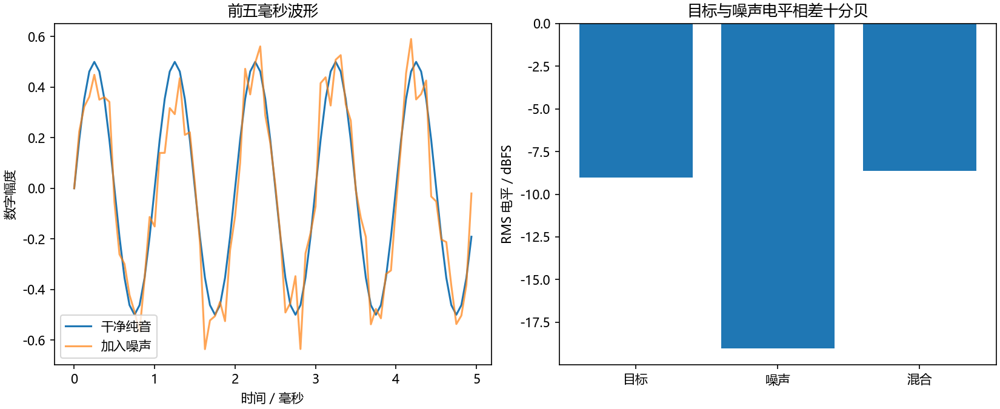

右图目标与噪声的 RMS dBFS 相差 10 dB，与功率比定义一致；混合电平不是前两根柱子的算术和。左图看的是同一段混合后的前 5 ms，只是为了看清波形，不能用这 5 ms 的视觉起伏替代完整 1 秒的 SNR 计算。

`s`、`n`、`noise` 和 `y` 都是 `(16000,)`。`mean` 把一个数组归约成一个数，`alpha` 是标量，乘数组时广播到每一个采样。`noise` 单独保存非常重要：如果只保存混合后的 `y`，之后就不能靠简单相减均方值来获得可靠的同一定义噪声功率。

理论预期：峰值 0.5，RMS 约 0.353553；峰值约 −6.0206 dBFS，RMS 约 −9.0309 dBFS；构造的 SNR 在浮点误差范围内等于 10 dB。混合峰值依赖这段噪声样本，不能用“目标 SNR 是 10 dB”保证不会削波。请运行后记录你的输出，不要把本段理论值当作真实设备测试。

本次实际运行上述代码，构造 SNR 为 `9.999999999999998 dB`，混合峰值约 `0.892200`，峰值与 RMS 的结果符合前述计算。这是数学合成数据验证，不是从真实录音准确估出了未知噪声。

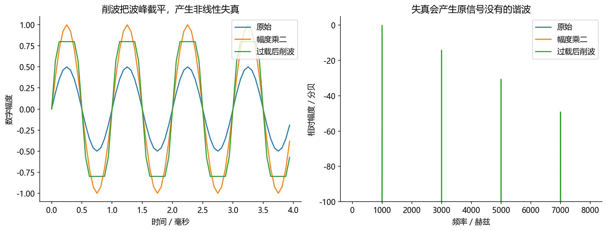

图来自 [beginner_labs.py](code/beginner_labs.py) 的 `levels()`，它使用同样的半幅 1 kHz 正弦，但扩展操作是“增益翻倍”和“过载削波”，不是上方随机混噪。左图看削波后的平顶；右图看原先没有的谐波，说明限制最高点也可能改变音色。实际脚本测得幅度翻倍增加约 6.0206 dB。右图幅度谱按自己的频谱计算约定显示，不能称为经过声压校准的测量图。

## 7. LUFS、响度、动态范围与削波

响度是听觉感知概念；RMS 是数学统计量。LUFS/LKFS 等节目响度度量使用指定的频率加权、声道处理及测量规则，不能用一句“就是 RMS 换单位”代替。True Peak 又关心重建波形可能出现的采样间峰值，不等于数组最大采样值。需要正式测量时应使用实现相应规范的工具，并记录设置；[ITU-R BS.1770](https://www.itu.int/rec/R-REC-BS.1770-5-202311-I/)规定了节目响度与真峰值相关算法。

峰均比（crest factor）可用 $20\log_{10}\!\left(\frac{x_{\mathrm{peak}}}{x_{\mathrm{RMS}}}\right)$ 表示。完整正弦约为 3.01 dB，脉冲型信号可以大很多。AGC 试图调节整体电平，压缩器随电平改变增益，限幅器侧重限制峰值，它们不是完全相同的工具。先学会把目标写成“希望短时 RMS 稳定且不引入明显失真”，比笼统说“让声音更大”更有工程意义。

## 8. 一个真实工作式的小案例：怎么解释“增强后更安静”

假设同事说降噪输出更安静，你首先不应问“是不是网络没训好”，而应拆成三个问题：目标语音有没有被压低，噪声有没有被压低，播放链路有没有改变。把输出峰值归一化后再听，可能掩盖语音损失；把所有样本逐条归一化到同一峰值，也可能让静音段的噪声被意外放大。

做对比时保留未经后处理的输出，同时标注是否有统一播放增益。若有干净参考，先对齐时间与长度，分开检查目标保真和残留噪声。没有参考时，不能把“整体 RMS 更小”直接当成降噪成功：把所有样本乘 0.001 也会更小，但内容同样被抹掉了。

再设想一段录音前 9 秒静音、最后 1 秒有人说话。按整段算 RMS，语音能量被分摊到 10 秒；只在说话区域算，数值会大很多。这里没有谁天生算错，错的是没说明统计区域就把两个数放一起比较。项目报告应写时间窗、有效区间、参考量以及是否经过归一化。

现在做一个不需要新代码的预测：在本课 `s` 前面拼接 1 秒全零，噪声只在原来 1 秒出现和噪声覆盖完整 2 秒，计算的整段 SNR 是否相同？前一种只是同时增加静音，信号与噪声的均方都减半，SNR 不变；后一种噪声还持续存在，整段 SNR 会下降。能解释这点，你就能开始审查数据增强脚本的口径了。

## 9. 练习、答案和就业验收

1. 幅度降低到一半，dB 变化是多少？答：约 −6.02 dB。
2. 峰值 0.2 的完整正弦，按本课定义峰值和 RMS dBFS 各是多少？答：约 −13.98 和 −16.99 dBFS。
3. 整段录音统一乘 0.5，已有的 SNR 是否变化？答：目标与噪声同时缩放且无额外失真时不变，但绝对数字电平降低。
4. 目标 SNR 相同，为什么一个增强数据集更难？答：噪声类型、时频重叠、混响、有效语音口径、说话人和设备差异仍可能不同。
5. 能否把普通录音的 −20 dBFS 直接换算为 74 dB SPL？答：不能，缺少测量链路校准关系。

实习验收任务：给 20 条音频统计时长、峰值、RMS、削波比例和静音比例，先写清每个统计量的口径；再构造 0、5、10 dB 三档带噪样本，保留干净语音和实际加入的噪声。报告里区分“数字电平”“信噪比”“感知评价”，不要只写一个没有参考量的 dB。


---

# 第 4 课：用 NumPy 真正读懂一段音频

[上一课：分贝与响度](chapters/03_decibels.md) · [返回教程目录](README.md) · [下一课：频谱、卷积与 STFT](chapters/05_spectrum.md)

> 前置要求：会打开 Python 脚本并运行，会使用变量和简单四则运算。目标：一眼看懂 `[时间,声道]`、`[帧,采样]` 的区别；会安全计算 RMS、分帧和按声道增益；遇到报错能从形状与数据类型定位。建议 2 次各 60 分钟，不要只看代码不运行。

## 1. 数组不是声音本身，它是一张带规则的数字表

单声道波形可以用 `[0.1, 0.2, -0.1, ...]` 表示。数组保存这些值，但它本身通常不保存采样率。相同 16000 个数字，按 16 kHz 解释是 1 秒，按 8 kHz 解释是 2 秒。因此，一个音频输入通常至少需要“采样数组＋采样率”两个部分。

把二维数组想成表格很有帮助：行可以表示时间，列可以表示声道。例如 `audio.shape == (16000, 2)`，在本课约定下就是 16000 个时刻、两个声道。注意这只是约定，不是 NumPy 自动识别出的物理意义。若某个库返回 `(2,16000)`，你必须按它的规则解释，不能因为第一维小就擅自改动。

`shape` 告诉你每个维度有多长；`ndim` 告诉你有多少个维度；`dtype` 告诉你每个数字怎么存。`len(audio)` 只返回第一维长度，不是数组总元素数。`audio.size` 才是总元素数。对 `(16000,2)`，前者为 16000，后者为 32000。

## 2. 轴和归约：你想保留什么，就不要把它平均掉

`axis=0` 指第一维，`axis=1` 指第二维。设数据形状 `[时间,声道]`：沿 `axis=0` 求均值，会把所有时刻合并，得到每个声道的一个均值，形状 `[声道]`；沿 `axis=1` 求均值，会把声道合并，得到每个时刻的一个值，形状 `[时间]`。

先手算一张小表：`[[1,3],[5,7]]`。沿时间轴平均是 `[3,5]`，沿声道轴平均是 `[2,6]`。两者都能运行，都没有语法错误，但回答的是完全不同的问题。音频代码最危险的错误经常不是程序报错，而是维度错了还照样给出数字。

广播（broadcasting）是让兼容形状做逐元素运算的规则。`[时间,声道]` 乘 `[声道]` 可以给各声道分别加增益，因为从最后一维对齐时对应。若要给每个时间点一个增益，可用 `[时间,1]`。缺少这个 1，可能无法匹配，也可能在某些巧合长度下算错而不报错。NumPy 的正式规则是从末维向前比较，维度长度相同或其中之一为 1 才兼容。[官方广播说明](https://numpy.org/doc/stable/user/basics.broadcasting.html)可用于核对边界情况。

## 3. 第一段核心代码：两声道，不要写两套循环

```python
import numpy as np

# 行是时间，列是声道；这里只放 4 个时刻，方便手算。
audio = np.array([[0.1, 0.2], [0.2, 0.4],
                  [-0.1, -0.2], [-0.2, -0.4]], dtype=np.float64)
gains = np.array([1.0, 0.5])       # 左声道不变，右声道幅度减半
adjusted = audio * gains          # (4,2) 乘 (2,)，按末维广播
channel_rms = np.sqrt(np.mean(adjusted ** 2, axis=0))
mono = adjusted.mean(axis=1)      # 仅在允许混音时合并声道
print("输入/输出形状:", audio.shape, adjusted.shape, mono.shape)
print("每声道 RMS:", channel_rms)
print("混音结果:", mono)

# 单个数与切片的维度不同，接口对接时要主动检查。
print("第一列:", audio[:, 0].shape)    # (4,)
print("保留第二维:", audio[:, :1].shape)  # (4,1)
```

代码中先平方、再沿时间平均、再开根号，所以得到“每声道 RMS”，不是整个数组的一个 RMS。预期两个声道处理后相同，各自 RMS 约 `0.158114`，混音为 `[0.1,0.2,-0.1,-0.2]`。一维 `(4,)` 和二维 `(4,1)` 都只有四个数，却可能与后续数组产生完全不同的广播结果。把 `shape` 打印出来不丢人，省下一次错误训练才重要。

这段是数值与形状练习，没有生成图文件；下一段会把相同的“行列规则”用已运行的分帧图展示，避免把不对应的图片冒充这四个采样的运行结果。

## 4. 从长波形切出短帧：为什么同一个点会出现多次

语音随时间变化，我们常每隔一小段时间看一个短窗口。窗口长度 $L$ 表示每帧有多少采样，帧移 $H$ 表示下一帧从哪里开始。若 $H<L$，相邻帧重叠。重叠不是复制出新的信息，而是让不同窗口观察同一部分数据。

例如 16 kHz 下，25 ms 对应 $0.025\,\mathrm{s}\times16000\,\mathrm{Hz}=400$ 点，10 ms 帧移对应 160 点。不补零、只保留完整帧，且满足 $N\geq L>0$、$H>0$ 时，信号的帧数为：

$$
N_{\mathrm{frames}}=1+\left\lfloor\frac{N-L}{H}\right\rfloor.
$$

1 秒 16000 点对应 $1+\left\lfloor\frac{15600}{160}\right\rfloor=98$ 帧。使用中心补零的库可能返回不同帧数，所以看到“别人是 101 帧”应先查规则。

```python
import numpy as np

x = np.arange(10)                 # 原始波形：编号 0 到 9
length, hop = 4, 2                # 每帧 4 点，下一帧前进 2 点
starts = range(0, len(x) - length + 1, hop)
frames = np.stack([x[i:i + length] for i in starts])
print("帧矩阵形状:", frames.shape)
print(frames)                     # 每行是一帧，每列是帧内位置
print("逐帧均值:", frames.mean(axis=1))

# 在课程根目录运行；把这一段实际计算的 frames 直接画出来。
from pathlib import Path
import matplotlib
matplotlib.use("Agg")
import matplotlib.pyplot as plt
plt.rcParams.update({"font.family": "Microsoft YaHei", "axes.unicode_minus": False})
assert Path("tutorial/chapters").is_dir(), "请在 audio-course-zh 根目录运行"
fig, ax = plt.subplots(figsize=(9, 4), layout="constrained")
ax.imshow(frames, cmap="Blues", aspect="auto", vmin=0, vmax=9)
for row in range(frames.shape[0]):
    for col in range(frames.shape[1]):
        ax.text(col, row, str(frames[row, col]), ha="center", va="center",
                color="white" if frames[row, col] > 5 else "black")
ax.set(xticks=range(length), yticks=range(len(frames)),
       xlabel="帧内采样位置", ylabel="帧编号", title="本段代码生成的重叠帧")
fig.savefig("tutorial/figures/ch04_frames.png", dpi=150)
plt.close(fig)
```


这张图来自紧挨着它的代码，不是预先手绘的矩阵。请用鼠标或手指从第二行第一格顺着读一遍，你读到的就是第二帧的四个采样。若改帧移，行间重复关系也会相应改变。绘图部分额外需要 Matplotlib，使用静态后端，不弹出窗口。

图中第一行是 `[0,1,2,3]`，第二行从 2 开始；数字 2、3 在两行出现，直观展示了重叠。列不是声道，而是帧内位置。预期矩阵形状 `(4,4)`，逐帧均值 `[1.5,3.5,5.5,7.5]`。[beginner_labs.py](code/beginner_labs.py) 的 `frames_and_stream()` 使用同一组输入，运行记录见 [beginner_results.json](results/beginner_results.json)；这里不再重复放第二张相同内容的图。

这个最小示例假设 `hop>0`，且输入至少有一帧长。真实数据如果短于 `length`，`starts` 会为空，`np.stack` 就会报错。工程实现应明确选择“补零形成一帧”或“跳过并记录”，而不是让异常数据悄悄进入训练；不同选择也会影响有效长度和损失掩码。

这里用 `stack` 是为了易读，长音频大量复制会增加内存。后续可以学习滑窗视图与批处理，但先不要为了优化写出自己无法验证的索引。更不能把每一帧都当成独立录音随机划分训练集和测试集，同一原始录音的相邻帧高度相关，会造成泄漏。

## 5. 整数、浮点和数值安全

音频文件可能返回 `int16`，而训练模型通常期望浮点。先转浮点再平方，避免整数溢出；先转浮点再取绝对值，也能避开最小负整数的边界问题。`float32` 常用于模型训练，`float64` 适合某些教学验证和高精度数值计算，但不是所有任务都需要后者。

```python
import numpy as np

pcm = np.array([-32768, 0, 16384, 32767], dtype=np.int16)
x = pcm.astype(np.float64) / 32768.0  # 先转换，随后才计算
if x.size == 0 or not np.isfinite(x).all():
    raise ValueError("音频必须是非空、有限数值")
peak = np.max(np.abs(x))              # 不直接对 int16 最小值取绝对值
rms = np.sqrt(np.mean(x ** 2))
print("归一化采样:", x)
print("峰值/RMS:", peak, rms)
```

预期归一化值为 `[-1,0,0.5,0.999969...]`，峰值为 1。`isfinite` 同时检查 NaN 和正负无穷。不要把报错的 NaN 全部替换成 0 就宣布修复：先找它为什么出现，例如 `log(0)`、除以零、空切片或训练溢出。本块是边界数值检查，无独立绘图结果。

## 6. 读取真实音频：接口、路径与报错

第 2 课的 `wave` 内存例子已经演示过完整读写。实际工程可以选支持目标格式的音频库，但每次读入后统一执行体检：形状、数据类型、采样率、时长、范围、有限性。文件路径应明确；工作目录不一定等于脚本所在目录。Windows 路径里反斜杠可能被当作转义，使用 `pathlib.Path` 或原始字符串可以减少错误。

`FileNotFoundError` 首先检查路径是否存在、当前工作目录在哪里；`ModuleNotFoundError` 首先检查安装库的 Python 是否就是当前解释器；`ValueError: operands could not be broadcast together` 先逐个打印参与运算的形状；`IndexError` 先核对维数以及下标范围。不要看到每个错误都先重装环境。

切片还存在“视图”问题：`part=x[:100]` 可能共享原数据，修改 `part` 会改到 `x`。想明确独立副本可用 `.copy()`。这在制作干净语音与带噪版本时很重要，否则可能原本打算只改噪声样本，结果把干净参考也污染了。

## 7. 跟着定位一次“不报错但结果不对”的问题

现在假设你要给左右两路分别计算音量，却写成 `np.sqrt(np.mean(audio**2))`。程序成功返回一个数，为什么不对？不要先去改 `sqrt`，先问最终应该保留几个数。双声道各一个，应该保留声道维；当前 `mean` 没写轴，把时间和声道一起平均掉了。补上正确的 `axis=0`，再检查输出是不是 `(2,)`。

下一步故意把 `audio` 转置，但保持原来的计算代码不变。程序仍可能跑通，这次输出变成了每个时刻的统计。正确做法不是看哪个结果“更像”，而是在接口处记录布局，必要时显式转换一次，然后让后续函数统一遵守约定。可以给函数命名 `rms_per_channel_time_first`，或者写清输入注释；清晰名称比在十处代码里猜维度有效。

最后检查测试是否太容易：若左右声道一模一样，许多错误不容易暴露。测试应故意让两路幅度不同，再用很短的数组手算答案。实际工程中的单元测试往往就这么小，但能很快抓住一大类形状错误。学会构造能“区分对错”的输入，比只拿随机长录音跑一遍更有价值。

## 8. 自测与参考答案

1. `(48000,2)` 的音频，48 kHz，时长、总元素数分别是多少？答：1 秒、96000。
2. 对 `[时间,声道]` 求每声道 RMS，应沿哪个轴平均？答：沿时间轴，也就是本课的 `axis=0`。
3. `(100,2)` 乘 `(100,)` 能否直接给每个时间点加增益？答：一般不能，应把增益改成 `(100,1)`，如 `gain[:,None]`。
4. 10 个采样、窗长 4、帧移 3，不补零时有几帧？答：3 帧，从 0、3、6 开始。
5. 为什么需要先 `astype(float)` 再平方？答：防止定长整数溢出，保证能得到所需的数值范围与精度。

## 9. 实习验收：能定位形状错误，比背函数名重要

请写一个 `describe_audio(samples, fs)`，拒绝空数组、非正采样率和非有限数值；输出时长、声道数、数据类型、峰值和 RMS。再给它测试单声道、双声道、空输入与 NaN 输入。你不需要第一天就搭完整训练框架，但需要证明“输入坏了时我能及时发现”。下一课把 `[帧,采样]` 转成 `[帧,频率]`，频谱就不再只是彩色图片。


---

# 第 5 课：卷积、频谱、窗函数与 STFT——听见声音的内部结构

[上一课：NumPy](chapters/04_numpy.md) · [返回教程目录](README.md) · [下一课：Mel、MFCC 与音高](chapters/06_features.md)

> 前置要求：知道频率、采样率、数组形状；做过上一课的分帧。目标：解释卷积的物理意义，识别 FFT 频率轴，理解加窗的代价，完成一次带相位的 STFT 重建。建议分两次学习，每次 90 分钟。公式不是背诵目标，能把它与代码对上才是。

## 1. 卷积：每个历史采样留下多大影响

假设房间会让一次拍手变成“立即一声＋稍后较小的一声”。用脉冲响应 $h[n]$ 表示这间房间对单个理想脉冲的响应，那么连续说话就是许多微小激励的响应叠加。线性时不变近似下：

\[
y[n]=\sum_k h[k]x[n-k].
\]

$x$ 是输入，$h$ 是脉冲响应，$y$ 是输出。$k$ 表示回看多少采样。直观上，输出是“当前及历史输入按权重相加”。像一道菜每次加入一勺原料，锅里的味道保留过去的影响；类比只强调记忆与叠加，真实系统若有削波、自动增益或时变路径，就不能完全用固定线性卷积描述。

手算 `x=[1,2,3]`，`h=[0.5,0.5]`，边界外输入视为 0，完整卷积为 `[0.5,1.5,2.5,1.5]`。例如第二个输出是 $0.5\times2+0.5\times1=1.5$。最后一个值不是 0，因为输入结束后系统还有历史影响。长度是 $3+2-1=4$，这会影响音频对齐和评测裁剪。

```python
import numpy as np

x = np.array([1.0, 2.0, 3.0])    # 三个输入采样
h = np.array([0.5, 0.5])         # 当前和前一采样各占一半
y = np.convolve(x, h, mode="full")  # 保留卷积尾巴
print("完整卷积:", y)
print("输出长度:", len(y))
```


上面的最小代码预期输出 `[0.5,1.5,2.5,1.5]`。图由 [beginner_labs.py](code/beginner_labs.py) 的 `filter_and_room()` 生成，是同一原理的扩展实验，不是四个输出点的绘图：左上给出 9 个相等滤波权重；右上显示它对不同频率的影响并不相同；左下用三根脉冲表示直达声和两次反射；右下是另一个独立的理想指数衰减模型，不能把两幅下图误认为同一个房间的测量。

## 2. DFT 在问：“这段数据含有多少这种旋转节奏？”

傅里叶变换把信号表示为不同频率成分的组合。对长度 $N$ 的离散片段，DFT 为：

\[
X[k]=\sum_{n=0}^{N-1}x[n]e^{-j\frac{2\pi kn}{N}}.
\]

先不用害怕复数：它把“与余弦像不像”和“与正弦像不像”放在一起，保留了幅度和时间位置的信息。$\lvert X[k]\rvert$ 描述该频率系数大小，$\arg X[k]$ 描述相位。只存绝对值会丢相位，不能指望简单逆变换还原原波形。

FFT 是高效计算 DFT 的算法家族，不是另一种物理频谱。频率格点为 $f_k=\frac{k f_s}{N}$。16 kHz、512 点 DFT 的间隔为 31.25 Hz，索引 $k=32$ 对应 1000 Hz；这里从 $k=0$ 计数，所以它是数组的第33个元素。对实输入，`rfft` 利用共轭对称，只保留非负频率；512 点输入对应 257 个复数系数。[NumPy FFT 文档](https://numpy.org/doc/stable/reference/routines.fft.html)给出了实际的符号和归一化约定。

## 3. 为什么频谱会漏出一片，窗函数又牺牲了什么

你只截取了一段声音。DFT 计算相当于在特定意义上处理这个有限片段的周期延拓；若片段首尾接不上，就会出现额外的边界变化，频谱能量扩散到周围格点，叫谱泄漏。一个频率不正好落在格点上的正弦，尤其容易显出这种现象。

Hann 窗把两端逐渐压低，通常能降低远处旁瓣，但主瓣会更宽。所以加窗不是“使所有分辨率都变好”：想看旁边的小分量与想区分两个非常近的大分量，可能有不同取舍。窗长决定观察的时间范围；补零会让频率采样网格更密，却不会凭空增加原始观测时长。


这张图来自 [run_experiments.py](../code/run_experiments.py) 的实际实验。左图同样两个频率分量，Hann 窗远处泄漏较低，峰附近却更宽；右图是频率随时间上升的合成扫频信号，亮色轨迹从左下走向右上。右图横轴是时间、纵轴是频率、颜色是未校准的功率 dB，不是声压级。它与下面的重建代码属于同类实验，但输入信号不同。

## 4. STFT：把“整段频谱”变成“每个短时刻的频谱”

一句话的前半段与后半段可能完全不同。短时傅里叶变换（STFT）先分帧、再加窗、再逐帧 FFT。结果是一个复数矩阵。本课约定 `[时间帧,频率格点]`，而某些库用 `[频率,时间]`；绘图时经常还要转置，别把显示方向当作储存方向。

以 16 kHz 为例，32 ms 窗长为 512 点，8 ms 帧移为 128 点。大窗通常给出更细的频率结构，但跨越更长时间；小窗更容易追踪突然变化，却更难分辨很近的频率。流式系统还要区分窗长、帧移、前瞻和计算耗时：帧移 8 ms 不代表整个算法延迟必然只有 8 ms。

## 5. 核心代码：保留相位，再把各帧加回去

下面是教学实现，使用对称 Hann 窗、两端补零，以及窗平方归一化。它不是实时处理器，因为提前访问了整段输入。请先预测 `frames` 和 `spec` 的形状，再运行。

```python
import numpy as np

fs = 8000
t = np.arange(4000) / fs
x = 0.3*np.sin(2*np.pi*500*t) + 0.1*np.sin(2*np.pi*1800*t)
length, hop = 256, 64
window = np.hanning(length)       # 窗在两端接近/等于零
padded = np.pad(x, (length, length))  # 让原信号两端也被有效窗覆盖
extra = (-(len(padded) - length)) % hop
padded = np.pad(padded, (0, extra))   # 补齐最后一个完整帧
starts = np.arange(0, len(padded) - length + 1, hop)
frames = np.stack([padded[s:s+length] for s in starts])
spec = np.fft.rfft(frames * window, axis=1)  # 保留复数，不只保留绝对值

# 每帧逆变换，再乘合成窗，放回原来的时间位置。
back_frames = np.fft.irfft(spec, n=length, axis=1)
output = np.zeros_like(padded)
weight = np.zeros_like(padded)
for start, frame in zip(starts, back_frames):
    output[start:start+length] += frame * window
    weight[start:start+length] += window ** 2

# 分析窗和合成窗各乘一次，所以累计的是窗的平方。
valid = weight > 1e-12
output[valid] /= weight[valid]
restored = output[length:length+len(x)]  # 去掉人为补的边界
print("分帧/STFT 形状:", frames.shape, spec.shape)
print("最大重建误差:", np.max(np.abs(restored-x)))

# 从本段实际 spec 和 restored 绘图；请在课程根目录运行。
from pathlib import Path
import matplotlib
matplotlib.use("Agg")
import matplotlib.pyplot as plt
plt.rcParams.update({"font.family": "Microsoft YaHei", "axes.unicode_minus": False})
assert Path("tutorial/chapters").is_dir(), "请在 audio-course-zh 根目录运行"
fig, axes = plt.subplots(2, 1, figsize=(10, 7), layout="constrained")
axes[0].plot(t[:80]*1000, x[:80], label="原信号")
axes[0].plot(t[:80]*1000, restored[:80], "--", label="重建信号")
axes[0].set(xlabel="时间／毫秒", ylabel="数字幅度", title="两条曲线重合")
axes[0].legend()
centers = (starts+length/2-length)/fs  # 减去前端补零对应的时间
frequencies = np.fft.rfftfreq(length, 1/fs)
image = axes[1].pcolormesh(centers, frequencies,
    20*np.log10(np.maximum(np.abs(spec.T), 1e-6)), shading="auto")
axes[1].set(xlabel="帧中心时间／秒", ylabel="频率／赫兹", title="两条水平亮带")
fig.colorbar(image, ax=axes[1], label="未校准幅度谱／分贝")
fig.savefig("tutorial/figures/ch05_stft_rebuild.png", dpi=150)
plt.close(fig)
```


上半图重建曲线与原波形几乎完全重合，不能仅凭肉眼证明完美，所以代码还打印最大误差；本地实际运行为约 `1.67×10⁻¹⁶`。下半图两条亮带对应 500 Hz 和 1800 Hz。两端略超出原始 0—0.5 秒范围，是边界补零及帧中心定义带来的，不是额外录到了声音。

预期形状为 `(68,256)` 和 `(68,129)`。重建误差应接近浮点精度，不要求精确等于 0。为什么分母是窗平方？分析时已经乘一次窗，合成时又乘一次；第 $m$ 帧在采样点 $n$ 的贡献为 $x[n]\,w[n-mH]^2$，其中 $H$ 是帧移。重叠位置按帧累加后，除以对应的窗平方权重和，才能回到 $x[n]$，前提是该权重和非零。如果合成采用不同窗口，则要按对应的乘积关系与重建条件处理，不能死记“任何 STFT 都除窗平方”。

这段绘图代码使用幅度谱的 $20\log_{10}$，颜色标注“未校准”，避免让它被误读为声压级。你也可以改画功率谱，但必须同时换成相应的 $10\log_{10}$ 与参考约定。形状和坐标正确，是让图具有解释价值的第一步。

## 6. 逐步故障实验：故意改错，比再读一遍有效

先把 `spec` 替换成 `abs(spec)` 再逆变换，重建数值会改变，因为所有复数相位信息丢了；本段代码没有播放步骤，先看误差与波形即可。再恢复相位，只注释掉代码中的 `output[valid] /= weight[valid]`，你会看到振幅随重叠权重变化。最后取消边界补零时，要同时调整 `starts` 和最终裁剪位置，再检查开头几个采样；Hann 窗端点为零时，边界可能没有足够信息可恢复。若只删除一行补零却保留旧裁剪规则，长度错位不能当作窗函数失效的证据。

做完这些反例，你就能回答为什么“把频谱弄回时域”不是只调用一次 IFFT。增强模型若修改了幅度、复数谱或相位，重建策略和损失设计都会受影响；很多“声音断断续续”问题来自分帧、窗与状态，而不是网络层数不够。

## 7. 不同图回答不同问题，别被颜色带走

波形适合定位爆音、停顿、削波和大致时序；整段频谱适合观察稳定的频率成分，但会混合不同时间的事件；声谱图同时展示时间和频率，却需要选择窗长等参数。同一段音频在这三种表示里不会长得一样，也不应该长得一样。检查一个短促点击声时，小时间窗很有用；研究两个靠得很近的稳定音调时，又可能需要更长观测。

颜色缩放也会影响判断。若两张图分别按自己的最大值归一化，弱信号可能看起来与强信号一样亮；若每张图自动设置颜色上下界，“降噪前后颜色都很鲜艳”也不能说明噪声没变。比较两个结果时，要明确是否使用同一单位、同一参考值、同一颜色范围。图题里写“各自归一化”与“共同参考”是两种不同实验。

一个实习报告里，图不应只是装饰。请在图下注明采样率、窗长、帧移、幅度或功率、颜色参考，然后用一句话指出读者应该看哪里。例如“观察 0.2 秒附近的宽带竖线，它对应一次短促冲击”，比“结果如图所示”更像一个真正做过分析的人。

## 8. 自测与参考答案

1. 16 kHz、400 点 DFT，频率间隔是多少？答：40 Hz。
2. 输入长 1000，FIR 长 65，完整卷积多长？答：1064。
3. 把 400 点片段补零到 1600 点，是否等于真实多录了四倍时长？答：不是，只是频谱取样更密。
4. 为什么只保存声谱图颜色一般不能精确恢复音频？答：常已丢相位，还可能做了对数、裁剪和量化。
5. STFT 窗长 32 ms、帧移 8 ms，算法延迟一定为 8 ms 吗？答：不一定，还取决于取窗方式、前瞻、缓存与计算。

## 9. 就业验收任务

录入或选择一条有使用许可的短音频，画波形和带正确坐标的声谱图；解释一段稳定元音、一次瞬态与一段静音在图中的差别。再做“STFT → 原样 ISTFT”回环测试，检查长度、误差和首尾样本。通过这一步再开始写频域降噪，会少掉大量难定位问题。


---

# 第 6 课：Mel、MFCC、F0 和共振峰，给机器看什么特征

[上一课：频谱与 STFT](chapters/05_spectrum.md) · [返回教程目录](README.md) · [下一课：滤波与房间声学](chapters/07_filters.md)

> 前置要求：能解释 STFT 的两个轴，知道幅度谱与功率谱不同。目标：自己算一个 Mel 能量、看懂 log-Mel 与 MFCC 的轴、区分音高和共振峰，知道输入特征必须匹配模型。建议 90—120 分钟。不要求现在记住所有语音特征，但要知道每一步丢了什么信息。

## 1. 为什么不直接把所有数字都交给模型

原始音频一秒可能有 16000 个点。特征提取会把它整理成更适合某些任务的表示，例如每 10 ms 描述一次频率结构。像给一段文章写按主题归纳的笔记：字数变少，结构更清楚，但也可能丢掉细节。这个类比的限制是，笔记没有唯一标准；音频特征同样必须服务具体任务，不能说“越压缩越聪明”。

现代模型既有使用波形的，也有使用 log-Mel 的，还有使用学习到的离散音频 token 的。这里讲传统特征，是为了理解输入与误差来源，不是宣称所有现代语音模型都必须用 MFCC。

## 2. Mel 频率：换一把尺子，再做频带汇总

普通 FFT 的 Hz 格点等间隔。Mel 尺度试图以一种非线性频率刻度组织频带，常使低频处更密、高频处更宽。它是听觉启发的尺度，不等于精确复制人耳。不同实现可能使用 HTK 或 Slaney 等定义，频带归一化也可能不同。[librosa 的 Mel 滤波器官方文档](https://librosa.org/doc/0.11.0/generated/librosa.filters.mel.html)明确区分了这些选项。

本课使用 HTK 风格的变换及其反变换：

$$
m=2595\log_{10}\!\left(1+\frac{f}{700}\right),\qquad
f=700\left(10^{m/2595}-1\right).
$$

$f$ 的单位是 Hz，$m$ 是 Mel 数值。代入 1000 Hz，得到约 1000 Mel；但不要因此误以为所有频率下两把尺子都相等。

把若干三角形权重放在 FFT 频率轴上，计算每个频带的加权能量：

$$
E_b=\sum_k H[b,k]P[k].
$$

$b$ 表示频带索引，避免与上文的 Mel 数值 $m$ 混淆；$P[k]$ 是功率谱，$H$ 是 Mel 滤波器组。若一个小例子的三点功率是 `[1,4,9]`，某频带权重是 `[0.5,1,0.5]`，则能量为 $0.5+4+4.5=9$。它不是取三个数最大值，也不是先把 dB 数值直接相加。

## 3. 为什么取对数，MFCC 又多做了什么

功率变化范围很大，对数可以压缩动态范围。$\ln(E+\varepsilon)$ 使用自然对数，$10\log_{10}\!\left(\frac{E}{E_{\mathrm{ref}}}\right)$ 是以 10 为底的相对功率 dB，两者不能在没有换算时混用。$\varepsilon$ 避免 $\ln(0)$，但它会影响极低能量区域；训练和推理必须一致。本课代码实际采用 $\ln\!\left(\max(E,\varepsilon)\right)$，即把低于阈值的能量抬到地板，再取对数；这与给所有能量都加 $\varepsilon$ 并不完全相同。

MFCC 在 log-Mel 之后，再沿 Mel 频带轴做离散余弦变换 DCT，常保留前若干系数。DCT 不是沿时间轴做的 FFT。保留低阶系数相当于突出频谱包络较平滑的变化，细节会被舍弃。MFCC 图纵轴是倒谱系数编号，不是 Hz，也不是 Mel 频带编号。

第 0 个系数常与 log-Mel 总体水平相关，但是否保留、是否用能量替换、是否进行 liftering，都取决于实现。别人说“13 维 MFCC”还远远不够，你需要完整的前端配置。也不要把倒谱的“倒”理解成对频率取倒数。

## 4. 核心代码：只用 NumPy 做一帧 log-Mel 和 MFCC

下面从一段 32 ms 的合成音开始。它是一帧示例，不含真实语音，也不调用预训练模型。三角滤波器采用峰值型权重；它不保证数值与任何默认库配置完全相同。

代码里的 `power=abs(FFT)**2` 是未做物理校准的功率型谱值，用于说明特征变换；它不是以瓦特计的声功率，也不是已经按 Hz 归一化的功率谱密度。跨库比较数值时，还要检查 FFT、窗函数及单边谱的归一化约定。

```python
import numpy as np

fs, n_fft, bands = 16000, 512, 20
t = np.arange(n_fft) / fs
x = 0.5*np.sin(2*np.pi*500*t) + 0.2*np.sin(2*np.pi*1500*t)
power = np.abs(np.fft.rfft(x * np.hanning(n_fft))) ** 2
freqs = np.fft.rfftfreq(n_fft, 1/fs)  # (257,)，每个格点的 Hz

# 在 Mel 尺度等间隔取端点，再映射回 Hz。
mel_max = 2595*np.log10(1 + (fs/2)/700)
mel_points = np.linspace(0, mel_max, bands + 2)
hz_points = 700*(10 ** (mel_points/2595) - 1)
bank = np.zeros((bands, len(freqs)))
for m in range(bands):
    left, center, right = hz_points[m:m+3]
    rising = (freqs-left)/(center-left)   # 三角形左侧上升
    falling = (right-freqs)/(right-center)  # 右侧下降
    bank[m] = np.maximum(0, np.minimum(rising, falling))

energy = bank @ power                  # (20,257) @ (257,) -> (20,)
log_mel = np.log(np.maximum(energy, 1e-10))
# 构造正交归一化 DCT-II，保留前 13 个系数。
k = np.arange(13)[:, None]             # (13,1)：系数编号
m = np.arange(bands)[None, :]          # (1,20)：Mel 频带编号
dct = np.cos(np.pi*(m+0.5)*k/bands) * np.sqrt(2/bands)
dct[0] /= np.sqrt(2)                   # 第 0 行采用不同归一化系数
mfcc = dct @ log_mel                   # (13,20) @ (20,) -> (13,)
print("功率/Mel/MFCC 形状:", power.shape, log_mel.shape, mfcc.shape)
print("全部数值有限:", np.isfinite(mfcc).all())

# 绘制刚计算的一帧特征，不把单帧图误当成整句语音。
from pathlib import Path
import matplotlib
matplotlib.use("Agg")
import matplotlib.pyplot as plt
plt.rcParams.update({"font.family": "Microsoft YaHei", "axes.unicode_minus": False})
assert Path("tutorial/chapters").is_dir(), "请在 audio-course-zh 根目录运行"
fig, axes = plt.subplots(3, 1, figsize=(10, 8), layout="constrained")
axes[0].plot(freqs, bank.T)
axes[0].set(xlabel="频率／赫兹", ylabel="权重", title="二十个三角频带")
axes[1].bar(np.arange(bands), log_mel)
axes[1].set(xlabel="梅尔频带编号", ylabel="自然对数能量", title="本帧的 log-Mel")
axes[2].bar(np.arange(13), mfcc)
axes[2].set(xlabel="倒谱系数编号", ylabel="系数值", title="前十三个 MFCC：纵值不是赫兹")
fig.savefig("tutorial/figures/ch06_single_frame_features.png", dpi=150)
plt.close(fig)
```

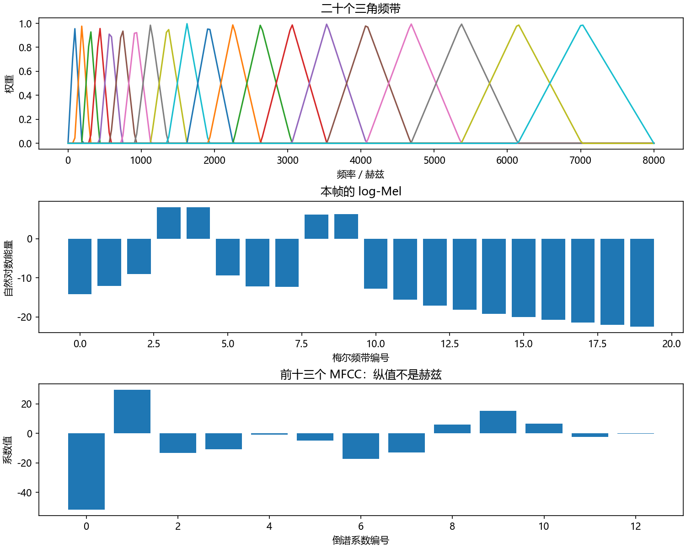

这张图与刚才代码参数完全一致，在课程根目录运行整段即可重建，需要 Matplotlib。上图横轴是 Hz，中、下图横轴则是频带/系数编号。先指出哪一张图还能定位到具体 Hz，再解释后两张为什么不能直接当作原始频谱；这是读懂特征图的重要练习。

先看 `@` 两边的形状：滤波器组的每一行对应一个频带，乘功率向量就是这个频带的加权和；DCT 矩阵的每一行对应一个倒谱系数，乘 log-Mel 又是一次加权和。预期形状为 `(257,)`、`(20,)`、`(13,)`，有限性检查应为 `True`。这比一开始就背“某个 API 返回 80 维特征”更能让你知道程序在做什么。

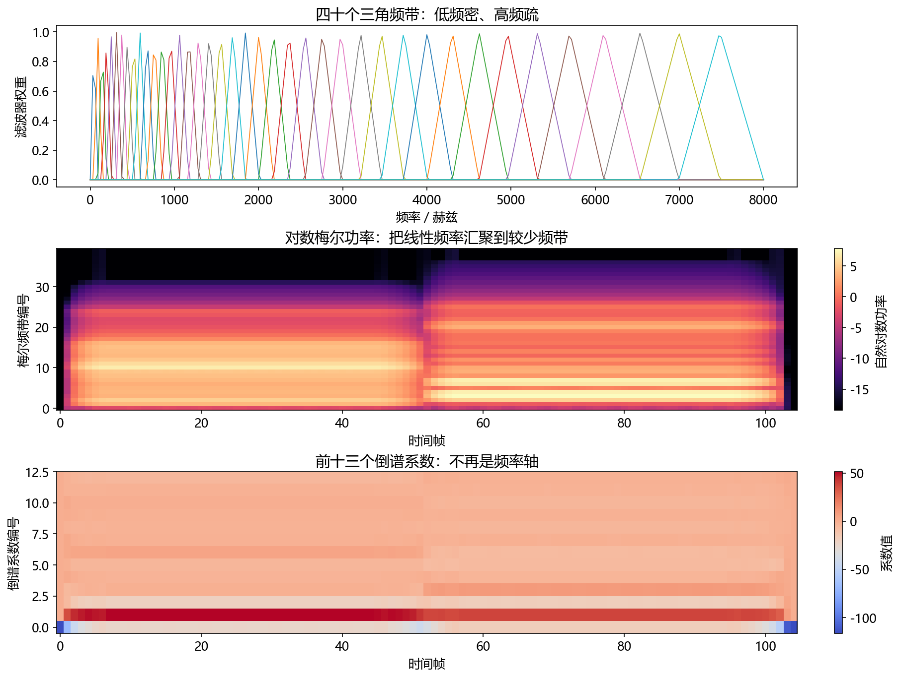

这张图由 [features_lab.py](../code/features_lab.py) 实际生成，使用 [audio_core.py](../code/audio_core.py) 中的特征函数。它是上述计算的多帧扩展，配置为 40 个 Mel 频带和前 13 个 MFCC，而不是本段 20 频带单帧代码的输出。上图看三角频带：高频更宽，低频更密；中图横轴时间帧、纵轴 Mel 频带，亮色表示较大 log 能量；下图纵轴已经换成 MFCC 编号，不能再把第 10 行读成某个具体频率。中间约第 50 帧的变化来自合成信号的切换，不是识别出了某个汉字。

## 5. F0 与共振峰：谁在振，哪里在共鸣

基频 F0 描述近似周期性激励的重复频率；音高是相关但不完全相同的听觉属性。共振峰描述声道共振造成的谱包络峰区。前者可以类比“每秒敲几次”，后者像“容器偏爱放大哪些频率”。类比有用，但真实声带振动与声道存在相互作用，不是完全独立的两个旋钮。

一个简单 F0 估计法是在一帧里找自相关峰。若采样率 16 kHz，重复周期约 80 点，则 $F_0\approx\frac{16000\,\mathrm{Hz}}{80}=200\,\mathrm{Hz}$。但零延迟的自相关通常最大，因此不能把所有延迟直接 `argmax`；还要限制合理搜索区间、识别无声帧、处理倍频和半频错误。最强频谱峰也不一定就是 F0，因为某个谐波可能更强。

共振峰通常比单条谐波更像谱包络的宽峰，不能在任意 FFT 中找最高的三根线就宣布它们是 F1、F2、F3。LPC 等方法有自己的假设、阶数选择和失效场景；噪声、短帧和高基频都会增加难度。实习阶段可先会解释与检查，不必急着从零做一个生产级音高跟踪器。

## 6. CMVN、预加重和差分：能用，但不要无条件加

均值方差归一化 CMVN 常对各特征维度减均值、除标准差，降低某些偏移与尺度差异。但统计范围很重要：整句、每个说话人、整个训练集、滑动窗口，结果都不同。用测试集统计去拟合训练前处理会造成数据泄漏；流式系统也不能在每个时刻偷看完整未来句子来计算整句均值。

预加重常写 $y[n]=x[n]-\alpha x[n-1]$，通常取 $0<\alpha<1$，使高频相对于低频更突出。它曾常用于某些传统语音前端，但不是所有现代模型的默认步骤。已有模型训练时没做，你推理时擅自加上，可能破坏输入分布。

Delta 特征描述特征随时间的变化趋势，传统做法会利用附近若干帧。若使用未来帧，流式系统就增加前瞻；若在句子边缘填充，也会影响结果。不要把“把常见模块全堆上”当成专业，真正专业的是配置能解释、能复现、能与模型一致。

## 7. 输入配置清单，比一个模型名称更有用

拿到 ASR/TTS 模型时至少核对：采样率、声道处理、窗长、帧移、FFT 点数、窗口类型、是否居中补零、幅度还是功率谱、Mel 定义、频带数量、最高/最低频率、对数底与地板、归一化方式。TTS 声码器尤其依赖它训练时的 Mel 规格，形状相同也不代表数值语义相同。

例如两个前端都输出 `[80,T]`，一个用自然对数功率，另一个用幅度 dB，网络接口不会因为“单位错了”自动报错。发现效果差时先逐项对齐配置，再怀疑模型权重。把这张配置清单放进项目 README，比只写“使用 Mel 特征”更有说服力。

## 8. 跟着做一次特征排错

设训练时每秒约 100 帧特征，推理时却只有约 50 帧。先检查帧移是否从 10 ms 变成了 20 ms，再检查是否有模型内部下采样；不要看到时间维不同就直接插值拉长。特征与文字、音素时长或声码器输出长度之间常有明确对应，随意插值可能让接口形状满足，却让时间语义错位。

再设一批录音特征几乎全是同一个很小的数。可能是文件近乎静音，也可能是读取整数时缩放错了、声道平均发生抵消、对数地板设得过高。排查顺序应从原始波形开始，逐步看幅度范围、功率谱、Mel 能量、对数值和归一化结果。每次只打印一个阶段的最小值、最大值和形状，找到在哪一步突然变成常数。

最后提醒一个常见误解：特征标准化之后均值接近零，不意味着声音没有能量；负的 log-Mel 值也不表示负功率。特征空间的数字经过变换，其语义已经改变。先说清表示方式，再解释数值，能避免把正常模型输入误诊成坏数据。

## 9. 五道自测与参考答案

1. Mel 权重 `[0.2,1,0.2]`，功率 `[5,2,10]`，加权能量多少？答：$1+2+2=5$。
2. 为什么不能把 MFCC 第 5 行标注为 500 Hz？答：轴是倒谱系数，不是线性频率。
3. 16 kHz 下周期 100 点，F0 多少？答：160 Hz。
4. 没有明显周期的摩擦音，F0 算法输出 250 Hz，应直接接受吗？答：不应，应检查有声判断与置信度，可能是伪估计。
5. 同样 80 维 Mel，能直接替换某个 TTS 模型的前端吗？答：不能，必须同时匹配全部数值与时间配置。

就业验收：给一个音频模型写一页“输入契约”，记录上述参数；保留一条固定测试音频的特征作为回归测试。再对比去掉归一化、换对数底的结果，解释为什么数值变了。你完成的是可复现的前端工程，不是只会调用一个函数。


---

# 07｜滤波器：让某些声音通过，让另一些声音变小

[返回教程目录](README.md) · [上一课：语音特征](chapters/06_features.md) · [下一课：回声消除](chapters/08_aec.md)

## 本课先拿下什么

你不需要先背完整的滤波器设计理论。本课结束时，应能解释“低通滤波为什么不是把音量整体调小”，手算一个三点平均滤波器，读懂频率响应，并说清 FIR、IIR、EQ 和动态压缩的区别。先修是数组、采样率、正弦波与 FFT；建议分三次学习：直觉和手算 45 分钟，运行代码 60 分钟，改参数与写报告 60 分钟。

先记住一条主线：**滤波器是一条输入序列到输出序列的规则；频率响应是用不同频率的正弦波去探测这条规则。** 对线性时不变滤波器，这两种描述能够互相对应。

## 1. 从一杯晃动的水理解低通，但别把类比当公式

你拿着水杯走路，手的快速小抖动可以被柔软支架减弱，缓慢的位置变化仍能传到杯子。低通滤波也有类似效果：慢变化比较容易保留，快变化受到衰减。不过音频不是“数值小就是低频”。幅值为 0.01 的 6 kHz 正弦仍是高频，幅值为 0.8 的 100 Hz 正弦仍是低频。频率描述变化速度，幅值描述变化大小。

更重要的局限是：有些“噪声”也处于低频，例如空调振动和风噪；有些有用的语音信息在高频，例如部分擦音。低通不是万能降噪。滤波前先问干扰在哪个频带、目标需要保留什么，再决定频率选择。

| 名称 | 操作 | 典型用途 | 不能由此推出 |
|---|---|---|---|
| 低通 | 低频保留得多，高频变小 | 重采样前抗混叠、抑制带外分量 | 高频全是噪声 |
| 高通 | 抑制低频和直流 | 去直流、减小低频扰动 | 能修复麦克风饱和 |
| 带通 | 保留一段频带 | 针对频段分析 | 通过频段一定只有目标 |
| 陷波 | 在窄频带强衰减 | 固定频率电气干扰 | 不会影响同频目标 |

## 2. 手算：三个历史采样怎样变成一个新采样

令输入为 $x=[0,0,3,0,0]$，滤波器规定：

$$
y[n]=\frac{x[n]+x[n-1]+x[n-2]}{3}
$$

未出现的历史输入按零处理，因此 $y[0]=0$，$y[1]=0$，$y[2]=1$，$y[3]=1$，$y[4]=1$。一个尖峰被分摊到连续三个位置。你得到的不是“免费消除尖峰”：输出出现了时间扩展。若这一下本来就是重要的敲击声，它也会被改变。

把三个系数写成 $h=[\frac{1}{3},\frac{1}{3},\frac{1}{3}]$。对于 $L$ 个抽头，通式是：

$$
y[n]=\sum_{k=0}^{L-1}h[k]x[n-k]
$$

这里 $n$、$k$ 的单位都是采样点，$h[k]$ 是无量纲增益，$x$ 与 $y$ 的幅值单位相同。如果输入是归一化 PCM，输出也不是突然变成帕斯卡。

这就是有限冲激响应 FIR：给它一个孤立的单位脉冲，输出只持续有限个采样。三个系数称为三个抽头，阶数是二，不要把“抽头数”和“阶数”写反。

下面片段独立运行，不依赖课程路径：

```python
import numpy as np
from scipy.signal import lfilter

x = np.array([0., 0., 3., 0., 0.])
# 三个系数之和为一：稳定的常量输入不会被放大。
h = np.ones(3) / 3
# 分母 [1.] 表示没有反馈，输出按输入长度截取。
y = lfilter(h, [1.], x)
print(y)  # [0. 0. 1. 1. 1.]
assert np.allclose(y, [0, 0, 1, 1, 1])
```

`h` 是前馈系数；第二个参数 `[1.]` 表示没有反馈项。`lfilter` 返回与输入等长的一段输出，若想观察输入结束后的全部尾巴，要额外补零。`np.convolve(x,h,mode="full")` 则直接返回完整卷积，长度为输入长度加系数长度减一。

自测：若把 `h` 改成 `[1,1,1]` 会怎样？它仍有平滑效果，但直流增益变成三，输出可能超过允许幅度。平滑不等于保持音量。

## 3. 频率响应、相位和群延迟分别回答什么

给滤波器输入 500 Hz 正弦，稳定后测输出幅值和相位；换成 1000 Hz，再测；逐一遍历，就能认识频率响应 $H(f)$。幅频响应回答“这个频率被乘了多少”；相频响应回答“它的周期相位挪了多少”。幅度图常用 $20\log_{10}\lvert H(f)\rvert$，因为比的是幅值，不是功率。

例如 $\lvert H\rvert=0.5$ 对应约 −6.02 dB，$\lvert H\rvert=1$ 对应 0 dB。图上 −60 dB 表示非常小，不等于计算机中恰好为零。截止频率也不是一道无限陡直的门；通常要同时定义通带、过渡带、阻带及允许误差。

群延迟描述频率附近的包络延迟。在角频率单位为弧度/采样时：

$$
\tau_g(\omega)=-\frac{\mathrm{d}\varphi(\omega)}{\mathrm{d}\omega}
$$

结果单位为采样点。换成秒要除以采样率。对称的奇数抽头线性相位 FIR，理想群延迟为 $\frac{L-1}{2}$ 点；在响应为零等相位未定义的位置，不能机械解读数值。

例：65 抽头、16 kHz 的对称 FIR，群延迟为 32 点，即 2 ms。它不是整套应用的总时延，采集缓存、分帧、模型预看和播放缓存还会继续增加时间。频谱幅值很漂亮，也可能不适合低时延通话。

## 4. 实验：真正设计一个低通，再看它改了哪些成分

从课程根目录 `audio-course-zh` 运行下方完整片段。它把图保存到 `tutorial/figures/`，不会自动打开窗口或播放声音。

```python
import numpy as np
from scipy.signal import firwin, lfilter, freqz

fs = 16000
t = np.arange(fs) / fs
# 低频目标与高频分量，便于分别检查保留和抑制。
x = np.sin(2*np.pi*500*t) + 0.3*np.sin(2*np.pi*6000*t)
# 截止频率以 Hz 输入；65 抽头的阶数为 64。
b = firwin(65, 2000, fs=fs)
y = lfilter(b, [1.], x)
# 直接从系数计算两个频率处的响应，不受启动暂态影响。
f, response = freqz(b, worN=[500, 6000], fs=fs)
print("两个频率的增益 dB：", 20*np.log10(np.abs(response)+1e-12))
print("理论群延迟 ms：", 1000*(len(b)-1)/(2*fs))
assert abs(response[0]) > 0.9
assert abs(response[1]) < 0.01

# 同一次运行保存系数与频响，图的参数与上面计算完全一致。
from pathlib import Path
import matplotlib
matplotlib.use("Agg")
import matplotlib.pyplot as plt
plt.rcParams.update({"font.family": "Microsoft YaHei", "axes.unicode_minus": False})
f_all, h_all = freqz(b, worN=2048, fs=fs)
fig, axes = plt.subplots(1, 2, figsize=(11, 3.8))
axes[0].stem(np.arange(len(b)), b)
axes[0].set(title="65 抽头 FIR 的系数", xlabel="抽头序号 / 点", ylabel="系数")
axes[1].plot(f_all, 20*np.log10(np.maximum(abs(h_all), 1e-8)))
axes[1].axvline(2000, color="tab:red", ls="--", label="设计截止频率")
axes[1].set(title="同一滤波器的频率响应", xlabel="频率 / Hz", ylabel="增益 / dB", ylim=(-100, 5))
axes[1].legend()
fig.tight_layout()
out = Path("tutorial/figures/ch07_filter_response.png")
out.parent.mkdir(parents=True, exist_ok=True)
fig.savefig(out, dpi=160)
plt.close(fig)
print("已保存运行图：", out.as_posix())
```

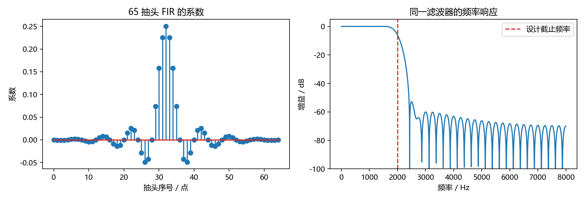

这就是该片段同参数运行后的图：左侧系数关于中心对称，与线性相位相联系；右侧低频接近 0 dB，高频明显衰减。红线是设计截止频率，不是一条“过线立即归零”的边界。看右图时对照打印的 500 Hz 与 6000 Hz 增益，再联系前面算出的 2 ms 延迟。

本轮实际运行输出：500 Hz 约 −0.00046 dB，6000 Hz 约 −68.24 dB，理论群延迟为 2.0 ms。不同库版本可能有细微数值差异；重点是目标基本保留、高频显著衰减，以及延迟没有消失。

第一组正弦让你有一个应该保留的低频目标，第二组是希望抑制的高频成分。`firwin` 生成 65 个系数；`fs=fs` 使截止频率按 Hz 解释。若忘记 `fs`，却继续把 `2000` 当作 Hz，参数意义会出错。

本例还有一个常见面试陷阱：`firwin` 的单个 `cutoff` 按**半幅度点**定义，约为 −6 dB；不要把它默认成某些 IIR 设计中的半功率点 −3 dB。半幅度意味着功率约变成四分之一。比较两种滤波器时，先统一截止点、通带与阻带的定义，不能只让两边都写“2000 Hz”。

`lfilter` 是因果滤波：当前输出只看当前和过去输入。`freqz` 不需要等你把所有正弦都录一遍，它根据系数计算同一件事。断言只核验本例两个频率；不能据此宣称所有通带纹波、阻带与稳定性指标均满足产品要求。


此图来自已运行的 `tutorial/code/beginner_labs.py` 中 `filter_and_room`，结果见 `tutorial/results/beginner_results.json`。上图采用九点等权平均 FIR，不是本节 65 抽头 `firwin` 的即时输出；二者都用于说明滤波，但系数与响应不同。左上看九个相同的抽头，右上看低频总体更容易通过以及明显旁瓣：平均滤波器并非理想低通，不能以为截止以上全部归零。左下三个反射脉冲与右下指数尾音也是两个独立模型，后面声学章节逐一解释。

读图时先找坐标轴：频率响应图的横轴是 Hz，脉冲响应图的横轴是时间或采样点，二者不能直接比较横向宽度。要区分“人为选择频率”与“传播过程产生拖尾”。观察过渡和旁瓣，再看相位或延迟；不要只截图衰减最明显的一段。

## 5. IIR：用上一时刻的输出参与计算

最简单的 IIR 可以写成：

$$
y[n]=0.1x[n]+0.9y[n-1]
$$

它像一个有惯性的追踪器：输入突然变为一，输出先是 0.1，再是 0.19，再是 0.271，逐渐靠近一。脉冲影响会不断递减，理论上没有有限时刻保证严格变为零，所以称无限冲激响应。

系数少不代表可以随便修改。若反馈项改为 $1.1y[n-1]$，一次很小的扰动也可能不断增长。因果有理离散系统的稳定性要检查极点；本例反馈极点 0.9 在单位圆内。高阶 IIR 实现通常优先考虑二阶节形式 SOS，避免直接用高阶多项式时的数值敏感。

不要说“FIR 一定好、IIR 一定差”。FIR 常易得到严格线性相位，可能需要更多抽头；IIR 常能以较少系数实现陡峭响应，但通常相位非线性、实现需注意稳定性。若你使用前后向滤波 `filtfilt`，它借助未来样本得到零相位效果，适合某些离线处理，不可伪装成无需未来数据的实时算法。

`filtfilt` 也不是“保持原滤波器幅频响应，只把延迟去掉”。对实系数滤波器，在忽略有限记录边缘处理影响的频域解释下，前后两次的合成幅度响应为 $\lvert H(f)\rvert^2$，等效阶数加倍；因此原来衰减约 3 dB 的频率，双向处理后会衰减约 6 dB。端点暂态还要单独检查。[SciPy filtfilt 官方文档](https://docs.scipy.org/doc/scipy/reference/generated/scipy.signal.filtfilt.html)

## 6. EQ 与压缩器：一个按频率调，一个按电平调

EQ 调整不同频段的增益，例如轻微削减某段共振；参数包括中心频率、增益和带宽或 Q。提升某频段会占用峰值余量，输出可能削波。不能只听“更响了”就认为音质更好，比较时要控制整体响度。

动态范围压缩器按输入电平改变增益。假设阈值为 −20 dBFS，压缩比为 4:1，输入为 −8 dBFS，超过阈值 12 dB；静态输出高于阈值 $\frac{12}{4}=3\,\mathrm{dB}$，所以是 −17 dBFS，暂不计补偿增益。起控和释放决定增益随时间怎样变化，软拐点决定阈值附近怎样过渡。它与 MP3/AAC 的“数据压缩”不是一回事。

## 7. 常见失败，按这个顺序排查

| 现象 | 优先检查 | 小验证 |
|---|---|---|
| 输出音调完全不对 | 读写采样率是否一致 | 打印文件采样率和数组长度 |
| 每块边界有咔嗒声 | 分块滤波是否丢失状态 | 整段滤波与保留状态分块结果比较 |
| 声音忽大忽小 | 增益控制是否逐帧跳变 | 画增益随时间曲线 |
| 波形和原信号错开 | 群延迟与缓存延迟 | 用脉冲测峰值位置 |
| 输出爆炸或 NaN | IIR 系数顺序、反馈符号、稳定性 | 先输入小幅脉冲，不接真实扬声器 |
| 降噪后发闷 | 有用高频是否被同时削掉 | 对比擦音、听感和下游识别 |

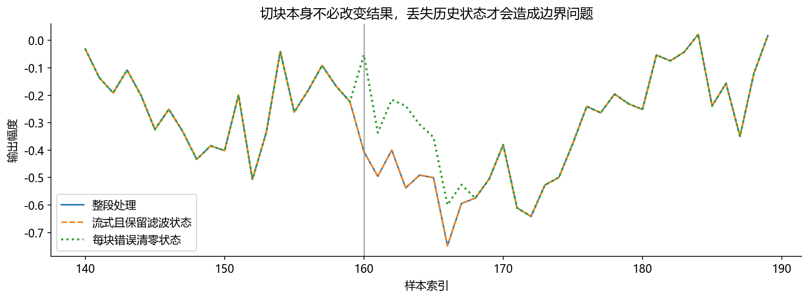

该图也来自已运行的 `tutorial/code/beginner_labs.py`，不是频率响应图。它比较九点 FIR 的整段结果、保留 `zi` 状态的分块结果，以及每块把状态清零的错误结果。观察第 160 点：正确分块应连续贴合整段曲线，错误清零却丢掉前一块最后八点的贡献。完整实验中正确最大误差约 `1.11×10⁻¹⁶`，清零版本约 `1.011`；最后一块只有 71 点，说明程序还要处理不足整帧的尾块。具体样本数只属于该实验，不是任何分块长度都产生同样数字。

## 8. 练习、参考答案与实习作业

练习一：三点平均滤波器输入常数 2，稳定输出是多少？答案是 2，因为系数和为一；开头两点有零初始化的暂态。

练习二：把 65 抽头改为 129，16 kHz 下线性相位群延迟是多少？答案是 64 点、4 ms。注意这只是滤波器部分。

练习三：阈值 −24 dBFS、比例 2:1、输入 −12 dBFS，静态输出是多少？答案是 −18 dBFS，不计起控、释放、软拐点和补偿增益。

实习作业：实现“可分块运行的语音前端滤波器”。交付输入输出 WAV、频响与脉冲响应图、整数与浮点输入处理说明、整段与分块输出误差、处理耗时。比较 33、65、129 抽头，至少写出一个音质—时延折中。做到能解释失败，才比“调用了一个滤波函数”更有简历价值。

下一次学习前合上本章，口头回答：频率和幅值有什么区别？为什么滤波会延迟？为什么每块重新初始化状态可能出问题？答不出来就先跑一次脉冲实验，不急着背更多滤波器名称。

参考：[SciPy firwin 官方文档](https://docs.scipy.org/doc/scipy/reference/generated/scipy.signal.firwin.html)、[SciPy group_delay 官方文档](https://docs.scipy.org/doc/scipy/reference/generated/scipy.signal.group_delay.html)。文档版本可能更新，课程代码按当前本地 SciPy 环境核验。


---

# 08｜AEC 回声消除：先学会预测，再学会相减

[返回教程目录](README.md) · [上一课：滤波器](chapters/07_filters.md) · [下一课：增强与活动检测](chapters/09_enhancement.md)

## 学完本章，你应当能做什么

能解释视频通话回声的来源；用一支笔算出一次 LMS 更新；运行课程的 NLMS；分清残差、残余回声和近端语音；设计双讲、延迟失配、路径变化三类测试。先学第 07 章的 FIR，再读本章。建议用两小时读懂与手算，再用两至三小时完成改参实验。

## 1. 两个人打电话，为什么对方听到自己的声音

你与朋友视频聊天。朋友说的声音从你的扬声器出来，又被你的麦克风收进去，随后网络把它传回朋友那边。朋友就听到了自己的延迟副本。你的任务不是“把录音里的说话声都压下去”，而是保留你自己的声音，去掉从扬声器绕回麦克风的那部分。

AEC，即 Acoustic Echo Cancellation，利用设备知道的播放信号预测回声。可以把它想成一张“房间复印机”的说明书：知道原稿，估计复印过程，然后减掉复印件。但类比有边界：复印过程不是简单乘一个音量系数，它包含传播延迟、墙面反射、扬声器频响、可能的非线性和时钟变化。

因此不能直接做“麦克风减播放参考”。在播放参考出现某个采样时，麦克风可能还没收到；等麦克风收到时，它已经混合了多个历史采样的反射。

| 符号 | 含义 | 单位与形状 |
|---|---|---|
| $x[n]$ | 远端播放参考 | 本例归一化幅值，单通道序列 |
| $h[k]$ | 真实声学路径 | 长度 $L$ 的系数，通常未知 |
| $r[n]=\sum_{k=0}^{L-1}h[k]x[n-k]$ | 进入麦克风的真实回声 | 与麦克风幅值单位相同 |
| $s[n]$ | 本地要保留的近端语音 | 并非噪声 |
| $v[n]$ | 其他背景噪声 | 未必与参考相关 |
| $d[n]=r[n]+s[n]+v[n]$ | 麦克风观测 | 算法实际可见 |
| $\hat y[n]$、$e[n]=d[n]-\hat y[n]$ | 预测回声、输出残差 | 残差不等于纯残余回声 |

记忆方法：参考告诉你“播了什么”，滤波器学习“怎么绕回来”，残差是“减完以后还有什么”。

## 2. 单抽头手算：梯度到底把参数推向哪里

先把所有反射简化成一个音量系数。真实路径是 $h=0.5$，这一刻 $x=1$，没有本地语音或噪声，所以 $d=0.5$。你的初始猜测为 $w=0$，预测 $\hat y=wx=0$，误差 $e=0.5$。

定义需要减小的量 $J=\frac{e^2}{2}$。因为 $e=d-wx$，对 $w$ 的导数为 $-x$，所以 $\frac{\mathrm{d}J}{\mathrm{d}w}=-ex$。梯度下降要减去梯度，因此更新变成：

$$
w_{n+1}=w_n+\mu\,e[n]x[n]
$$

下标 $n$ 表示本次更新，$n+1$ 表示更新后；$\mu$ 是步长。

取 $\mu=0.2$，第一次更新到 `0.1`。下一次若输入还是一，预测为 0.1，误差为 0.4，再更新到 0.18。方向是对的：系数逐渐接近 0.5。**这里的加号不是经验口诀，而是误差定义和求导共同决定的。** 如果换一种误差符号，必须重新检查推导。

现在把本地语音设为 $s=0.8$，麦克风就变成 $d=1.3$。若仍只追求让总残差尽可能小，单抽头可能被推向 1.3，而不是真实路径 0.5。这解释了“双讲时不能盲目相信误差”的直觉：误差里含有要保留的东西。

注意这只是恒定参考、恒定本地分量的手算反例，不能推出“双讲必然把最优系数变成 1.3”。若近端语音与远端参考在统计上不相关，理想均值模型中的目标路径不一定改变；但有限数据下的梯度扰动、较大步长和非平稳语音仍会让跟踪变差。工程上必须同时测近端保真和参数稳定性。

```python
w = 0.0
mu = 0.2
for _ in range(5):
    x, d = 1.0, 0.5
    # 先用旧权重预测，再根据本次误差更新。
    estimate = w*x
    error = d-estimate
    w += mu*error*x
    print(round(w, 6), round(error, 6))
```

先在纸上预测前两行，再运行。这个片段只有一个抽头和恒定输入，仅用于理解更新方向，不是足以辨识真实长路径的输入设计。

本轮实际运行的前两行分别是 `0.1 0.5` 和 `0.18 0.4`；第一列是更新后的参数，第二列是本次更新前计算的误差。第五次参数达到 `0.33616`，尚未达到 0.5，不要把“方向正确”误读成“一步就学会”。

## 3. 从 LMS 到 NLMS：同一步长不该随音量失控

真实路径需要很多抽头。令最近 $L$ 个参考采样组成列向量：

$$
\mathbf{x}_n=\bigl[x[n],x[n-1],\ldots,x[n-L+1]\bigr]^{\mathsf T}
$$

参数向量为 $\mathbf{w}_n$，预测是内积 $\hat y[n]=\mathbf{w}_n^{\mathsf T}\mathbf{x}_n$。上标 $\mathsf T$ 表示转置，粗体表示向量。LMS 更新就是把上面的标量乘法换成向量。

如果参考幅度放大十倍，相关梯度尺度会明显变化，同一个步长容易变得过激。NLMS 用当前参考向量的能量归一化：

$$
\mathbf{w}_{n+1}=\mathbf{w}_n+\mu\,\frac{e[n]\,\mathbf{x}_n}{\mathbf{x}_n^{\mathsf T}\mathbf{x}_n+\varepsilon}
$$

分母中的 $\mathbf{x}_n^{\mathsf T}\mathbf{x}_n$ 是参考向量的平方和，不是“再做一次降噪”，而是把更新大小与输入能量关联起来。$\varepsilon$ 是防止静音附近除零的小正数。它无法修复错误的参考声道，也无法让不足的抽头突然表示几秒钟的回声路径。

下面是课程已测实现的核心思想；完整函数在 [audio_core.py](../code/audio_core.py)。

```python
import numpy as np

def one_nlms_step(weights, history, microphone, mu=0.3):
    # 向量内积模拟当前与历史参考经过估计路径的结果。
    estimate = weights @ history
    error = microphone-estimate
    # 小正数避免静音时分母为零；不解决参考失配。
    energy = history @ history + 1e-8
    new_weights = weights + mu*error*history/energy
    return new_weights, estimate, error

w = np.zeros(3)
history = np.array([1., 0.5, 0.])
w, echo, residual = one_nlms_step(w, history, 0.5)
print(w, echo, residual)
assert np.allclose(w, [0.12, 0.06, 0.], atol=1e-7)
```

本轮实际输出为权重 `[0.12,0.06,0]`、旧参数预测 `0.0`、本次残差 `0.5`。它仍是单步数值核验，不需要画一条虚假的收敛曲线。

`history` 长度等于抽头数，顺序从最新到最旧；`@` 计算内积。`weights` 与 `history` 都是一维数组，不需要误加 batch 维度。函数先用旧参数预测，再用本次误差更新；若更新与预测顺序搞反，你验证的就不是这一步算法。

## 4. 在真实的数组长度上跑一次，但仍承认它是仿真

从课程根目录 `audio-course-zh` 运行下面片段。它只使用合成随机参考，不下载音频，也不接扬声器：

```python
import sys
import numpy as np
from scipy.signal import lfilter
sys.path.insert(0, "code")
from audio_core import nlms

rng = np.random.default_rng(7)
x = rng.normal(0, 0.1, 16000)
h = np.zeros(32)
# 三个反射分量都处于滤波器可表示的 32 抽头之内。
h[[5, 12, 22]] = [0.7, 0.25, -0.1]
true_echo = lfilter(h, [1.], x)
microphone = true_echo + rng.normal(0, 0.0001, len(x))
estimate, residual, trace = nlms(x, microphone, taps=32, mu=0.3)
# 只评后半段，并用已知回声真值隔离背景噪声。
tail = slice(8000, None)
remaining_echo = true_echo[tail]-estimate[tail]
erle = 10*np.log10(np.mean(true_echo[tail]**2) /
                  (np.mean(remaining_echo**2)+1e-12))
print("理想仿真尾段 ERLE：", erle)
assert erle > 20

# 绘制本片段的真实输出与路径学习过程，不调用其他实验的图片。
from pathlib import Path
import matplotlib
matplotlib.use("Agg")
import matplotlib.pyplot as plt
plt.rcParams.update({"font.family": "Microsoft YaHei", "axes.unicode_minus": False})
fig, axes = plt.subplots(2, 1, figsize=(10, 6))
time = np.arange(len(x))/16000
axes[0].plot(time, microphone, alpha=0.55, label="麦克风输入")
axes[0].plot(time, residual, alpha=0.8, label="NLMS 输出残差")
axes[0].set(title="本片段：固定路径、无近端语音", xlabel="时间 / 秒", ylabel="幅值")
axes[0].legend()
# trace 每隔 128 点记录一次参数；这里评估参数误差，不称为 ERLE。
misalignment = np.sum((trace-h)**2, axis=1)/np.sum(h**2)
axes[1].plot(np.arange(len(trace))*128/16000, 10*np.log10(misalignment+1e-12))
axes[1].set(title="估计路径逐渐接近真实路径", xlabel="时间 / 秒", ylabel="归一化路径误差 / dB")
fig.tight_layout()
out = Path("tutorial/figures/ch08_aec_convergence.png")
out.parent.mkdir(parents=True, exist_ok=True)
fig.savefig(out, dpi=160)
plt.close(fig)
print("已保存运行图：", out.as_posix())
```

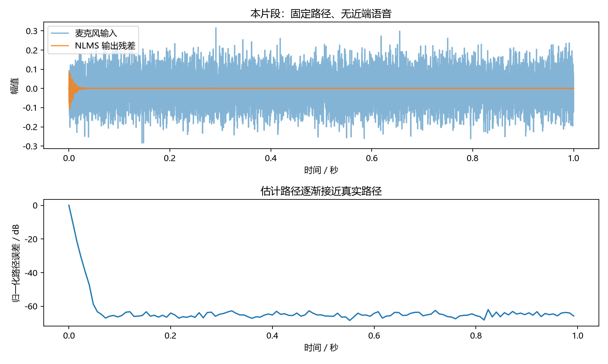

先看上图：开始时残差还较大，随后显著减小。再看下图：估计路径的误差下降后在弱噪声条件下波动，这条纵轴越低越好；它是参数误差，不是越高越好的 ERLE。图中没有近端语音和路径突变，因此还不能评判双讲表现。

本轮运行得到尾段 ERLE 约 64.78 dB，全部断言通过。这个大数字依赖白噪声激励、固定线性路径、正确抽头覆盖和很弱背景噪声，不能外推成实际会议通话性能。

`h` 的三个非零位置表示三个延迟不同、幅度不同的传播分量；负系数允许相位反转，不代表负能量。`lfilter` 生成真实回声。测试只在后半段计算，避免把启动学习与稳态混为一个数字。白噪声参考有丰富激励，线性固定路径又完全匹配，结果会比真实语音设备好得多。

## 5. 三种场景必须分开看

远端单讲：只有扬声器播放，适合学习路径和观察回声抑制。近端单讲：只有本地人在说话，重点是不能误伤本地声音。双讲：双方同时说话，既要减回声，又要保住本地声音，更新策略也更难。

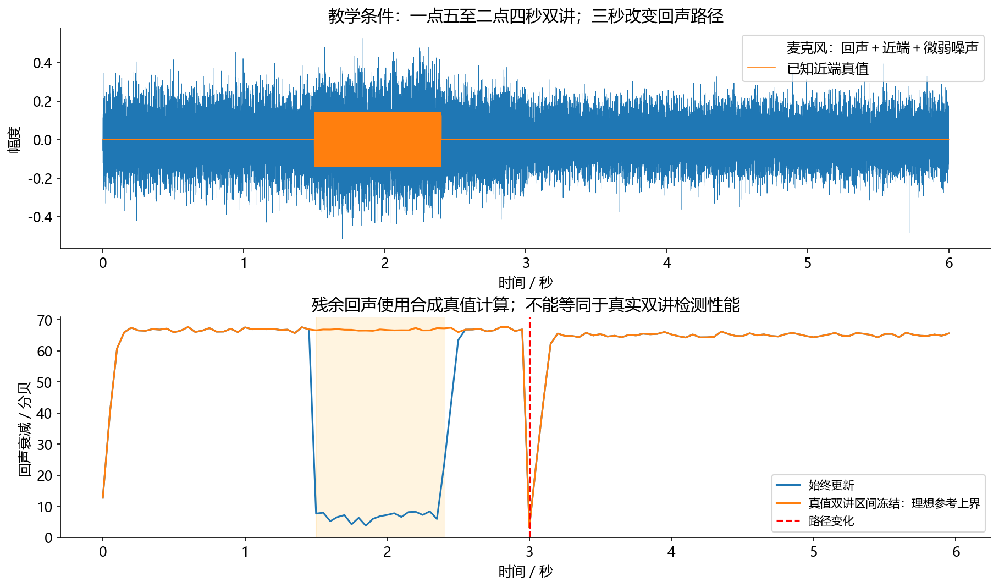

图来自已运行的 `code/run_experiments.py`，记录在 `results/dsp_results.json`。它是下面讨论的完整六秒实验，不是上一节 16000 点小片段的运行截图。上一节看自己的打印值；本图用来研究双讲与路径变化，数据条件不同。

按时间轴读图：前段远端单讲，参数逐渐学到路径；约 1.5—2.4 秒加入本地成分，盲目持续更新会污染参数；3 秒改变声学路径，旧参数不再合适，需要重新学习。曲线暂时掉下去不一定是代码错误，也可能是实验有意改变了环境。

其中“真值冻结”用合成时已知的近端活动位置暂停更新。这是理想对照，不是已经实现了可靠双讲检测，也不是所有条件下的性能上界。课程曾测得该对照在这一实验中显著优于盲目更新，只能用于解释机制，不能直接写成真实通话优化成绩。若双讲期间路径也在变化，完全冻结反而会失去跟踪机会。

ERLE 通常表达消除前后回声能量比。合成实验可以用已知真实回声计算；真实双讲录音没有独立回声真值时，不能拿“回声＋本地语音＋噪声”的总输出硬当纯回声残留。否则把本地语音压没了，指标也可能虚假变好。

## 6. 为什么真实产品远不止几十行 NLMS

首先要找对参考：参考必须对应实际播放内容，并考虑音量、重采样、设备处理与延迟。其次要处理长路径，直接逐样本长 FIR 的运算量可能很大，工程中可使用分块或频域自适应结构。再次要处理双讲、路径突变、采样时钟漂移、参考丢失和扬声器非线性。线性预测后还可能需要残余回声抑制，但不能无限压制近端语音。

WebRTC 的音频处理模块将 AEC、噪声抑制和增益控制等作为配合工作的组件，这能帮助理解产品的系统边界，不表示本教程几十行代码已经达到同等成熟度。[WebRTC APM 官方说明](https://webrtc.googlesource.com/src/+/8c90d57b4151b0a009ce83f85c57dfca8b2e1fe1/modules/audio_processing/g3doc/audio_processing_module.md)

## 7. 排查表：别一失败就把 μ 调大

| 现象 | 先怀疑什么 | 最小验证 |
|---|---|---|
| 一直不收敛 | 参考不对应、延迟超出滤波器范围 | 合成已知 5 点延迟核验 |
| 一大声就失稳 | 步长、削波、扬声器非线性 | 降低输入幅度，查看峰值 |
| 本地说话后效果恶化 | 双讲污染 | 用已知真值冻结做机制对照，不当通用上界 |
| 搬动设备后暂时变差 | 路径改变、跟踪太慢 | 明确切换路径时刻 |
| 长时间后逐渐变差 | 时钟漂移、缓存偏移 | 跟踪参考与麦克风的相对延迟 |
| 指标很好但听不清人声 | 指标把目标语音当干扰 | 单独评估近端失真和双讲 |

## 8. 练习答案与实习交付

练习一：真实路径 0.5、$x=2$、$w=0$、$\mu=0.2$、无近端时，一次 LMS 更新多少？$d=1,e=1$，所以更新后 $w=0.4$；同条件忽略 $\varepsilon$ 的 NLMS 更新为 `0.1`。这说明归一化确实改变了输入幅度敏感性。

练习二：16 kHz、64 抽头覆盖多长的系数窗口？64 个采样约 4 ms；最后一个抽头相对第一个的延迟为 $\frac{63}{16000}$ 秒。真实回声的整体延迟和尾长都要考虑，不能只听见“64”就认为够长。

练习三：双讲时冻结一定最好吗？不一定。冻结能减少近端语音对更新的干扰，却无法同时跟踪正在改变的路径；真值冻结只是利用已知活动标签的理想对照，真实检测还会误判。

实习作业：交付一个 AEC 故障实验集，包含远端单讲、近端单讲、双讲、路径切换、额外延迟、软饱和六种情况。每种保存配置、输入输出、曲线和失败解释。报告起始收敛、路径切换恢复、近端保真及处理耗时，不只报告最大 ERLE。简历可写“实现并评测 NLMS 基线，设计双讲与失配消融”，但只有你实际完成后才能写，且必须标注仿真条件。


---

# 09｜让声音更干净、更稳定：ANS、AGC、VAD 与 KWS

[返回教程目录](README.md) · [上一课：AEC](chapters/08_aec.md) · [下一课：麦克风阵列](chapters/10_arrays.md)

## 学习目标与先修

本章把几个容易混淆的名字变成具体任务。读完应能解释降噪、调音量、检测说话和识别唤醒词为什么不是一回事；能手算维纳增益、AGC 增益与 VAD 挂起时间；能搭起带测量的前端实验。先修是采样率、分帧、STFT、信噪比。建议先花 90 分钟理解链路，再分两次各 60 分钟运行实验和整理错误样例。

第一次学习先完成传统降噪、AGC 和能量 VAD。第 4 节神经降噪先了解输入输出，学完第 12 课训练基础再深入；KWS 先掌握评测方法，不要求本章就训练一个唤醒模型。

## 1. 餐厅里和智能音箱说话：五个模块各管什么

假设音箱正播放音乐，你在较远位置说“你好，打开灯”，旁边还有风扇。AEC 处理设备自己播放回来的声音；ANS/NS 减小未知背景干扰；AGC 调整总体电平；VAD 判断哪些时间有语音；KWS 判断是否出现指定唤醒词。下游 ASR 再把真正的指令识别成文字。

招聘里常说的“3A”通常指 **AEC（声学回声消除）、ANS（自动噪声抑制）和 AGC（自动增益控制）**。VAD 和 KWS 可以与它们配合，但不算这三个 A；ANC（主动噪声控制）也不是 ANS 的另一个名字。

| 模块 | 它回答的问题 | 典型输入输出 | 不能替代什么 |
|---|---|---|---|
| AEC | 哪些声音是设备自己播放回来的？ | 麦克风＋播放参考→残差 | 不能靠线性参考消除所有未知声音 |
| ANS/NS | 哪些成分是背景干扰？ | 音频→增强音频 | 不保证每次都提高 ASR 正确率 |
| AGC | 音量是否处于合适范围？ | 音频＋状态→调电平音频 | 不会自动提高信噪比 |
| VAD | 此刻是否有语音活动？ | 音频帧→概率或标签 | 不认识具体说了什么 |
| KWS | 是否出现某个关键词？ | 音频片段→关键词判决 | 不等于通用语音识别 |

“先清洁、再调音量、再检查内容”是方便入门的理解顺序，不是所有产品唯一的执行顺序。VAD 可以在多处参与控制，数字与模拟增益也可能分层。AEC 的参考和麦克风之间若经过了不一致处理，还会破坏回声建模；设计链路必须记录每一步输入来自哪里。

## 2. 降噪的第一直觉：保留像语音的频点，但别误以为能凭空知道真值

麦克风混合可写成 $y[n]=s[n]+v[n]$。STFT 后是复数相加 $Y=S+V$；它不是三个幅度直接相加。我们尝试给每个时频单元一个增益 $G$，输出为 $\hat S=GY$。目标强就少压，噪声强就多压。这像把房间里不同小灯分别调亮暗，但一个频点可能同时有目标和噪声，不能认为关掉某个格子只会去噪、不伤语音。

在线性最小均方误差、信号与噪声不相关等简化条件下，维纳增益为：

$$
G=\frac{P_s}{P_s+P_n}
$$

其中 $P_s$ 与 $P_n$ 是相应时频位置的非负功率量，单位相同，增益无量纲。该分式要求 $P_s+P_n>0$；静音时两者可能同时为零，代码在分母加小正数，避免 $0/0$。如果语音功率为 4、噪声功率为 1，增益是 0.8；如果语音功率为 1、噪声功率为 4，增益是 0.2。

实际没有干净语音真值，所以本课基线先从额外纯噪声段估计 $P_n$，再用 $\max\bigl(\lvert Y\rvert^2-P_n,0\bigr)$ 估计语音功率。最大值避免负功率，但也暴露了这是估计规则，不是精确分解。若校准噪声是风扇，实际突然变成敲键盘，旧估计可能不适用。

## 3. 运行完整降噪基线，再对照图而不是只看一个数字

从课程根目录运行：

```python
import sys
import numpy as np
sys.path.insert(0, "code")
from audio_core import mix_at_snr, wiener_enhance, si_sdr

fs = 16000
t = np.arange(fs*2) / fs
# 合成音仅验证算法，不把它称为真人语音测试集。
clean = 0.15*np.sin(2*np.pi*220*t) + 0.07*np.sin(2*np.pi*440*t)
rng = np.random.default_rng(9)
noisy, scaled_noise = mix_at_snr(clean, rng.normal(size=len(t)), 0)
# 校准噪声与测试噪声独立，只让功率尺度相近。
calibration = rng.normal(size=fs)*np.std(scaled_noise)
output, gain = wiener_enhance(noisy, calibration, floor=0.08)
print("输入和输出 SI-SDR：", si_sdr(noisy, clean), si_sdr(output, clean))
print("时频增益形状：", gain.shape)
assert output.shape == clean.shape
assert np.isfinite(output).all()
```

本轮短片段实际输出：输入 SI-SDR 约 0.023 dB，输出约 5.804 dB，增益形状 `(253,129)`。这是下面完整实验图之外的另一条已运行验证。129 个频率点来自 256 点实数 FFT；253 帧则与本课程 STFT 的补齐、帧长和帧移共同有关。

第一步控制输入 SNR 为 0 dB，即整段信号功率与噪声功率相等。`calibration` 与混合中实际那段噪声不同，避免拿测试真值作弊。`floor=0.08` 让增益不低于某个下限，可以减轻极端断续，也会保留更多底噪。`gain` 的两个轴是帧和频率，不能拿它直接当时域波形播放。

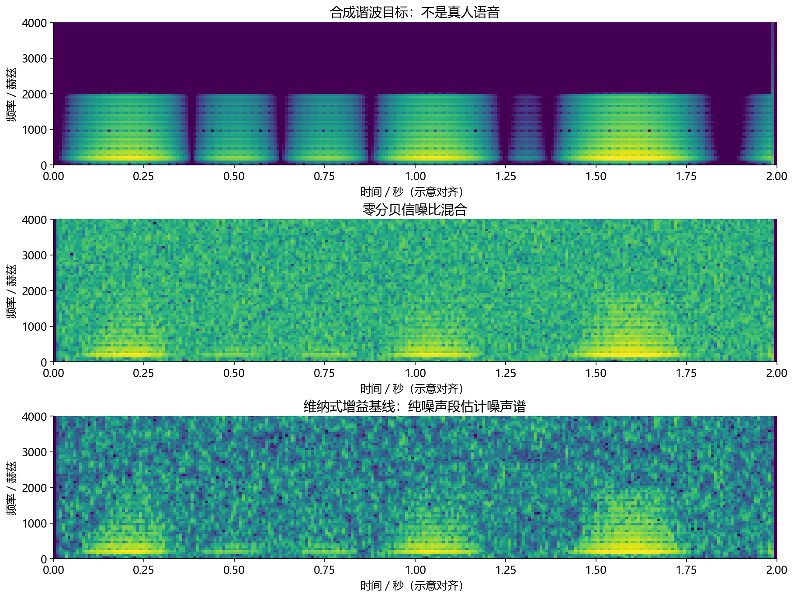

这张图来自已运行的 `code/run_experiments.py`，不是上面两条正弦片段的即时截图。完整脚本使用更丰富的合成谐波；其记录在 `results/dsp_results.json`，输入 SI-SDR 约 −0.01 dB、输出约 5.11 dB。上面的新片段应以自己的打印值为准，不能抄用该数字。

读图先看上图的水平谐波条纹，再看中图噪声把条纹之间填亮。下图如果背景变暗而条纹保留，说明目标结构相对更清楚；如果条纹也被擦断，说明目标受到损伤。色阶必须一致，否则单独调暗输出图也能制造“降噪很好”的错觉。再试听咝声、尾音、颗粒感和忽大忽小，不只听背景安不安静。

## 4. 神经降噪是在学习什么，不是把“模型很大”当解释

传统基线靠手写统计规则估计增益；神经网络从带噪输入学习预测掩码、干净谱或波形。最容易起步的是幅度掩码：输入带噪对数幅度，输出每个时频位置的保留比例，再乘原始复数谱重建。它继承了带噪相位，强噪声下可能限制质量。

进阶路线包括复数掩码、复数谱估计、时域模型和深度滤波。每种都需要说明张量形状、因果性、训练目标和重建方法。对实时应用，使用未来帧的模型即便计算很快，也有预看时延；$\mathrm{RTF}<1$ 不能自动证明对话低延迟。

先验收数据：干净与带噪是否时间对齐？训练和测试是否按说话人分开？噪声种类是否泄漏？补零帧有没有错误参与损失？这些比先换更大网络更适合新手起步。课程 [训练实战](../deep/02.html) 提供已运行的小型网络和真实训练曲线，但训练数据为合成教学数据，不等于商用真人语音降噪模型。

## 5. AGC：想让声音稳定，先防止把停顿放成风暴

一帧有 $N$ 个实数采样时，RMS 为：

$$
\mathrm{RMS}=\sqrt{\frac{1}{N}\sum_{n=0}^{N-1}x[n]^2}
$$

若当前 RMS 是 0.02，目标是 0.1，理想线性增益为 5，即约 13.98 dB。语音和噪声同乘五，二者功率同乘二十五，所以 SNR 不变。若原来只有底噪，AGC 可能把它一起放大。

因此需要最大增益、静音或活动控制、平滑以及峰值保护。输出已经削波的失真，也不能靠后面再压低音量恢复。课程实现用较快衰减避免突然太响，用较慢提升减少底噪抽吸；最终硬裁剪只是教学保护，不是高质量限制器。

```python
import sys
import numpy as np
sys.path.insert(0, "code")
from audio_core import frame_agc, energy_vad

fs = 16000
t = np.arange(fs) / fs
# 先静音，再小声正弦；它不是有语言内容的人声。
x = np.zeros(fs)
x[4000:12000] = 0.08*np.sin(2*np.pi*300*t[4000:12000])
y, gain = frame_agc(x, size=160)
# 迟滞判断使用原始输入，便于观察阈值，不把处理顺序当唯一标准。
rms, flags = energy_vad(x, size=160, on=0.04, off=0.025, hangover=5)
print("每帧毫秒：", 1000*160/fs, "帧数：", len(flags))
print("判为活动的帧数：", int(flags.sum()))
assert len(flags) == 100

# 把本片段的电平、增益、VAD 真值/预测并排放在同一时间轴。
from pathlib import Path
import matplotlib
matplotlib.use("Agg")
import matplotlib.pyplot as plt
plt.rcParams.update({"font.family": "Microsoft YaHei", "axes.unicode_minus": False})
fig, axes = plt.subplots(3, 1, figsize=(10, 7), sharex=True)
axes[0].plot(t, x, label="输入", alpha=0.6)
axes[0].plot(t, y, label="AGC 输出", alpha=0.6)
axes[0].set(ylabel="幅值", title="本片段：一秒合成活动信号")
axes[0].legend()
axes[1].plot(t, gain)
axes[1].set(ylabel="线性增益", title="增益平滑，不在帧边界突然跳变")
frame_time = np.arange(len(flags))*160/fs
truth = (np.arange(len(flags)) >= 25) & (np.arange(len(flags)) < 75)
axes[2].step(frame_time, truth.astype(int), where="post", label="合成活动真值")
axes[2].step(frame_time, flags.astype(int), where="post", ls="--", label="VAD 判决")
axes[2].set(xlabel="时间 / 秒", ylabel="活动标签", title="结束后额外保留五帧")
axes[2].legend()
fig.tight_layout()
out = Path("tutorial/figures/ch09_agc_vad.png")
out.parent.mkdir(parents=True, exist_ok=True)
fig.savefig(out, dpi=160)
plt.close(fig)
print("已保存运行图：", out.as_posix())
```

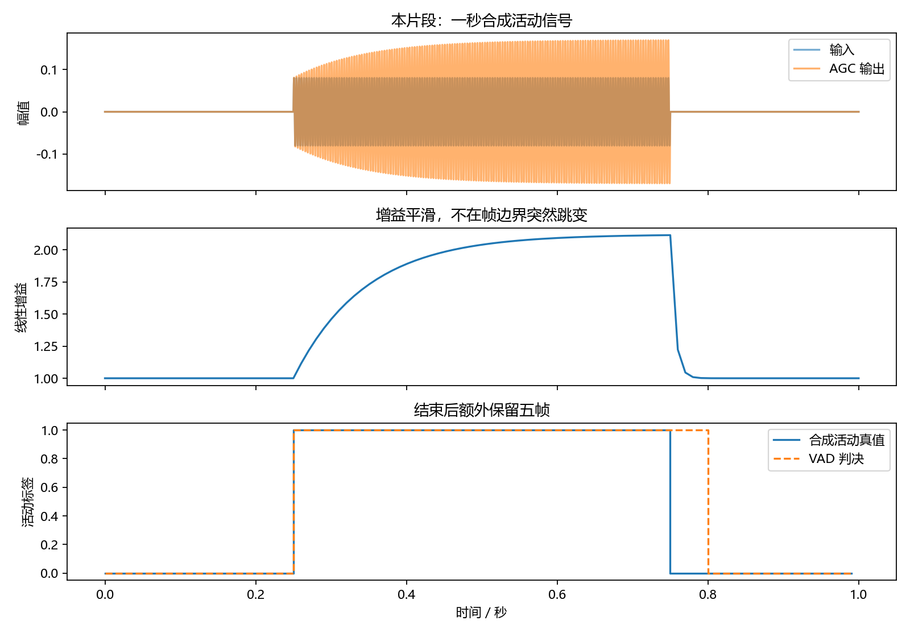

把视线放到 0.75 秒：真值已结束，虚线判决仍保持约 50 ms，正是五帧挂起。中图在强度切换处连续变化，说明增益保留了历史状态。这只是合成正弦活动检测，不能据此声称能可靠区分真实人声与音乐。

本轮实际输出为帧长 10.0 ms、100 帧、55 帧判为活动。目标片段本身持续 50 帧，另外五帧来自挂起。这恰好说明“多保留尾音”和“增加结束等待”是同一机制的两面。

## 6. VAD 为什么需要两条阈值和一点耐心

如果只有一个门限 0.04，帧 RMS 在 0.039 与 0.041 之间抖动，状态就可能不停切换。这里代码比较的是 RMS 幅值，不是平方后的能量，不能把同一门限直接挪给能量判决。迟滞设置较高的开启门限 `on` 和较低的关闭门限 `off`：进入语音需要更强证据，已经进入后则不因小幅变弱立即退出。挂起 `hangover` 再保留几个低电平帧，保护尾音。

16 kHz 下，160 点是 10 ms；五帧挂起约 50 ms，但整个端点器的结束等待还可能包含其他规则。不能把 VAD、端点检测和对话轮次结束判断画等号。说话人思考半秒，VAD 可能是无声，语义上却未必说完。

本例是不重叠分帧，因此帧长等于帧移。若换成 20 ms 窗长、10 ms 帧移，五次判决对应的挂起量仍约为 50 ms，而不是 100 ms；应按**判决更新的时间间隔**计算，再加上窗口等待及其他缓存。

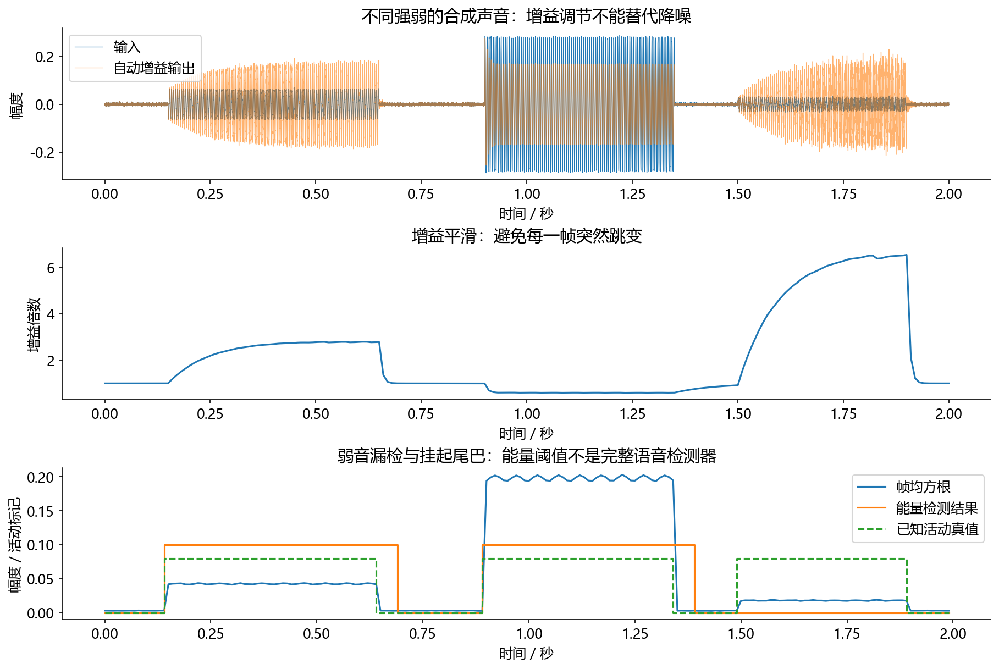

该图同样由 `code/run_experiments.py` 产生，场景与上面一秒片段不同。先看低音量段的增益上升是否平滑，再看强音是否被压低，最后对比 VAD 真值与预测的开始和结束位置。完整实验 F1 约 0.792；这不是通用真实语音 VAD 分数，只是合成活动标记测试。能量检测还会把风声、音乐等非语音当作活动。

## 7. KWS 与评测：别用 99% 准确率掩盖天天误唤醒

KWS 需要识别指定词，例如“你好小智”。模型可能用 Log-Mel 加小型 CNN，也可能采用其他结构；关键不只是网络名称，而是正样本覆盖不同说话人、口音、距离、音量，并有足够长的无关键词背景。

假设 10 小时负样本录音出现 3 次误触发，误唤醒率是 0.3 次/小时。100 次真实唤醒漏掉 8 次，漏检率为 8%。若先在开发集选阈值，再在独立测试集报告这两个指标，才更可比较。不要反复看测试集调阈值后仍称其“未见测试”。

VAD 要看帧级精确率、召回率、F1，也要看句首截断和尾端等待。增强要看目标保真、噪声残留、SI-SDR 改善以及适用的感知指标；有 ASR 目标时还要测 CER/WER。AGC 要看目标电平、峰值削波、增益波动和背景提升。单一指标无法替代完整听感和业务目标。

## 8. 失败排查与闭卷练习

| 失败表现 | 优先检查 | 改动后要补测 |
|---|---|---|
| 噪声没了，人声也没了 | 掩码过强、训练目标、静音偏置 | 干净输入是否受损 |
| 换个噪声就失败 | 噪声校准失配、训练覆盖不足 | 未见噪声分组 |
| 尾音被截掉 | VAD 门限、挂起、端点逻辑 | 结束等待时间 |
| 停顿时背景越来越响 | AGC 静音控制和释放策略 | 纯背景长录音 |
| 演示成功，实际天天误唤醒 | 负样本不足、阈值过松 | 小时级误触发和漏检 |
| 增强后识别反而下降 | 辅音失真、分布变化 | 相同 ASR 的前后 CER |

练习一：$P_s=9,P_n=1$ 时维纳增益是多少？答案是 0.9，不是 9，也不是把噪声完全减零。

练习二：一帧 320 点、16 kHz、挂起 8 帧，相应的帧长与挂起量是多少？答案是 20 ms 和约 160 ms。

练习三：20 小时无唤醒词背景误触发 4 次，300 次唤醒漏掉 15 次？答案是 0.2 次/小时和 5%。这两个数需要连同数据与阈值设置报告。

实习作业：做“可回放的语音前端评测台”。至少保存未处理、维纳基线和一个神经方法的输出；选十个成功和十个失败样例；按噪声、距离、音量分组；绘制增益、VAD 状态与输出声谱；记录首包、总时延及 RTF。第一周只把传统基线和评测跑正确，第二阶段再加入模型。成果不是一段“听起来不错”的视频，而是一套别人能复查的对照实验。


---

# 10｜麦克风阵列：先对齐，再增强，最后理解子空间

[返回教程目录](README.md) · [上一课：增强与活动检测](chapters/09_enhancement.md) · [下一课：声学与水声迁移](chapters/11_acoustics.md)

## 学习阶梯

本章不要四个算法一起背。第一阶：两路声音到达时间不同，能估时延。第二阶：把目标对齐再相加，能做延迟求和。第三阶：利用噪声统计分配权重，理解 MVDR。第四阶：从阵列协方差里分出信号与噪声子空间，理解 MUSIC。先修为采样、复数频谱、向量内积；协方差和特征分解不熟也可先完成前两阶。

建议分四次各 60—90 分钟。每次必须留下一个可检验结果：时延正负、对齐前后波形、约束误差、方向峰。对你而言，这一章尤其适合连接水声背景，但同一个算法名不代表空气和水下参数能够直接照搬。

## 1. 生活直觉：人能听出左右，机器需要明确坐标

声音从左边来，可能先到左耳、再到右耳。两个麦克风也能利用到达时间差。不过人耳还利用声级差和耳廓频率响应，机器的两麦时差模型只是其中一部分；前后歧义、反射和多个说话人都可能让简单模型不够。

本课把两个麦克风放在一条线上，间距为 $d$；角度 $\theta$ 从阵列法线方向量起，正前方是零度。在远场平面波近似下，时差为：

$$
\tau=\frac{d\sin\theta}{c}
$$

若从阵列轴线量角，公式会改成余弦形式。两个公式不冲突，坐标定义不同而已。

还要把正负号写清：本课定义 $\tau=t_2-t_1$，也就是“第二路到达时间减第一路”；角度的正方向选为让第二路更晚到的一侧。只有连同通道顺序和这个约定，正时差才对应下面的正角度。两麦线阵本身也不能消除前后方向的几何歧义。

| 量 | 意义 | 单位 |
|---|---|---|
| $d$ | 两传感器间距 | 米 |
| $c$ | 声速 | 米/秒，空气演示取 343 |
| $\tau$ | 到达时间差 | 秒，可正可负 |
| $k=\tau f_s$ | 相差的采样数 | 点，可为非整数 |
| $\theta$ | 入射角 | 公式三角函数内部注意弧度/角度 |
| $\mathbf X$ | 多通道频域快拍 | 常见形状 `[通道,快拍]` |

手算：$d=0.08\,\mathrm{m}$，$f_s=16000\,\mathrm{Hz}$，最大时差是 $\frac{d}{c}\approx0.000233\,\mathrm{s}$，约 3.73 点。如果某算法在这组几何下报告 200 点时差，先查同步、回声和实现，而不是直接把它转换成一个角度。若第二路比第一路晚 2 点：

$$
\sin\theta=\frac{2}{16000}\times\frac{343}{0.08}\approx0.536
$$

得到约 32.4°，前提仍是本课的正负和坐标约定。

## 2. 第一阶：相关就是拿一段波形左右移动去找最像的位置

两路录到相同目标但有延迟时，移动其中一路，找到最能重合的位置，就能估时差。普通互相关还会受某些频带能量过强影响。GCC-PHAT 先计算互谱，再除以互谱幅值，强调跨频率相位关系。

本课使用 `FFT(later) × conj(FFT(earlier))`，所以第二路晚到时应得到正延迟。`conj` 是复共轭；如果两个输入顺序交换，延迟符号也应交换。PHAT 不是“保证找出直达声”的魔法：强反射、窄带周期信号和低信噪比都可能制造错误峰。

从课程根目录运行：

```python
import sys
import numpy as np
sys.path.insert(0, "code")
from audio_core import gcc_phat

rng = np.random.default_rng(10)
earlier = rng.normal(size=2048)
# 第二路晚两点：补零移位，不用 np.roll 产生环绕声。
later = np.r_[np.zeros(2), earlier[:-2]]
delay, lags, values = gcc_phat(later, earlier, max_lag=4)
print("估计延迟（点）：", delay)
assert delay == 2
# 交换顺序应反号，这是最值得先写的单元测试。
reverse, _, _ = gcc_phat(earlier, later, max_lag=4)
assert reverse == -2

# 本次实际相关曲线：横轴是采样点，不是角度。
from pathlib import Path
import matplotlib
matplotlib.use("Agg")
import matplotlib.pyplot as plt
plt.rcParams.update({"font.family": "Microsoft YaHei", "axes.unicode_minus": False})
fig, ax = plt.subplots(figsize=(8, 4))
ax.stem(lags, values)
ax.axvline(delay, color="tab:red", ls="--", label="估计时延 +2 点")
ax.set(title="本片段的 GCC-PHAT 相关峰", xlabel="时延 / 采样点", ylabel="相关值")
ax.legend()
fig.tight_layout()
out = Path("tutorial/figures/ch10_gcc_peak.png")
out.parent.mkdir(parents=True, exist_ok=True)
fig.savefig(out, dpi=160)
plt.close(fig)
print("已保存运行图：", out.as_posix())
```

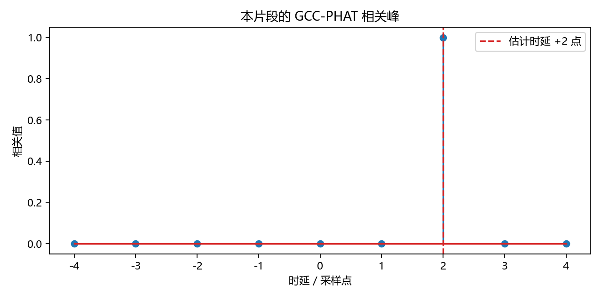

这幅图直接来自上面的随机种子与两点延迟。先找到零点，再确认峰在右侧 +2，而不是仅看峰“很高”。峰外不一定严格为零；有限长度、补零边界和频域归一化都会影响数值。

本轮实际运行得到 +2 点，交换输入后 −2 点，两个断言均通过。先把这种符号测试固定下来，再把输入替换为真实多通道录音。

`max_lag=4` 按几何允许范围取整数上界。频谱长度需要足够，避免把线性相关误做成循环相关。噪声信号在这里是容易验证时延的宽带探针，不是最终语音定位评测集。

注意搜索到 ±4 点这个整数格，不代表物理时差上限从 3.73 点变成了 4 点。若把 4 点直接代入反正弦，会得到大于一的输入。应检查量化误差、同步和错误峰，必要时估计分数时延并带着误差范围报告角度；不能悄悄截成 ±90°，再称其为精确定位。

## 3. 第二阶：延迟求和，先让同一件事同时发生

假设第一路是 $x_1[n]=s[n]+v_1[n]$，第二路晚两点，$x_2[n]=s[n-2]+v_2[n]$。离线可把第二路向前对齐，然后平均。目标相干相加；若两路噪声独立、同功率，平均后噪声功率约减半，理论 SNR 改善约 3.01 dB。

这个数字条件很多：同方向干扰、相关噪声、通道失配和错误时延都可能让改善变少。实时系统无法凭空取得未来样本，可以把早到那路延迟两点，付出额外等待，而不是假装没有延迟。

```python
import numpy as np

rng = np.random.default_rng(11)
s = rng.normal(size=10000)
v1, v2 = rng.normal(size=(2, 10000))
x1 = s + v1
# 第二路的目标晚两点，噪声是独立生成的。
x2 = np.r_[np.zeros(2), s[:-2]] + v2
# 离线裁剪到共同有效区间；不评价被裁掉的边界。
target = s[:-2]
beam = (x1[:-2] + x2[2:]) / 2
noise_single = x1[:-2]-target
noise_beam = beam-target
gain_db = 10*np.log10(np.mean(noise_single**2)/np.mean(noise_beam**2))
print("独立噪声下的实验改善 dB：", gain_db)
assert 2.5 < gain_db < 3.5
```

本轮实际测得改善约 2.963 dB，与独立同功率噪声下约 3.01 dB 的理论预期接近。有限样本不会精确等于理论值；若想测试“相关噪声不再减半”，应让两路噪声在**完成目标对齐之后**仍相同，而不是仅把移位前的两个噪声数组设成相同。不同的时间索引会改变它们的相关性。

核心不在 `/2`，而在 `x1[:-2]` 与 `x2[2:]` 对齐了相同目标采样。若不对齐，目标本身也会相消，尤其在某些频率上出现梳状频响。真实的 $\tau f_s$ 常不是整数，需要分数延迟滤波或频域相位补偿；截断成整数会产生方向与频率相关误差。

## 4. 用图把“估时间”与“估方向”分开

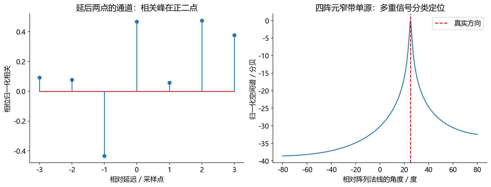

该图来自已运行的 `code/run_experiments.py`，结果记录在 `results/dsp_results.json`，不是上面每一片段的共同运行截图。左图峰值为 +2 点，与本课符号约定一致；横轴是点，不能直接读成角度。右图是另一组窄带四阵元仿真，真值和估计都是 25°；它与左图“两点对应 32.4°”并不矛盾，因为两图的实验设定不同。

右图峰高不等于“置信概率 99%”。MUSIC 谱是由子空间投影形成的分数，未经概率校准。还要看主峰外是否有强假峰、网格分辨率多细，以及多个随机条件下是否稳定，不能用一个正好落在网格上的角度证明真实定位精度。

## 5. 第三阶：MVDR，在保住目标响应的约束下压低噪声

延迟求和在对齐后给各通道相同权重。MVDR 会利用噪声协方差 $\mathbf R_n$：它不只知道某一路噪声多大，还知道各路噪声怎样共同变化。令导向向量 $\mathbf a$ 描述目标在各传感器的复数相位和幅度，权重为 $\mathbf w$，输出是 $\mathbf w^{\mathsf H}\mathbf X$。上标 $\mathsf H$ 代表共轭转置，不是普通转置。

目标是让输出噪声功率 $\mathbf w^{\mathsf H}\mathbf R_n\mathbf w$ 最小，同时满足 $\mathbf w^{\mathsf H}\mathbf a=1$，避免靠把全部声音变为零取得“最小噪声”。解的形式为：

$$
\mathbf w_{\mathrm{MVDR}}=\frac{\mathbf R_n^{-1}\mathbf a}{\mathbf a^{\mathsf H}\mathbf R_n^{-1}\mathbf a}
$$

上式假设 $\mathbf R_n$ 是厄米正定矩阵，且导向向量 $\mathbf a\ne\mathbf 0$，这样逆矩阵存在，归一化分母也为正。实际代码优先解线性方程而不是显式求逆；样本矩阵奇异或近奇异时，应先进行适当的对角加载等稳定化处理，不能直接套用逆矩阵公式。

手算两个通道：目标导向都是一，噪声不相关但功率分别为一和四，因此 $\mathbf R_n=\operatorname{diag}(1,4)$。逆协方差作用于导向向量后得到 $[1,\frac{1}{4}]^{\mathsf T}$，归一化后权重是 $[0.8,0.2]^{\mathsf T}$。目标增益仍为一，噪声功率变成 $0.8^2\times1+0.2^2\times4=0.8$；等权平均的噪声功率为 1.25。它利用了第二路更吵这个信息。

“更吵的通道给更小权重”只适合这个对角协方差的简单例子。一般 MVDR 的权重是复数，可能用不同相位来抵消空间相关干扰，不一定都是 0 到 1 的正数。应检查 $\mathbf w^{\mathsf H}\mathbf a$ 和输出噪声功率，不能仅凭某个权重绝对值很大就判错。

```python
import sys
import numpy as np
sys.path.insert(0, "code")
from audio_core import mvdr

# 玩具例子：已知真实噪声协方差，目标在两路没有相位差。
noise_cov = np.diag([1., 4.]).astype(complex)
steering = np.ones(2, dtype=complex)
w = mvdr(noise_cov, steering, loading=0)
print("权重：", w.real, "目标响应：", np.vdot(w, steering))
assert np.allclose(w, [0.8, 0.2])
assert np.isclose(np.vdot(w, steering), 1)
```

本轮实际得到 `[0.8,0.2]`，目标响应约 `0.9999999999992+0j`。它和手算一致，最后的小偏差来自数值保护项和浮点精度。

`np.vdot` 对第一个参数取共轭，和目标约束对应。这个例子只验证代数；实际更难的是从录音估计干净的噪声统计和目标方向。如果把目标语音误放进噪声估计，或导向向量失配，模型可能伤害目标。协方差少样本、近奇异时，对角加载是稳健手段之一，不是所有问题的万能修复。

## 6. 第四阶：MUSIC，为什么“噪声空间”还能告诉我们声源在哪

想象同一声源在每只麦克风上都只是不同相位和幅度的版本。在一个固定频率上，它们共同变化的模式主要落在某个低维方向。本例采用零均值信号模型，对 $K>0$ 次快拍组成的 $\mathbf X$ 计算：

$$
\mathbf R=\frac{\mathbf X\mathbf X^{\mathsf H}}{K}
$$

不减均值时，上式一般是二阶矩或空间相关矩阵的估计；本例在零均值模型下将它用作协方差估计。非零均值数据若要计算协方差，应先沿快拍维减去各通道均值。再做特征分解，可分出显著的信号变化方向和其余噪声子空间。

在理想单源模型下，正确方向的导向向量与噪声子空间接近正交。扫描每个候选角度，算它投到噪声子空间的能量，能量越小，取倒数后的谱峰越高。本课程 [music_scan](../code/audio_core.py) 的关键步骤是：`eigh` 对厄米矩阵分解、取除最大特征值对应向量之外的向量、扫描 $\exp(-\mathrm{j}2\pi f\tau)$、计算投影能量倒数。

别急着把四步背完，先回答假设：本例声源数已知为一；阵元几何已知；信号窄带；快拍足够；目标与噪声不相关，并且各阵元噪声互不相关、功率相同，即噪声协方差近似 $\sigma^2\mathbf I$。最后一项叫空间白噪声假设，它让噪声只把特征值整体抬高，不改变理想子空间方向。若噪声有空间相关性或各通道噪声功率不同，不能照搬这个最简单版本；需要相应的预白化或更一般的模型。[MathWorks MUSIC 模型说明](https://www.mathworks.com/help/phased/ug/music-super-resolution-doa-estimation.html)

真实语音宽带，需要逐频点处理与融合等设计。强反射会产生相干分量，可能使简单子空间方法退化。增加网格密度只能让搜索更细，不能凭空创造原始数据没有的信息。

## 7. 阵列工程里最常见的错误

| 现象 | 优先检查 | 为什么 |
|---|---|---|
| 左右方向相反 | 通道顺序、互谱共轭顺序、坐标 | 公式正确也可能约定不一致 |
| 时延超过几何上限 | 同步、缓存、反射或错误峰 | 时差不仅可能来自传播 |
| 静态能用，一移动就坏 | 窗口长度、跟踪、时延更新 | 统计滞后会导致旧权重失配 |
| MVDR 消掉了目标 | 目标方向与噪声统计污染 | 约束保的是估计方向，不是自动保真实目标 |
| MUSIC 假峰很多 | 声源数、相干反射、快拍数 | 理想子空间假设被破坏 |
| 高频角度有歧义 | 阵距与波长 | 阵距过大可能发生空间混叠 |

对均匀线阵在常见全视场窄带设计中，$d\leq\frac{\lambda}{2}$ 是避免空间混叠的重要条件之一。这里 $\lambda=\frac{c}{f}$；8 cm 阵距对应 $\frac{c}{2d}\approx2144\,\mathrm{Hz}$。这不等于 2144 Hz 以上所有宽带算法立刻失效，但提醒你不能忽略高频歧义和频带选择。

## 8. 练习与实习作业

练习一：在本课定义下，两路时差为零一定意味着声源只有一个、正前方吗？不一定；还有几何歧义、多个声源混合等可能，时差零只是一个观测约束。

练习二：两路目标对齐、独立同功率噪声，平均后理论噪声功率如何变化？减半，理想 SNR 约增 3 dB。若两路噪声在对齐之后完全相同，它们也会相干叠加，这个收益不成立。

练习三：MVDR 约束误差接近 $10^{-12}$ 能证明真实降噪好吗？不能，它验证的是计算约束，不是统计估计准确，也不是业务结果。

实习作业按阶梯交付：先做两麦时延估计单元测试；再比较单麦和延迟求和；之后加入 MVDR 与方向失配；最后选做 MUSIC。对不同 SNR、角度、混响、通道增益误差分组，报告方向误差和目标质量，而非只展示一个尖峰。保存几何、采样率、声速、随机种子和有效频带，水声版本必须重新明确这些参数。

参考：[MathWorks GCC-PHAT 官方说明](https://www.mathworks.com/help/phased/ref/gccphat.html)、[波束形成官方概览](https://www.mathworks.com/help/phased/ug/beamforming-concepts.html)。两者帮助核对术语和窄带/宽带边界，本章 Python 实作仍以课程源码与测试记录为准。


---

# 11｜音频背后的物理：房间、测量、水声迁移与 ANC

[返回教程目录](README.md) · [上一课：麦克风阵列](chapters/10_arrays.md) · [下一课：神经网络与训练](chapters/12_pytorch.md)

## 这章解决什么问题

如果你只会把 WAV 放进网络，却说不清房间、距离、反射和设备增益怎样改变录音，就很难解释真实项目里的失败。本课目标是认识脉冲响应、混响、RT60、DRR、近远场、测量链，以及水声能力能怎样迁移到语音就业。最后分清主动降噪 ANC 与回声消除 AEC。先修为卷积、分贝、滤波器，建议两次各 90 分钟加一次测量方案练习。

## 1. 一声拍手为什么会拖出尾巴

在铺着厚地毯的小房间和空旷走廊里拍手，听感不同。最先到麦克风的是直达声，之后是若干较早反射，再之后大量反射叠成稠密尾部。可以把房间想成许多“延迟的小副本”。但不是每次反射都只乘一个固定常数：材料吸收随频率变化，位置、障碍物和声源指向性也会改变传递。

短时间内把声源、麦克风和房间当成线性时不变系统，可写 $y[n]=(h*x)[n]$，其中 $*$ 表示卷积。$h$ 是房间脉冲响应 RIR：如果输入理想单位脉冲，输出是什么。现实无法安全、精确地产生无限短无限带宽的冲击，测量常通过已知测试信号和系统辨识估计它，而不是必须在房间里制造巨大爆响。

$h$ 不是一间房间永恒唯一的身份证。移动声源或麦克风、开关门、改变家具，都可能改变它。用某个 RIR 卷积训练语音，是一种模拟传播的办法，但不自动包含麦克风非线性、时钟漂移、全空间方向性等因素。

## 2. 手算三个副本：混响会改变时间，也会改变频率

设脉冲响应为：

$$
h[n]=\delta[n]+0.5\delta[n-480]+0.25\delta[n-1200]
$$

采样率为 16 kHz，延迟分别是 0、30 ms 和 75 ms。输入一个单位脉冲，就在这些时刻出现三个响应；输入一句话，每个采样都会产生三个副本，副本之间可能重叠。

在这三个脉冲互不重叠的离散 RIR 中，按样本平方求和，直达部分的能量为一，两条反射部分的能量为 $0.5^2+0.25^2=0.3125$，直混比 DRR 是：

$$
\mathrm{DRR}=10\log_{10}\left(\frac{1}{0.3125}\right)\approx5.05\,\mathrm{dB}
$$

这不是说任意语音经过三条路径后，总能量也能忽略相干交叉项直接相加。实际 RIR 中如何选择直达声窗口、早期反射算不算混响，必须写清评测约定，不能只报一个 DRR。

从课程根目录 `audio-course-zh` 运行本章代码；图片保存在 `tutorial/figures/`，不会自动弹窗。所有音频都是合成数组，不会自动播放。

```python
import numpy as np

fs = 16000
h = np.zeros(1601)
# 三个离散传播分量，0、30、75 毫秒；不是完整实测房间。
h[[0, 480, 1200]] = [1.0, 0.5, 0.25]
impulse = np.array([1.0])
response = np.convolve(impulse, h)
direct_energy = response[0]**2
reflected_energy = np.sum(response[1:]**2)
drr = 10*np.log10(direct_energy/reflected_energy)
print("三个到达时间 ms：", np.flatnonzero(h)/fs*1000)
print("模型 DRR dB：", drr)
assert np.isclose(drr, 5.051499783199061)

# 保存同一个三路径模型的图，零点表示直达声到达时刻。
from pathlib import Path
import matplotlib
matplotlib.use("Agg")
import matplotlib.pyplot as plt
plt.rcParams.update({"font.family": "Microsoft YaHei", "axes.unicode_minus": False})
fig, ax = plt.subplots(figsize=(9, 4))
arrivals = np.flatnonzero(h)
ax.stem(arrivals/fs*1000, h[arrivals])
for index in arrivals:
    ax.annotate(f"{index/fs*1000:.0f} 毫秒，系数 {h[index]:g}",
                (index/fs*1000, h[index]), xytext=(7, 7), textcoords="offset points")
ax.set(title="本片段的三路径脉冲响应", xlabel="相对到达时间 / 毫秒", ylabel="幅值系数",
       xlim=(-5, 105), ylim=(-0.05, 1.22))
fig.tight_layout()
out = Path("tutorial/figures/ch11_room_impulse.png")
out.parent.mkdir(parents=True, exist_ok=True)
fig.savefig(out, dpi=160)
plt.close(fig)
print("已保存运行图：", out.as_posix())
```

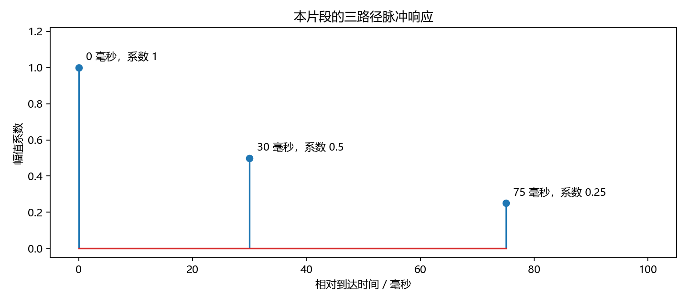

图中三根竖线的横坐标表示到达时间，纵坐标表示幅值系数，不是能量。计算 DRR 时要先平方，所以 0.5 那条路径对应的相对能量是 0.25。横轴零点已对齐直达声，不意味着物理传播完全没有耗时。

这个结果只对应当前三脉冲模型。语音经过多条路径相加时，相位关系还会使某些频率增强、另一些频率抵消，形成梳状频响。所以混响不是简单的“同样的声音持续更久”，它也会改变频谱结构。

## 3. RT60：用能量衰减速度描述尾巴，而不是盯最后一个非零采样

RT60 表达混响能量级衰减 60 dB 所需的时间。真实录音后面总有底噪，不能通过“最后一个非零点”测量。常用方法是对 RIR 的平方从末尾向前累计，得到能量衰减曲线 EDC，再在可靠范围拟合斜率并外推。T20 常用 −5 到 −25 dB 区间；T30 常用 −5 到 −35 dB 区间。名称中的 20/30 是拟合跨度，报告值通常仍是外推至 60 dB 的时间。[MathWorks 声学空间分析示例](https://www.mathworks.com/help/audio/ug/model-evaluate-and-design-acoustic-spaces.html)

手算：如果可靠区间每秒下降 150 dB，外推 RT60 是 $\frac{60}{150}=0.4\,\mathrm{s}$。若背景噪声在 −20 dB 就使曲线变平，不能假装自己测到了干净的 −35 dB 区间。实际还应分频带分析，检查拟合直线性、噪声补偿和截断策略；单个宽带数字会掩盖频率差异。

```python
import numpy as np

fs, expected_rt60 = 16000, 0.4
t = np.arange(fs*2)/fs
# 独立理想指数尾音：幅值在 expected_rt60 秒衰减 60 dB。
h = np.exp(-3*np.log(10)*t/expected_rt60)
# 从末尾反向累计平方，得到剩余能量；再相对初值归一化。
edc = np.cumsum(h[::-1]**2)[::-1]
edc_db = 10*np.log10(np.maximum(edc/edc[0], 1e-15))
valid = (edc_db <= -5) & (edc_db >= -35)
slope, intercept = np.polyfit(t[valid], edc_db[valid], 1)
estimated_rt60 = -60/slope
print("理想尾音 RT60 秒：", estimated_rt60)
assert np.isclose(estimated_rt60, 0.4, atol=1e-4)
```

`h` 是幅值，所以指数选成在 0.4 秒降到原来的 0.001；平方后是百万分之一功率，仍对应 −60 dB。`np.polyfit` 拟合的是 dB 随秒的直线，斜率单位 dB/s。这个生成和拟合相互匹配的理想例子适合检验代码，不足以证明真实测量可靠。

这里刻意使用全正的指数序列，只为验证能量衰减公式；它不是具有真实频带和随机反射结构的房间响应，不宜直接当作真实房间数据增强。真实测量还可能出现多段衰减斜率，T20、T30 与早期衰减时间不必相同。不要只截取“最直”的几帧就宣称测得了可靠 RT60。


图由已运行的 `tutorial/code/beginner_labs.py` 中 `filter_and_room` 生成；结果见 `tutorial/results/beginner_results.json`。左下图是 0/30/75 ms 的三个路径；右下图是另一个独立指数尾音模型，设定 RT60 为 0.4 秒，拟合得到约 0.4 秒。**不能把左下的三个脉冲当成右下曲线的输入，也不能把两者说成同一真实房间。** 上面两个片段分别复现两个模型的关键计算。

## 4. 近场、远场与距离：不要把“远场语音”误当绝对距离标签

阵列处理中，远场常指波前在阵列范围内可以近似平面；近场需要考虑球面传播，不同麦克风不仅有时延差，也可能有明显幅值差。是否足够远与阵列孔径、波长和允许近似误差有关，不是所有场景超过一米就自动是远场。

产品语境里“远场拾音”也常表示离设备较远的交互场景，此时还包含混响、背景噪声和较低直达声比例等困难。要分清这是使用场景描述，还是你所用数学模型的假设。

自由场理想点声源的声压幅值大致随距离的倒数减小，距离翻倍约下降 6 dB；有墙面反射、混响场、指向性或近场效应时，不能机械套用。也不要把离说话人更近等同于只有好处：风噪、喷麦、近讲效应与硬件饱和都可能增加。

## 5. 从 PCM 数值到声压，需要校准链而不是一个乘法猜测

PCM 值 0.1 只是数字幅值，dBFS 是相对于数字满量程的表示；声压级 dB SPL 需要以帕斯卡计的声压和参考压力。两者之间隔着麦克风灵敏度、前置放大、ADC 满量程、设备增益与软件处理。没有校准，不能从 WAV 的 RMS 直接声称现场有多少 dB SPL。

测量方案至少记录：设备型号与通道；采样率和位深；固定输入输出增益；测试信号和播放电平；源与接收点位置；环境条件；是否开启系统 AEC/AGC/NS；重复次数。声学测量软件也会遇到缓冲延迟、自动增益和系统增强，应检查而非默认关闭。

测 RIR 可以用适当电平的扫频和逆滤波，或其他辨识方法。先以很低音量确认链路、检查无削波，再逐步验证信噪比；不要为追求更低噪声底而使用过大音量。你可以先做离线卷积实验，再与实验室确认可用设备和规范，完全不必从高声压硬件测试开始。

## 6. 水声背景怎么迁移，哪些东西不能直接迁移

可迁移的是方法：离散信号处理、卷积与滤波、随机过程、谱估计、检测估计、阵列、波束形成、实验设计与误差分析。需要重建的是物理与任务：传播速度、频段、尺度、多径结构、传感器、噪声分布、目标定义和评价指标。空气中的说话人识别、文字识别和自然语音合成还有语言数据与深度学习能力，不能只靠“都是声学”跳过。

空气示例常取约 343 m/s；海水演示常见数量级约 1500 m/s，但真实海水声速依赖温度、盐度与压力等条件。工程模型应采用实际环境参数，而不是把所有水域写死为 1500。[NPL 海水声速技术指南](https://resource.npl.co.uk/acoustics/techguides/soundseawater/index.html)

声压级参考也有差异：空气常用 20 μPa，水下常用 1 μPa。比较数字之前必须写清参考，且跨介质的声强关系还涉及声阻抗，不能简单把 dB 数字当作相同听感或风险。[英国 NPL 声压级说明](https://resource.npl.co.uk/acoustics/techguides/concepts/spl.html)、[DOSITS 声级教学资料](https://dosits.org/wp-content/uploads/2017/07/DOSITS-Vigness-Raposa_Sound_Movement_Msrmt.pdf)

对你的课题组经历，合适表述是“在某项目中实现了某算法、用某数据验证了某指标”，再说明与目标岗位的相通能力。未核验导师具体项目内容前，不能断言其中语音占比、软件栈或个人贡献。涉及保密时只展示获准公开的代码、合成数据或脱敏方法；不能把水声目标检测改名为 ASR。

## 7. ANC 为什么不是 AEC 换个缩写

AEC 在已经录到的信号上减掉预测回声，输出是一段更干净的数字录音。ANC 则通过扬声器发出控制声，希望在某个物理位置减小实际声压。若噪声从参考麦克风到耳边经过主路径，控制信号还会经过“功放、扬声器、传播”的次级路径。你直接输出 $-x$，到耳边时可能已经延迟、变相，甚至加强原噪声。

FxLMS 的关键是更新参数时，把参考先通过次级路径估计过滤，体现“控制参数怎样影响最终误差”。本课程误差定义为 $e=d+S*y$，其中 $S*y$ 表示控制信号经过次级路径，因此梯度更新采用减号；AEC 常定义 $e=d-\hat y$，其中 $\hat y$ 是预测回声，更新符号不能生搬硬套。

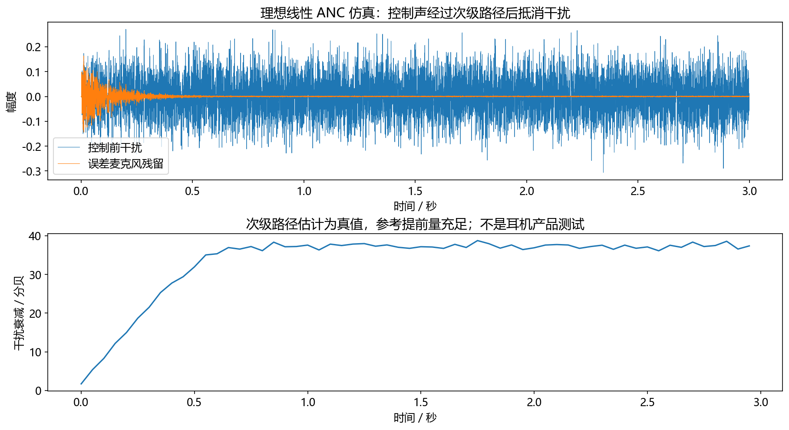

图由已运行的 `code/anc_lab.py` 生成，核心实现位于 `code/audio_core.py`。此实验有足够参考提前量，次级路径估计等于真实路径，另加不可预测弱噪声；尾段降幅约 37.27 dB。它没有驱动真实设备，不是耳机性能测试。观察前段参数尚未收敛，后段残留仍非严格为零；改变路径估计或增加延迟，结果可能明显变差。

不建议新手直接将仿真控制器接大音量扬声器。主动控制的稳定性、输出限幅、链路延迟和故障保护都需要硬件层面的验证。就业准备可以先做路径失配、提前量不足与限幅的离线消融。

## 8. 练习、答案和一份可展示作业

练习一：16 kHz 下 50 ms 的反射对应几个采样？800 点。若仍用 48 kHz 采集，50 ms 对应 2400 点，物理时间不变。

练习二：EDC 拟合斜率为 −100 dB/s，外推 RT60 是多少？0.6 秒；前提是拟合区间可靠，而不是底噪平台。

练习三：PCM RMS 从 0.1 变到 0.2，幅度相对增加多少？约 6.02 dB；单凭这些数字不能知道实际声压级增加是否相同，因为采集增益可能改变。

练习四：把空气阵列代码声速从 343 改为 1500 就算水声项目了吗？不算，还需真实任务、几何、环境、数据、传感器与评测依据。

实习作业：做“房间鲁棒性与物理参数检查报告”。先用多个公开可用或获授权的 RIR 对语音卷积，记录 RT60、DRR 的估计口径；比较同一增强或 ASR 系统在不同房间的表现；附上近场/远场假设、设备增益和失败样例。没有实测设备时如实称仿真，不影响它作为可复现实验的价值。完成后，你应能解释性能为何下降，而不只是说“泛化不好”。


---

# 第 12 章｜第一次训练音频神经网络：从一个旋钮到频谱掩码

[返回教程目录](README.md)

建议用两次学习完成本章：第一次跟着手算和短代码走，第二次再读完整训练文件。先修是 Python 函数、数组下标，以及前面讲过的 STFT。若还分不清数组的轴，先回到[第04课：音频数组](chapters/04_numpy.md)；若还不清楚频谱帧怎么来，先回到[第05课：频谱与STFT](chapters/05_spectrum.md)。暂时不会复杂求导也没关系，本章只从一个参数开始。

学完后的目标不是“听说过 PyTorch”，而是能回答：模型究竟输入什么、预测什么、错在哪里、怎样更新，以及凭什么说它在新数据上也有效。

## 1. 神经网络先不要想成“大脑”，把它想成可调整的计算器

假设你有一个可调旋钮 $w$，计算器收到数字 $x$，输出 $\hat{y}=wx$（代码里的 `prediction`）。现在输入 $x=2$，希望输出 $y=3$（代码里的 `target`），但旋钮设成 $w=0.5$，所以只输出 1。

我们用损失 $\mathcal{L}=(\hat{y}-y)^2$ 表示错得多严重。本次损失是 $(1-3)^2=4$。平方的作用是让正负错误都产生非负代价，而且大错误受到更重惩罚；它不是所有音频任务的唯一正确选择。

下一步不是随机乱拧旋钮，而是问：$w$ 稍微增大，损失会怎样变化？这个局部变化率叫梯度。链式法则把两段变化相乘：

$$
\frac{\partial\hat{y}}{\partial w}=x=2,\qquad
\frac{\partial\mathcal{L}}{\partial\hat{y}}=2(\hat{y}-y)=-4
$$

$$
\frac{\partial\mathcal{L}}{\partial w}
=\frac{\partial\mathcal{L}}{\partial\hat{y}}\,
\frac{\partial\hat{y}}{\partial w}
=(-4)\times2=-8
$$

梯度为负，说明在当前位置稍微增大 $w$ 会降低损失；“负梯度方向”则是梯度取反后的方向，这两个说法不要混淆。取学习率 $\eta=0.1$（代码里的 `lr`），更新规则为：

$$
w_{\mathrm{new}}=w-\eta\frac{\partial\mathcal{L}}{\partial w}
=0.5-0.1\times(-8)=1.3
$$

新的预测是 2.6，损失变成 0.16。

这里的“下坡”类比只描述局部方向。学习率太大可能越过谷底；多个参数的复杂损失面也不保证每一步都让验证成绩变好。

下面代码从课程根目录 `audio-course-zh` 运行，会把实际计算出的损失画到 `tutorial/figures/ch12_gradient.png`。绘图需要 Matplotlib；中文标签使用本机微软雅黑，其他系统可换成已安装的中文字体。

```python
import torch

w = torch.tensor(0.5, requires_grad=True)  # 一个需要学习的标量
x = torch.tensor(2.0)
target = torch.tensor(3.0)
prediction = w * x
loss = (prediction - target).square()
loss.backward()                          # 自动计算 d(loss)/d(w)
print(loss.item(), w.grad.item())         # 手算预期：4.0，-8.0
with torch.no_grad():                    # 更新本身不再建立求导图
    w -= 0.1 * w.grad
print(w.item())                          # 约 1.3

# 把这次真实计算的更新前后损失保存为图，不弹出窗口。
from pathlib import Path
import matplotlib
matplotlib.use("Agg")
import matplotlib.pyplot as plt
plt.rcParams.update({"font.family": "Microsoft YaHei", "axes.unicode_minus": False})
after = (w.detach()*x-target).square().item()
values = [loss.item(), after]
fig, ax = plt.subplots(figsize=(7, 3.8))
bars = ax.bar(["更新前", "更新一次后"], values, color=["#d88b60", "#398795"])
ax.bar_label(bars, labels=[f"{value:.4f}" for value in values])
ax.set(ylabel="平方误差", title="一步梯度下降：从手算到实际结果", ylim=(0, 4.6))
Path("tutorial/figures").mkdir(parents=True, exist_ok=True)
fig.savefig("tutorial/figures/ch12_gradient.png", dpi=150, bbox_inches="tight")
plt.close(fig)
```

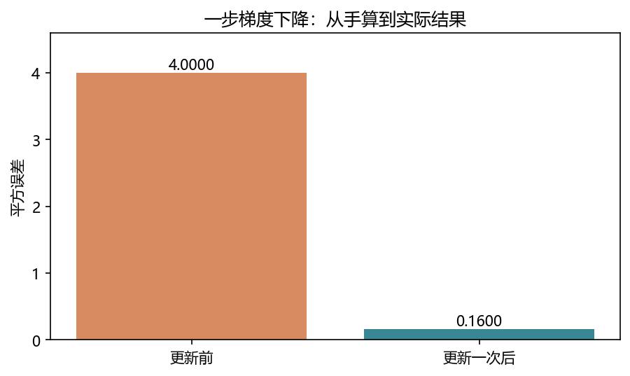

图中的两根柱子就是代码里的 `loss` 与 `after`，不是示意成绩。这个只有一个参数的例子能核对更新方向，不代表完整降噪网络每次更新都如此大幅改善。

`requires_grad=True` 是要求记录参数如何影响损失；`backward()` 按计算图应用链式法则，不是自动寻找“正确答案”。`.grad` 保存梯度，`.item()` 把单个张量数值取出来供打印。真实网络有很多旋钮，但原理仍是前向计算、衡量错误、反向求导、更新参数。

## 2. 把问题换成音频：每个时频格点应该保留多少

带噪复数频谱记为 $Y$，干净频谱记为 $S$。我们训练网络预测与频谱对应的增益掩码 $M$，逐个时频点相乘，得到估计：

$$
\hat{S}_{f,t}=M_{f,t}\,Y_{f,t}
$$

其中 $f$ 是频率格点索引，$t$ 是时间帧索引。这是逐元素乘法，不是矩阵乘法。掩码方法不是决定整段录音开或关，而是为不同时间、不同频率分别调音量。

假设某个格点 $\lvert Y\rvert=8$、$\lvert S\rvert=2$，理想幅度比是 $\frac{2}{8}=0.25$。网络若预测 0.5，就会保留过多能量。若用掩码均方误差，这一格的损失是 $(0.5-0.25)^2=0.0625$；若比较重建幅度，则是 $(0.5\times8-2)^2=4$。两种损失的权重与含义不同，数值不能直接横向比较。

本课把目标幅度比截到 $[0,1]$，并用 sigmoid 把输出限制在这个区间。好处是简单；限制是不能放大。真实混合存在相位抵消，干净幅度可能大于带噪幅度，所以“理想幅度比永远小于 1”是错的。只改幅度还保留了带噪相位，也会限制效果。

## 3. 先认识形状，再读网络

完整实验使用 4096 点波形、128 点 FFT、64 点帧移，而且不在波形两端做居中填充。频率格点数为 $\frac{128}{2}+1=65$；时间帧数为 $1+\frac{4096-128}{64}=63$。

| 变量 | 单个样本形状 | 一个批次的形状 | 每个轴代表什么 |
|---|---|---|---|
| 原始波形 | `[4096]` | `[B,4096]` | 样点 |
| 复数频谱 | `[65,63]` | `[B,65,63]` | 频率、时间 |
| 网络特征 | `[1,65,63]` | `[B,1,65,63]` | 通道、频率、时间 |
| 目标掩码 | `[1,65,63]` | `[B,1,65,63]` | 每格一个增益 |
| 有效标记 | `[1,1,63]` | `[B,1,1,63]` | 哪些时间帧是真数据 |

`B` 是同时处理几条样本，不是声道数。这里网络输入的“1 个通道”是特征通道；不要和双麦克风的两个物理录音通道混淆。`log1p(abs(Y))` 压缩幅度范围，让特别响的格点不至于在数值上压倒其他格点；它不是把波形直接取对数。

下面是可独立运行的缩小版模型。先预测 `output.shape`，再运行检查。

```python
import torch
from torch import nn
import torch.nn.functional as F

class MaskNet(nn.Module):
    def __init__(self):
        super().__init__()
        self.conv = nn.Conv2d(1, 4, (3, 3), padding=(1, 0))
        self.out = nn.Conv2d(4, 1, 1)

    def forward(self, x):
        x = F.pad(x, (2, 0, 0, 0))       # 时间轴只向过去补两帧
        hidden = F.relu(self.conv(x))   # [B,4,F,T]
        return torch.sigmoid(self.out(hidden))

model = MaskNet()
features = torch.randn(2, 1, 65, 63)
output = model(features)
assert output.shape == (2, 1, 65, 63)
print(output.shape)
```

`Conv2d` 用一组共享的小权重看相邻时频格点。`1→4` 表示从一种输入特征学习四种中间特征，不是把一条语音变成四条语音。ReLU 把负值截为零，加入非线性；最后的 `1×1` 卷积混合这四种特征，再变回每格一个增益。

`F.pad` 参数从最后一维开始，故 `(2,0,0,0)` 是时间左侧补 2、右侧补 0。它让当前结果不读取未来时间帧。频率上下补齐不等于读取未来。即便网络是帧级因果，采集当前分析窗仍需时间，所以因果不等于零延迟。

## 4. 长短不齐的语音，为什么不能随便补零后求平均

两条语音有效长度分别为 3 帧和 1 帧，每帧 3 个频率格点。为组成批次，都补到 4 帧。实际有效元素有 $(3+1)\times3=12$ 个，不是 $2\times4\times3=24$ 个。

若每个有效位置误差平方都是 0.25，正确平均是 $\frac{12\times0.25}{12}=0.25$。如果分母错误地使用全部补齐位置，结果可能被稀释；如果连填充区也参与求误差，模型又会被迫学习“空白标签”。

```python
import torch

pred = torch.full((2, 1, 3, 4), 0.5)
target = torch.zeros_like(pred)
lengths = torch.tensor([3, 1])
time = torch.arange(4)
valid = (time[None, :] < lengths[:, None])[:, None, None, :]
weight = valid.expand_as(target)        # [2,1,3,4]，广播到频率轴
loss = ((pred-target).square()*weight).sum() / weight.sum()
print(weight.sum().item(), loss.item()) # 12，0.25
```

`expand_as` 表达“所有频点共用这一帧的有效性”，不是创建新标签。这个例子也提醒你：张量形状能对上，不代表统计口径一定正确。示例确保至少有一帧有效数据；真实管线如果出现全空样本或整个批次都无效，应先记录并拒绝或跳过该批次，不能让分母为零后继续训练。

## 5. 一次训练和一次验证，到底差在哪里

读 [完整训练脚本](../code/neural_lab.py) 时，按这个顺序追踪 `train_epoch`：清梯度→取特征与标签→预测掩码→计算有效位置损失→反向传播→裁剪异常梯度→优化器更新。梯度默认会累加，所以通常每批都要清零；只有主动设计梯度累积时才保留。

`model.train()` 与 `model.eval()` 控制 Dropout、BatchNorm 等层的行为；`no_grad()` 控制是否记录求导图，两者不是替代关系。验证阶段既应选择评估行为，也不应更新参数。训练集负责学，验证集负责选方案，测试集用于最后一次公正验收。

优化器也不用一开始就背很多名字。普通梯度下降按当前梯度更新；动量方法积累过去的更新方向，减少某些来回摇摆；Adam 还追踪梯度及其平方的滑动统计，给不同参数形成不同的有效步长。它们都不能替你检查错误标签、未来信息泄漏和无效损失。学习率调度是在训练过程中改变步长，不是每次 loss 上升就手工乱改。

还有一个特别实用的检查：先拿十条固定样本反复训练，看能否把训练误差降得很低。这不是最终目标，而是证明模型、标签和更新链路基本接通的“小样本过拟合测试”。通过后再换独立验证集研究泛化；如果连十条都学不会，先排代码问题。固定这十条时要同时固定随机增广，否则每次生成不同噪声，实际任务一直在变化，就不再是同一个检查。

真实语音不能只把同一段录音随机切片后分给训练与测试。相邻切片可能共享说话人、房间、设备甚至重叠样点，成绩会过于乐观。应先根据目标决定按说话人、会话、设备或日期分组，再切片。归一化统计量也只能从允许的训练数据计算。

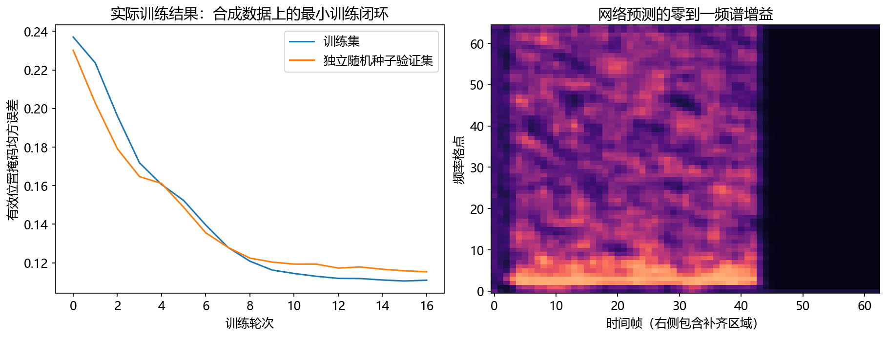

这张图由已经执行的 [neural_lab.py](../code/neural_lab.py) 生成，不是上面缩小版网络短代码的直接绘图。左图来自 96 条训练样本、24 条验证样本、16 轮训练的合成实验。训练与验证损失下降说明它学会了该合成分布中的规律。右图显示增益，不是干净语音频谱；越暗表示越强衰减。图上的补齐部分不参与训练损失。

这里没有真人语音，因此不能把曲线写成“真实通话降噪提升”。查看 [运行记录](../results/neural_results.json) 可以确认参数量、损失、版本与验证边界。原实验还改动未来帧，检查过去输出不变，这是很值得迁移到真实流式项目的单元测试。

## 6. 练习、答案与排错

练习一：把第一节学习率改为 1，更新后损失是多少？答案：$w=8.5$，预测 17，损失 196，明显发散。负梯度方向正确，不代表任意步长都合适。

练习二：批次有 8 条样本，输入 `[8,1,65,63]`，中间卷积输出 12 通道，张量是什么形状？答案：保持时频尺寸时是 `[8,12,65,63]`，不是 `[12,8,65,63]`。

练习三：训练损失持续下降，验证损失先降后升，应该选择最后一轮吗？答案：不应自动选择最后一轮。按预先约定的验证指标选择检查点，并检查过拟合与数据分布；不要用测试集挑轮次。

| 症状 | 先做的检查 | 不要急着做什么 |
|---|---|---|
| loss 是 NaN | 输入是否有限、除零、对数下界、学习率 | 直接换更大模型 |
| loss 完全不变 | 参数是否交给优化器、是否调用 step、梯度是否为零 | 盲目加训练轮数 |
| 十条数据都拟合不了 | 标签对齐、形状、损失、参数更新 | 先下载更多数据 |
| 验证异常好 | 重复录音、同会话切片、测试参与调参 | 直接把数字放简历 |
| 离线好、流式差 | 未来上下文、跨块缓存、特征边界 | 只调阈值掩盖问题 |

## 7. 到实习面试时，交什么才有说服力

本章的就业产物是一份最小训练报告：画出输入到损失的所有形状；记录数据划分、种子和配置；保留训练/验证曲线；展示一个失败样例；说明你独立修复过的错误。随后才把合成数据替换为有权使用的真实语音，并增加听感、语音指标和时延评测。

要记住训练四步和集合职责；要能推导一个标量梯度与有效元素平均；要能实现掩码损失、训练循环和因果测试。下一次学习先合上教程，用五分钟讲清楚“一个 batch 如何变成一次参数更新”，讲不清的地方就是优先复习的位置。


---

# 第 13 章｜语音识别 ASR：机器怎样把长声音对齐成短文字

[返回教程目录](README.md)

先修：[第06课的 Mel 特征](chapters/06_features.md)和[第12课的模型输入输出](chapters/12_pytorch.md)。本章不要求你从零训练大型识别器。目标是理解对齐、亲手算出一个 CTC 损失、正确评价识别结果，然后设计一个真实的领域转写项目。第一次阅读先完成第1—3节和第6节；动态规划与模型差异可在第二次阅读时补齐。

## 1. “声音变文字”中最难解释的一步：谁对应谁

一秒录音若每 10 ms 取一帧，大约有一百个时间位置；“打开空调”只有四个汉字。你不能规定每个字都占 25 帧：有人拖长“开”，有人在“空调”前停顿，同一字的发音内部也会变化。

识别系统通常先把波形变为特征，再由编码器提取与语音内容相关的信息，最后产生文字单元。文字单元可能是汉字、子词或其他符号，不必与“一个汉字”严格一一对应。编码器还能做时间下采样，因此要区分原始样点数、特征帧数和模型输出步数。

例如 100 帧特征经过近似 4 倍下采样，可能只剩约 25 个输出步；精确长度要按卷积核、步幅和填充公式计算。把原始 100 填进只输出 25 步的损失函数，是常见错误。

CTC 解决的是：只知道整句转写，不知道每一帧对应哪个字时，怎样训练序列模型。它不是音频特征，也不是某一种固定网络架构。

## 2. 先懂 blank，再懂重复字

假设词表只有“啊”和一个特殊空白符 `_`。CTC 路径在每个时间步都选一个符号，然后遵守两步规则：先合并相邻重复，再删除空白。

```text
啊 啊 _ 啊  →  啊 _ 啊  →  啊啊
啊 啊 啊    →  啊        →  啊
_ 啊 _      →  _ 啊 _    →  啊
```

顺序不能反过来。若先删空白，第一条路径会变成连续三个“啊”，再合并就错误地只剩一个。blank 表示这个输出步不发出新文字，不应简单理解为真实录音中的静音；有声音的帧也可能输出 blank。

这像把多个粗略时间标记折叠成一句话，但类比有边界：CTC 在训练时不先指定唯一的时间标记，而是把所有能得到正确文本的合法路径一起考虑。细节可参阅 [CTC 原论文](https://www.cs.toronto.edu/~graves/icml_2006.pdf)。

## 3. 两个时间步，完整手算一个 CTC 损失

现在目标只有一个“啊”，两步网络输出如下：

| 时间 | blank 的概率 | “啊”的概率 |
|---|---:|---:|
| 第 1 步 | 0.4 | 0.6 |
| 第 2 步 | 0.5 | 0.5 |

一共有四条路径。`__` 概率 $0.4\times0.5=0.2$，折叠为空文本，不符合目标。`_啊` 概率 0.2，`啊_` 概率 0.3，`啊啊` 概率 0.3，后三条都折叠为“啊”。因此目标文本概率为 $0.2+0.3+0.3=0.8$，损失为 $-\ln(0.8)\approx0.22314$。

关键是“先对合法路径求和，再取负对数”，不是只挑概率最高的那条路径。本例单条路径最高只有 0.3，但整个目标文本概率是 0.8。

下面用 Python 标准库枚举检查，再用 Matplotlib 绘图。0 表示 blank，1 表示“啊”；这是概率计算演示，不含语音模型。从课程根目录 `audio-course-zh` 运行，图保存在 `tutorial/figures/ch13_ctc_paths.png`。

```python
from itertools import product
from math import log, prod

def collapse(path):
    result = []
    previous = None
    for token in path:
        if token != previous and token != 0:
            result.append(token)
        previous = token                 # 即使是 blank 也必须更新
    return tuple(result)

probabilities = [[0.4, 0.6], [0.5, 0.5]] # [时间=2, 类别=2]
total = 0.0
valid_paths = []                         # 保存每条合法路径，供下面绘图
for path in product(range(2), repeat=2):
    probability = prod(probabilities[t][token]
                       for t, token in enumerate(path))
    if collapse(path) == (1,):
        total += probability
        name = "".join("空" if token == 0 else "啊" for token in path)
        valid_paths.append((name, probability))
print(total, -log(total))                 # 0.8，约 0.22314
assert abs(total - 0.8) < 1e-12

# 绘制刚才枚举得到的三条合法路径，不凭空填写概率。
from pathlib import Path
import matplotlib
matplotlib.use("Agg")
import matplotlib.pyplot as plt
plt.rcParams.update({"font.family": "Microsoft YaHei", "axes.unicode_minus": False})
fig, ax = plt.subplots(figsize=(7, 3.8))
bars = ax.bar([p[0] for p in valid_paths], [p[1] for p in valid_paths], color="#398795")
ax.bar_label(bars, labels=[f"{p[1]:.2f}" for p in valid_paths])
ax.set(ylabel="路径概率", xlabel="空表示 blank", ylim=(0, 0.4),
       title=f"三条合法路径相加：目标文本概率为 {total:.2f}")
Path("tutorial/figures").mkdir(parents=True, exist_ok=True)
fig.savefig("tutorial/figures/ch13_ctc_paths.png", dpi=150, bbox_inches="tight")
plt.close(fig)
```

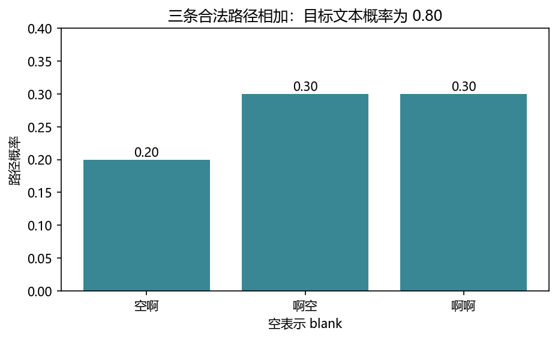

三根柱子都折叠为同一个“啊”。读图时先指出每根柱子对应哪条路径，再将高度相加；不能只拿最高柱子当作目标文本概率。

`product(...,repeat=2)` 枚举两步所有选择；`enumerate` 同时给出时间下标和该步符号。`previous` 不能只记录上一个非空白字符，否则“啊 blank 啊”会被错误折叠。

为什么损失要取负对数？目标概率越接近 1，负对数越接近 0；目标概率越接近 0，惩罚越大。多个独立样本的概率连乘也可以变成对数相加，更便于优化。它不是把概率变成百分数，而是把“提高正确答案概率”改写成“降低一个标量损失”。

推理时最简单的贪心解码是每步取最大概率符号再折叠。这样找到的是一条高概率路径，不保证是总概率最高的文本，因为另一个文本可能有很多条各自较小、加起来更大的路径。束搜索保留若干候选并累积相应分数，通常以更多计算换更充分的搜索；是否有效仍要在固定数据与时延条件下测试。

## 4. 时间步一多，为什么需要动态规划

如果有 100 步、1000 类，直接枚举需要考虑 $1000^{100}$ 条路径，不现实。动态规划的想法是：许多不同路径在同一时刻到达同一个目标位置后，后续计算相同，可以先把这些概率合起来。

以目标“你好”为例，扩展目标为 `[blank,你,blank,好,blank]`。定义 $\alpha_{t,s}$ 为到第 $t$ 步、走到扩展位置 $s$ 的所有合法路径总概率。当前状态可以从自己停留、从前一位置前进，特定情况下还能跨过中间 blank。

“跨两格”只在当前字符不是 blank、且与前两格字符不相同时允许。如果目标是“你你”，必须经过中间 blank 才能区分两个“你”。第一步只有开头 blank 和第一个字可达；最后把最后一个字状态与末尾 blank 状态求和。

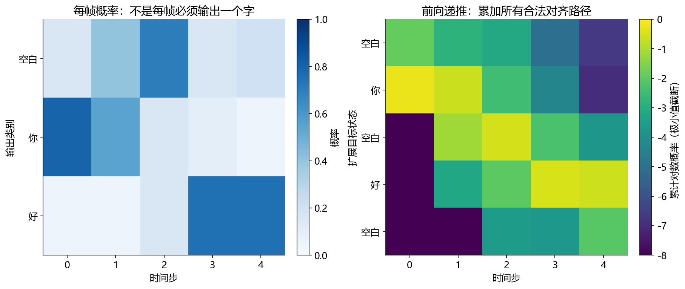

这张图由已经执行的 [run_experiments.py](../code/run_experiments.py) 生成。左图画每一步输出什么符号的概率；右图画“所有走到某个目标位置的路径累计了多少概率”。两个图不是一回事。前几步右图后面的状态不可达，所以非常暗。课程五步例子的总概率为 0.6674596875，与全部 243 条路径穷举一致；它和上面的两步短代码使用不同输入，不应期待数字相同，也不是该短代码直接生成的图。

长序列概率相乘可能小到计算机难以表示，所以 [原核心代码](../code/audio_core.py) 的 `ctc_log_probability` 在对数域累加。对数域的“相加概率”需要 `logaddexp`，不能直接相加对数，因为后者对应原概率相乘。

## 5. 怎样接到 PyTorch，哪些形状最容易弄错

网络未归一化输出称为 logits。先沿类别维做 `log_softmax`，再传给 `CTCLoss`。典型输入是 `[T,B,C]`：输出时间步、批次、含 blank 的类别数；不是所有网络常用的 `[B,T,C]`。目标字符不应把 blank 写进去；有效输入长度必须是下采样后的长度。

[已验证模块](../code/neural_lab.py) 中的 `check_torch_ctc` 使用 `[5,1,3]` 输入、两个目标字，与手写结果对齐。`reduction='sum'` 让单条负对数似然方便比较；其他归一化口径可能给出不同数字。API 细节以 [PyTorch 官方 CTCLoss 文档](https://docs.pytorch.org/docs/stable/generated/torch.nn.CTCLoss.html) 为准。

如果目标是“啊啊”，至少需要三步：`啊 blank 啊`。更一般地，目标有 $U$ 个符号、其中有 $R$ 对相邻重复符号，就至少需要 $U+R$ 个有效输出步。这个长度约束针对模型下采样后的输出，不是原始音频帧数。时间不足会产生零目标概率和无穷大损失。先查长度、重复字和下采样，不要把 `zero_infinity=True` 当万能修复键；它将无穷损失及相关梯度置零，会让坏样本不再贡献正常训练信号，并没有修复对齐条件。

## 6. 识别“错几个字”，要用编辑距离而不是逐位置比较

参考文本是“打开空调”，预测为“打空调啊”。逐位置比较会把后面的字全判错，但实际只需删除“开”、末尾插入“啊”两个操作。最少编辑次数是 2，参考长 4，所以 CER 为 $\frac{2}{4}=50\%$。

编辑距离允许替换 $S$、删除 $D$、插入 $I$。设参考字数为 $N_{\mathrm{ref}}$，则：

$$
\mathrm{CER}=\frac{S+D+I}{N_{\mathrm{ref}}}
$$

插入很多时可以超过 100%。下面只用标准 Python 实现核心递推：

```python
def edit_distance(reference, hypothesis):
    row = list(range(len(hypothesis) + 1))
    for i, ref_char in enumerate(reference, start=1):
        new = [i]
        for j, hyp_char in enumerate(hypothesis, start=1):
            deletion = row[j] + 1
            insertion = new[j-1] + 1
            substitution = row[j-1] + (ref_char != hyp_char)
            new.append(min(deletion, insertion, substitution))
        row = new
    return row[-1]

ref, hyp = "打开空调", "打空调啊"
errors = edit_distance(ref, hyp)
print(errors, errors / len(ref))         # 2，0.5
```

`row[j]` 来自上一行，表示已处理更短参考文本的最佳成本；`new[j-1]` 来自当前行左边，表示刚插入一个预测字符。每格取三种操作的最低成本，才不会被整体错位误导。

真实评测应先固定全半角、标点、大小写、数字等规范。“十二”与“12”是否等价是评测选择，不能对某个模型临时放宽。CER 按规范化后的字符计数；WER 按词计数，中文如果使用 WER，还必须固定分词规则。不要把词错误率与字错误率直接比较。[课程评分器](../code/asr_evaluate.py) 按编号对齐、拒绝漏样本、输出分组 CER。纯静音没有参考字，单独报告插入字数，不伪造分母；还要保留模型超时和失败的记录。

## 7. CTC、注意力与 RNN-T，先理解解决问题的方式

CTC 通常把给定输入后的路径概率分解到输出时间步，再折叠路径。编码器仍能利用上下文，所以条件独立假设不意味着网络只能看孤立一帧。

注意力编码器—解码器在生成下一个文字时，会利用之前生成的文字与输入表示。RNN-T 则结合声学时间状态与历史输出状态，在推进音频和发出文字之间建模。它们不是“旧→新→一定更好”的排行榜；数据、模型、解码和目标时延都影响选择。

流式能力也不是模型名字保证的。编码器若每次都读取整句未来，即使损失是 CTC，也不能直接当作低延迟流式系统。需要有限右上下文、跨块缓存，并区分暂定文字、稳定文字、句末结果。最终 CER 不会告诉你字幕在过程中修改了多少次。

## 8. 把基础转成可投实习的领域项目

你可以选“海洋与信号处理术语转写”，但只能使用获授权且可公开或脱敏的资料。先固定预训练模型、推理参数和语料划分，标出“波束形成、混响、水听器”等术语错误。热词是给解码增加领域偏好，不是把测试答案塞进去；要同时检查不含热词的负例会不会被误识成热词。

微调或 LoRA 之前先完成基线、归一化和错误分析。LoRA 减少可训练参数，并不自动保证少量数据不会过拟合。保留通用回归集，检查领域提升是否以通用识别退化为代价。

练习一：`啊 blank 啊啊` 折叠成什么？答案：“啊啊”。练习二：参考 100 字、编辑错误 12；另一段参考 10 字、错误 5，总体 CER 是多少？答案：$\frac{17}{110}\approx15.45\%$，不是简单平均 12% 与 50%。练习三：流式最终 CER 不变但首字晚 500 ms，是不是没有退化？答案：识别质量可能相近，交互体验已经退化。

排错时先检查采样率和声道，再检查 VAD 是否截断首尾、下采样长度是否正确、文本规范是否一致，最后才讨论模型大小。就业交付应包括逐句预测、分组 CER、领域词召回和误触发、首字/句末延迟、至少五类错误，以及一次可复现的单因素改进。只展示“成功调用模型转写一段音频”还不足以体现算法能力。


---

# 第 14 章｜语音合成 TTS：从一句中文到有内容、有音色的声音

[返回教程目录](README.md)

先修：[第06课的 Mel 与基频](chapters/06_features.md)、[第12课的神经网络输入输出](chapters/12_pytorch.md)；没学过语言学也可以跟上。目标是能画出合成链路，解释读音、时长、音高、音色分别由什么影响，并建立一套不只靠“听起来还行”的测试方法。先读第1—5节并完成时长展开实验；第6节的生成模型分类是拓展阅读，不要求一次全部掌握。

## 1. 先把任务拆成三个问题

TTS 是 text-to-speech，也就是把文字条件转换成语音。做好它至少需要回答：说什么、谁来说、怎样说。第一项是内容，第二项是音色或说话人特征，第三项是韵律，包括重音、节奏、停顿与音高变化。

可以把文字看成乐谱、声音看成演奏，但要记住这个类比的限制：普通文字没有写清每个音的精确长度和音高，同一句话可以有很多合理说法。模型要从文本与条件中补足这些没有明写的信息。

一个便于学习的模块化链路是：文本规范化→发音单元→时长及声学特征→声码器→波形。现代系统可能合并多个模块，或者先生成离散音频单元再解码，但这些功能问题仍然存在。学模型时先找它每一部分负责什么，再记模型名字。

## 2. 中文前端不是“查拼音字典”那么简单

“2026 年”通常按年份读数字，“2026 元”通常按数量读；电话号码又可能逐位读。`3.5 kg`、网址、英文缩写与算式都有不同规则。文本规范化的任务是把书写形式转换成适合发音的形式，而且应保留原文与转换结果，方便追查错误。

随后还有多音字消歧：“银行”和“行走”的“行”读法不同；词的边界和上下文都会影响读音。普通话中还涉及声调、变调、轻声、儿化，以及标点与语义造成的停顿。一个字的拼音也不必等于模型使用的一个 token：系统可能拆成声母、韵母和声调，或使用其他表示。

别把所有前端处理都硬写成字符串替换。例如“行”统一换成一个读音，会修好一个句子却破坏另一类句子。可靠方法是建立测试组：同一个规则至少放正例、反例、边界例，再观察改变是否只修复目标问题。

## 3. 音高、响度与音色：相互有关，但不是同一个旋钮

浊音的声带振动通常有近似周期，其倒数是基频 $F_0$。若周期为 5 ms，$F_0=\frac{1}{0.005\,\mathrm{s}}=200\,\mathrm{Hz}$。它与感知音高密切相关，但音高感知不是对所有信号都等同于一个频谱最大峰。

清辅音等无周期片段可能没有有意义的 F0。训练 F0 预测时，常要同时处理清浊音标记，不能把所有无声或清音位置的 0 都当作真实的“零赫兹音高”。能量描述强弱，通常从短时波形或频谱计算；感知响度还受频率、持续时间和上下文影响。

共振峰来自声道的共振，能影响元音身份。声源的谐波间隔主要随 F0 变，频谱包络又受到声道滤波等因素影响。只把一个人的 F0 调高，往往得到音高变化的声音，并不等于换成另一个人的完整音色。

## 4. 一个完整手算：三个发音单元怎样变成六帧

假设有三个示意单元 A、B、C，每个用一个二维向量表示：$\mathbf{A}=[1,0]$，$\mathbf{B}=[0,1]$，$\mathbf{C}=[1,1]$。预测时长分别为 2、1、3 帧。时长调节器按次数复制向量：

```text
输入单元： A      B      C
时长帧数： 2      1      3
输出帧：   A A    B      C C C
矩阵形状： [3,2]  →  [6,2]
```

若每帧移 256 个样点、采样率为 16000 Hz，则每帧移对应 16 ms，六个帧移对应 96 ms。这个极短例子仅用于计算，不是说一句真实中文只要 96 ms；最终波形边界还要按分析窗、填充和声码器对齐规则处理。

从课程根目录 `audio-course-zh` 运行下面完整代码，既打印展开矩阵，也把这个六帧例子画到 `tutorial/figures/ch14_duration.png`。

```python
import numpy as np

units = np.array([[1., 0.], [0., 1.], [1., 1.]]) # [单元=3, 特征=2]
durations = np.array([2, 1, 3], dtype=int)        # 每个单元占几帧
assert len(durations) == len(units)
assert np.all(durations >= 0)                    # 负时长没有意义
expanded = np.repeat(units, durations, axis=0)   # 只沿单元轴复制
print(expanded.tolist())
print(expanded.shape)                           # (6, 2)

# 转置只为画图：横轴是时间帧，纵轴是两个特征维度。
from pathlib import Path
import matplotlib
matplotlib.use("Agg")
import matplotlib.pyplot as plt
plt.rcParams.update({"font.family": "Microsoft YaHei", "axes.unicode_minus": False})
fig, ax = plt.subplots(figsize=(8, 3.2))
ax.imshow(expanded.T, cmap="Blues", vmin=0, vmax=1, aspect="auto")
ax.set(xticks=range(6), xticklabels=range(1, 7),
       yticks=[0, 1], yticklabels=["特征维零", "特征维一"],
       xlabel="展开后的时间帧", title="实际时长展开：甲两帧、乙一帧、丙三帧")
for frame in range(6):
    for feature in range(2):
        value = expanded[frame, feature]
        ax.text(frame, feature, str(int(value)), ha="center", va="center",
                color="white" if value > 0.5 else "black")
Path("tutorial/figures").mkdir(parents=True, exist_ok=True)
fig.savefig("tutorial/figures/ch14_duration.png", dpi=150, bbox_inches="tight")
plt.close(fig)
```

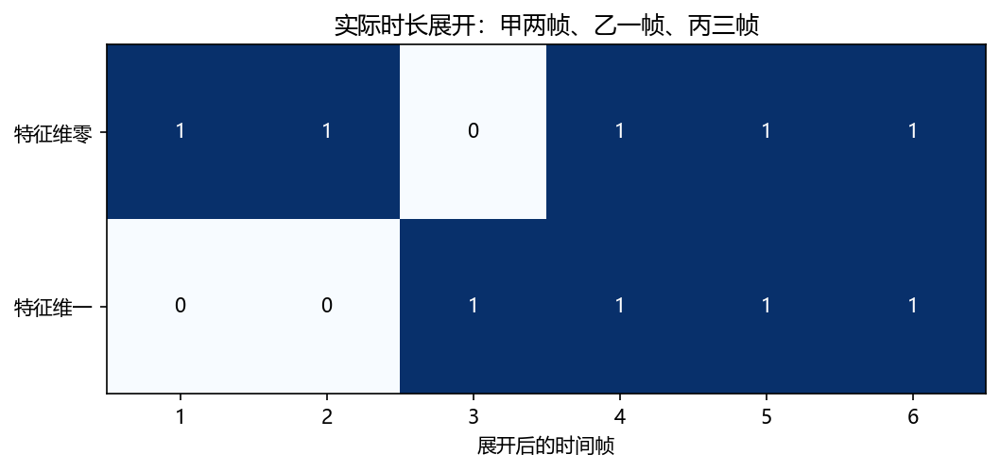

前两列是 A 的 `[1,0]`，第三列是 B 的 `[0,1]`，最后三列是 C 的 `[1,1]`。深色只表示这个玩具向量中的数值 1，不是实际音量或频谱能量。

预期行顺序为 `[[1,0],[1,0],[0,1],[1,1],[1,1],[1,1]]`。这里 `axis=0` 是沿单元轴展开；误写 `axis=1` 会复制特征维，而不是让声音变长。这段代码只执行已知时长，不会自动学习时长。真实系统还需要对齐方法或时长监督、时长预测器及相应训练目标。

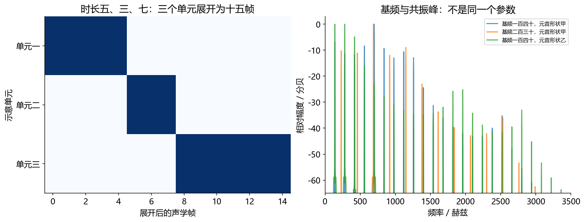

这张图由已执行的 [run_experiments.py](../code/run_experiments.py) 生成，不是上面六帧短代码的直接输出。左侧使用时长 `[5,3,7]` 展示十五帧复制关系，所以图的帧数与本节手算不同。右侧用合成谐波源与共振滤波器比较不同 F0、不同共振参数：先看细密谱峰间隔，再看较慢变化的包络，就能把两个因素区分开。

[教学声音甲](../audio/tts_demo_140_700.wav)、[教学声音乙](../audio/tts_demo_230_700.wav) 是人工类元音，帮助听出参数作用，不是真人克隆，也不能用来展示自然 TTS 的质量。试听先把设备音量调低。

## 5. 声码器为什么要把时间长度放大很多倍

Mel 序列只在每个时间帧保存少量频带信息；波形却每秒有几万个样点。声码器负责从声学表示生成细密波形。它不是无损地“把 Mel 逆变换回去”：Mel 压缩了频率信息，通常还没有完整相位，因此需要学习生成合理细节。

下面的教学网络从 `[B,80,T]` 变成 `[B,1,16T]`。`B` 是批次，80 是输入频带维，1 是输出单声道。随机权重仅能验证结构，不能产生自然语音。

```python
import torch
from torch import nn

vocoder = nn.Sequential(
    nn.Conv1d(80, 16, kernel_size=3, padding=1), # 提取相邻帧结构
    nn.LeakyReLU(0.1),                         # 保留少量负向梯度
    nn.ConvTranspose1d(16, 8, 8, stride=4, padding=2), # 长度乘 4
    nn.LeakyReLU(0.1),
    nn.ConvTranspose1d(8, 1, 8, stride=4, padding=2),  # 再乘 4
    nn.Tanh(),                                # 输出限制到 -1 至 1
)
mel = torch.randn(2, 80, 10)                    # 两条、各十帧特征
wave = vocoder(mel)
print(wave.shape)                             # [2, 1, 160]
assert wave.shape == (2, 1, 160)
```

不含额外输出填充且膨胀率为 1 时，一层转置卷积输出长度为：

$$
L_{\mathrm{out}}=(L_{\mathrm{in}}-1)s-2p+k
$$

其中 $s$、$p$、$k$ 分别对应代码里的 `stride`、`padding`、`kernel_size`。代入本例得到 $(L_{\mathrm{in}}-1)\times4-4+8=4L_{\mathrm{in}}$，连续两层就是 16 倍。若真实 Mel 帧移是 256 样点，整体上采样与边界处理必须相应配合，不能随便接这个 16 倍教学声码器。转置卷积不是普通卷积的数值逆运算，也不是把矩阵简单转置；这里用它学习如何从较稀疏的时间格点生成更多输出样点。[PyTorch 的长度公式](https://docs.pytorch.org/docs/stable/generated/torch.nn.ConvTranspose1d.html)还包含膨胀率和额外输出填充，换参数时应重新计算。

[neural_lab.py](../code/neural_lab.py) 中还有完整的形状与梯度检查：用不同 FFT 窗长比较预测与目标的对数幅度谱。长窗更精细地观察频率，短窗更敏感于时间瞬态。对数前加小常数防止 `log(0)`。频谱损失补充了波形误差的信息，但损失下降也不等于人耳一定觉得自然。

## 6. 自回归、扩散、流匹配，先用生成方式区分

自回归生成是“根据已生成内容继续生成下一单元”。单元可能是声学帧，也可能是离散音频 token。优势是容易利用历史输出；代价是生成步骤之间存在依赖，停止条件不稳时还可能重复或漏内容。离散音频 token 通常来自音频编码/量化系统，不一定对应一个字或音素。

扩散类方法通常学习从带噪表示恢复数据相关结构，推理通过若干步迭代生成。流匹配学习一个随位置和生成时间变化的向量场，用它把初始噪声逐步运输到数据分布。这里的“生成时间”不是录音中的第几秒，是生成过程的进度变量。两类方法联系紧密，但训练目标与路径设计并不都相同。

一个一维教学例子：初始噪声点 $z=-1$、目标数据点 $x=3$，取直线：

$$
x_t=(1-t)z+tx
$$

在 $t=0.25$ 时 $x_t=0$，沿这条线的目标速度是 $x-z=4$。若模型预测速度 3，平方损失为 1。使用正确速度、步长 0.25，四步可从 -1 走到 3。

这个手算只说明“学习速度场”的含义。真实模型面对大量样本、条件与高维表示，推理时没有正确目标点直接可用；也不是所有流匹配路径都是这条直线。进一步参阅 [Flow Matching 原论文](https://arxiv.org/abs/2210.02747)。不必为了应聘把三类模型都从头训练，先能解释一条完整链路并复现可靠测试更重要。

## 7. 怎样判断一段合成真的更好

内容、音色、自然度和速度应该分开评价。把合成声音送入 ASR 得到 CER，可以辅助查漏字错字，但这个结果同时受评测 ASR 的错误影响；CER 很低不意味着音色相似或语气自然。说话人嵌入相似度也只覆盖音色的一部分，并受模型和录音条件影响。

主观试听应使用同一播放响度与环境、随机顺序，尽量避免听者知道哪个是“改进版本”。MOS 要写明人数、评分说明和不确定性，不能自己听一遍就声称达到某个 MOS。实时业务还应记录首个可播放音频块延迟、后续生成速度及断句连续性。

零样本音色条件是在推理时提供参考音频，微调则真正更新参数。二者不要混称。使用声音时要取得授权，不把未授权克隆或个人敏感录音作为作品集材料。

## 8. 练习答案、排错与就业交付

练习一：时长 `[4,2,3]`、帧移 10 ms，名义帧移总长度是多少？答案：9 帧，90 ms；不是三个单元所以 30 ms。练习二：只增加 F0，是否保证“更像女声”？答案：不保证，音色还包括声道、发声方式等因素，不应把单一 F0 等同身份类别。练习三：随机声码器成功输出 `[2,1,160]`，能否写成“完成 TTS 模型训练”？答案：不能，只验证了前向形状。

| 现象 | 优先定位 |
|---|---|
| 多音字稳定读错 | 文本规范化、分词、发音表示 |
| 漏字或重复字 | 对齐、时长、生成停止、文本分块 |
| 金属音或断裂 | 声码器输入配置、跨块拼接、分布不匹配 |
| 语速一改音色也变 | 时长策略、波形重采样方式、模型能力边界 |
| 参考很像但噪声也被复制 | 参考质量、条件编码、训练分布 |

就业作业是建立一份中文困难文本测试集，至少覆盖数字、多音字、英文缩写、长句和停顿；固定模型版本与参考条件，做一次前端或分块策略改进，并保留成功和失败音频。你的贡献可以小，但要让别人能复现、能解释为何改善、能看到改善没有牺牲哪些条件。


---

# 第 15 章｜声纹、说话人日志与声音事件：谁在说，什么时候说，发生了什么

[返回教程目录](README.md)

先修：[第04课的向量与数组](chapters/04_numpy.md)、[第09课的 VAD](chapters/09_enhancement.md)；二分类表示在“同人/异人”等两个类别中做决定。本章目标是把“一个模型给了 0.8 分”变成可解释的决定，并分清声纹验证、说话人日志、语音分离和事件检测。先掌握第1—4节，再按目标岗位选择日志或事件检测分支。

## 1. 先把这些经常混用的任务分开

声纹验证问“两段录音是否来自同一人”；说话人辨认问“在已有候选人中最像谁”；说话人日志（diarization）问“谁在什么时间讲话”。日志常用 A、B、C 这样的匿名标签，不自动知道真实姓名。

语音分离又不同：它试图把混合录音拆成各个声源的波形。日志输出时间与标签，分离输出声音，二者可互相辅助，却不能当同一个任务。ASR 输出讲话内容，“我是张三”这句转写本身也不能证明说话人的身份。

声音事件检测则关心“此时有狗叫、门铃、碰撞还是发动机声”。整段分类只说录音里有什么；事件检测还需要起止时间。同一时刻可能一边有人讲话、一边有狗叫，所以很多事件任务是多标签的。

## 2. 声纹向量是什么：一张压缩的声音特征卡

声纹编码器把长短不一的语音转换为固定维向量，常称 embedding。可以把它想成“比较声音时使用的特征卡”，但不是人类身份的密码：同一个人的设备、语气、语言、噪声和录音长度变化，都可能改变向量；不同人的向量也可能很接近。

编码器通常先提取逐帧特征，再聚合为片段级表示。简单平均池化平均各帧；统计池化还能利用均值与变化程度；注意力池化给不同帧不同权重。短录音提供的信息少，静音或噪声占比高时，得分往往更不稳定。

最常见的比较起点之一是余弦相似度：两个向量的内积，除以各自长度。它比较方向，而不是简单比较幅度大小。分数越大通常表示越相似，但分数 0.8 不是“有 80% 概率同一个人”，除非专门做了概率校准并说明适用分布。

## 3. 手算余弦分数，再写第一段声纹评分代码

取向量 $\mathbf{a}=[1,0]$、$\mathbf{b}=[0.8,0.6]$。两者长度都是 1，内积为 $1\times0.8+0\times0.6=0.8$，所以余弦为 0.8。把 $\mathbf{b}$ 放大十倍得到 $[8,6]$，内积变成 8、长度变成 10，最终分数仍是 0.8。

这个性质说明它不直接受整体尺度影响，但并不说明它对噪声或设备变化天然免疫。下面用标准库实现，不需要下载任何声纹模型。

```python
from math import sqrt

def cosine(a, b):
    if len(a) != len(b):
        raise ValueError("两段嵌入维度必须相同")
    norm_a = sqrt(sum(x*x for x in a))   # 第一个向量的长度
    norm_b = sqrt(sum(x*x for x in b))   # 第二个向量的长度
    if norm_a == 0 or norm_b == 0:
        raise ValueError("零向量不能作为有效声纹")
    dot = sum(x*y for x, y in zip(a, b)) # 相同维度逐个相乘再相加
    return dot / (norm_a * norm_b)

print(cosine([1, 0], [0.8, 0.6]))      # 0.8
print(cosine([1, 0], [8, 6]))          # 0.8
```

实际模型可能输出几百维，但这段评分的思想不变。零向量不应该默默当作正常身份特征；应先查是否输入静音、特征失败或模型输出异常，并记录失败原因。

## 4. 阈值不是越高越好：手算 FAR、FRR 和 EER

假设开发集有四个“同一人”配对，分数为 `[0.9,0.8,0.6,0.4]`；四个“不同人”配对，分数为 `[0.7,0.5,0.3,0.1]`。规定分数大于等于阈值就接受为同人。

阈值取 0.6 时，同人对中的 0.4 被误拒绝，FRR（误拒率）为 $\frac{1}{4}=25\%$；异人对中的 0.7 被误接受，FAR（误接受率）也为 25%。在这个玩具例子上两者相等，这个工作点对应 25% EER。

阈值提高到 0.8 后，没有异人被接受，所以 FAR 为 0；但两个同人对被拒绝，FRR 升到 50%。降低一个错误率往往会抬高另一个。业务若对冒认很敏感，会选择更低 FAR 的工作点；这不等于模型本身突然变差。

从课程根目录 `audio-course-zh` 运行下列代码，可得到八个配对分数对应的真实阈值曲线，图保存到 `tutorial/figures/ch15_threshold.png`。

```python
same = [0.9, 0.8, 0.6, 0.4]            # 已知同人的配对分数
different = [0.7, 0.5, 0.3, 0.1]       # 已知异人的配对分数
for threshold in [0.6, 0.8]:
    false_accept = sum(s >= threshold for s in different)
    false_reject = sum(s < threshold for s in same)
    far = false_accept / len(different) # 分母只能是异人对数量
    frr = false_reject / len(same)      # 分母只能是同人对数量
    print(threshold, far, frr)
# 预期：0.6 0.25 0.25；0.8 0.0 0.5

# 每个阈值都重新统计误接受和误拒绝，有限样本自然形成阶梯曲线。
from pathlib import Path
import matplotlib
matplotlib.use("Agg")
import matplotlib.pyplot as plt
plt.rcParams.update({"font.family": "Microsoft YaHei", "axes.unicode_minus": False})
thresholds = [i/100 for i in range(101)]
fars = [sum(s >= t for s in different)/len(different) for t in thresholds]
frrs = [sum(s < t for s in same)/len(same) for t in thresholds]
fig, ax = plt.subplots(figsize=(7, 3.8))
ax.plot(thresholds, fars, label="误接受率")
ax.plot(thresholds, frrs, label="误拒率")
ax.scatter([0.6], [0.25], color="black", zorder=3, label="手算阈值零点六")
ax.set(xlabel="接受阈值", ylabel="错误比例", title="八个配对分数的实际阈值扫描")
ax.legend()
Path("tutorial/figures").mkdir(parents=True, exist_ok=True)
fig.savefig("tutorial/figures/ch15_threshold.png", dpi=150, bbox_inches="tight")
plt.close(fig)
```

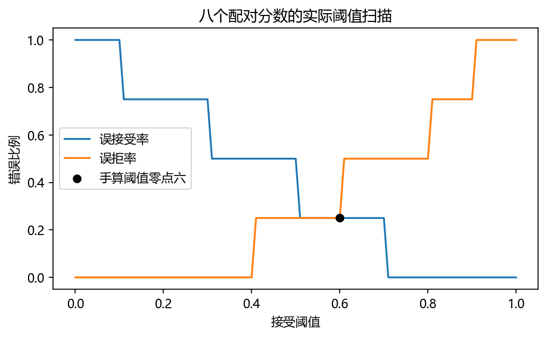

这张小样本曲线不光滑是正常的：总共四个同人对或异人对，每错一个就变化 25 个百分点。别把它画得很平滑再误以为测量精确到小数点后三位。

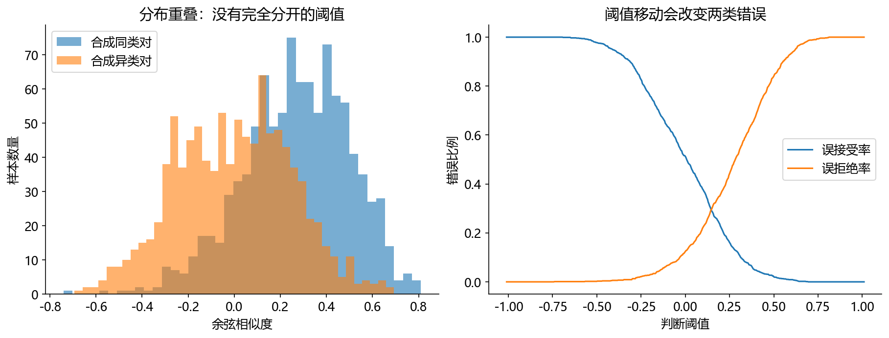

图由已经运行的 [run_experiments.py](../code/run_experiments.py) 使用另一组合成向量生成，不是上述八个分数的图。左图展示两类分数重叠；右图展示阈值变化时两类错误率的反向变化。该合成实验近似 EER 为 29.5%，只解释原理，不能作为真实声纹模型成绩。

现实曲线不一定刚好交于某个采样阈值，需要注明插值或近似规则。还要分清两件事：EER 是对一组带标签分数扫描阈值后得到的评价指标；上线时固定使用的接受阈值，应根据开发集和业务代价提前选择，再到测试集报告 FAR/FRR。按规定计算测试集 EER 本身不等于“偷看测试调参”，但不能把测试集上找到的阈值再包装成预先确定的上线阈值。[SpeechBrain 的 EER 接口](https://speechbrain.readthedocs.io/en/latest/API/speechbrain.utils.metric_stats.html#speechbrain.utils.metric_stats.EER)同时返回 EER 和对应阈值，使用时要注明它们来自哪个数据集合。

也不要只报准确率：若异人对占 99%，永远拒绝都能拿到 99% 准确率，却没有验证价值。

## 5. 说话人日志：每个时间片应该贴谁的标签

常见学习流程是 VAD 找语音区间→切片→提取嵌入→聚类→回填时间线→处理短插话和重叠。VAD 漏掉的语音不会神奇地在后面恢复；切片跨越两个人，嵌入可能被混合；片段过短又可能缺少稳定身份信息。

聚类编号没有固有语义。系统把真实 A 标为“2”、真实 B 标为“1”，不一定错了，评价时通常先寻找合理的一致标签映射。不能直接用字符串标签是否相等来评分。

DER 常把漏检语音时间、误检语音时间、说话人混淆时间加起来，再除以参考说话人时间。先看无重叠、无边界容差的简单例子：真实 A 在 0—4 秒说话，B 在 4—10 秒说话；系统报 A 在 0—5 秒、B 在 5—9 秒。

```text
时间： 0          4   5            9   10 秒
真值： A A A A    B   B B B B      B
预测： A A A A    A   B B B B      静音
问题：            混淆 1 秒        漏检 1 秒
```

分子依次是误检、混淆和漏检时间，分母是参考说话人时间：

$$
\mathrm{DER}=\frac{0\,\mathrm{s}+1\,\mathrm{s}+1\,\mathrm{s}}{10\,\mathrm{s}}=20\%
$$

真实会议有重叠讲话，评价时是否计入重叠、边界周围是否允许 collar 容差，会明显改变分数。collar 通常指从评价中排除参考边界附近的一小段时间，具体宽度定义以评测实现为准，不是随意把错误预测边界吸附到真值。重叠情况下参考说话人时间可能超过录音墙钟时间。报告里必须写明协议，不能拿两套不同协议的 DER 直接比较。[pyannote.metrics 官方说明](https://pyannote.github.io/pyannote-metrics/reference.html)可用于核对标签映射、评价区域和边界容差。

说话人日志也不自动等于“每句话都属于谁”的转写结果。ASR 的文字时间戳、日志边界和重叠语音需要进一步关联；在换人边界处分错，可能让整个句子的归属错误。

## 6. 声音事件检测：为什么不能强迫所有类别概率加起来等于 1

一段录音里同时有语音和狗叫，两类都应为真。单标签 softmax 倾向在互斥类别中竞争；多标签任务通常为每类分别输出 sigmoid 分数，并用逐类二元交叉熵等目标训练。具体是否互斥，应由标注定义，而不是照抄其他分类项目。

手算一个两类例子：真值是 `[有狗叫=1,有门铃=0]`，预测 `[0.8,0.2]`。两类的二元交叉熵分别为 $-\ln(0.8)$ 和 $-\ln(1-0.2)$，都约 0.223，平均也约 0.223。若真值改为两个事件都有，第二类就会受到 $-\ln(0.2)$ 的更大惩罚。

检测还要确定时间边界。把逐帧分数超过阈值的片段连起来，是最基础的后处理；滞回、最短事件时长、合并短间隔可以稳定结果，但也可能吞掉短事件。评价要区分片段级、帧级和事件级，明确起止容差，不要用整段分类准确率冒充事件定位效果。

类别不平衡时，还要说明如何汇总。宏平均先分别计算各类别指标再平均，让少见事件也占一份权重；微平均先累计各类别的正确、误报与漏报数量，更受常见事件影响。两者回答的问题不同，没有一个数字适合所有用途。若你的数据大部分是背景声，单报逐帧准确率可能掩盖所有短促事件都漏掉的问题，应单独查看事件召回和误报。

## 7. 常见失败，不一定需要换模型

| 失败现象 | 可验证的原因 | 先做的小实验 |
|---|---|---|
| 同人跨设备分数很低 | 通道和噪声域变化 | 按同设备/跨设备分组 |
| 两个人总被并到一起 | 切片混人、嵌入不足、聚类阈值 | 回听最相似的异人对 |
| 短插话经常消失 | VAD 最短时长、后处理合并 | 单独评价短于一秒片段 |
| 背景电视被当参会者 | 声源并未被业务定义区分 | 增加电视声负例与标注规则 |
| 事件总在某设备上准 | 学到设备背景而非事件 | 按设备隔离测试 |

你有水声背景，可以把“分组划分、弱目标检测、干扰分析”的经验迁移过来，但不能把水声类别模型直接写成说话人识别模型。迁移的是处理方法，输入分布、目标与评测仍要重新建立。

## 8. 练习答案与就业产物

练习一：1000 个异人对中 5 个被接受，FAR 是多少？答案：0.5%；分母不是所有配对数。练习二：系统把所有 A/B 标签互换，应算所有时间都错吗？答案：不能直接这样算，应按日志评价协议先做一致标签映射。练习三：把重叠区域全部删掉后 DER 下降，能说模型提升吗？答案：不能，那是评测条件改变，除非两版本都按相同新协议重评。

就业交付可以是一个小规模合法会议工具：保存录音编号、人工时间线、声纹配对分数、阈值选择依据、日志结果和错误回听清单；分别报告同设备/跨设备、长语音/短语音、重叠/非重叠条件。使用匿名标签，公开材料先脱敏，不把别人的声音和真实身份随意放到仓库。

本章要记住任务边界与 FAR/FRR 的分母；要能手算余弦和简单 DER；要能实现阈值扫描并解释一组失败案例。下一次复习不要只背 EER 缩写，拿出一张分数表，说明你为什么选择这个阈值、它会让哪一类用户付出代价。


---

# 第 16 章｜把算法变成能运行的音频系统：数据、缓存、时延和打断

[返回教程目录](README.md)

先修：[第04课的数组](chapters/04_numpy.md)、[第05课的分帧](chapters/05_spectrum.md)，以及你所选方向的一条基本推理链路。本章目标不是做一个大型服务平台，而是让你的实验有明确输入、有可复现结果，处理长录音时不乱、连续运行时不积压、用户插话时不继续播旧回答。第一次先完成数据清单、分块缓存和计时；量化与语音助手打断属于按项目需要继续学的部分。

## 1. 从一个文件到一个预测，中间要有“账本”

初学者常在代码里写一个音频路径，成功跑通后便认为数据管线完成了。真实项目更需要知道：这段音频是什么采样率、几个声道、来自哪个会话、属于哪个集合、标注由谁检查、是否有使用权限。

可以用一行一个样本的 JSONL 清单记录 `id、audio、sample_rate、duration、speaker、session、split、text` 等字段。不是所有任务都需要文字或真实说话人信息，但编号必须稳定；模型输出也要带同一个编号，不能依赖文件遍历顺序恰好相同。

读取时先检查文件能否解码、波形是否有限、是否全静音、是否削波、时长是否异常。转换采样率后保存转换规则；立体声转单声道要说明策略。对双麦阵列，随意求平均会丢掉空间信息，不能把它当作普遍正确的预处理。

训练集和测试集拆分必须先确定，再拟合归一化统计量、挑阈值和微调。随机种子能帮助复现，但不能替代完整配置；模型文件、代码版本、前处理参数和数据清单都要对应保存。一次成功运行的终端截图，无法替代这些证据。

## 2. 分块到达的声音，不能每一块都当作一条新录音

采样率 16000 Hz，声卡每 20 ms 回调一次，就会送来 $16000\times0.02=320$ 个样点。算法若用 32 ms 分析窗、10 ms 帧移，需要每帧 512 点、每次前进 160 点。第一块只有 320 点，连一帧都不够；要等下一块补足，再保留重叠部分继续分析。

缓存像一个传送带：新样点从后面进，处理过的帧按帧移向前走，尚未用完的重叠部分必须留下。它不是把整段历史永远存下来。网络若还有卷积或注意力历史状态，也需要自己的缓存，不能和波形缓存混为一谈。

为了看清下标，下面把帧长缩为 4、帧移缩为 2，输入按三块 `[0,1,2]`、`[3,4,5]`、`[6,7,8]` 到达。

从课程根目录 `audio-course-zh` 运行完整代码，会把实际形成的三个重叠帧保存到 `tutorial/figures/ch16_buffer.png`。

```python
import numpy as np

frame_size, hop_size = 4, 2
buffer = np.empty(0, dtype=float)             # 保存还可能参与下一帧的样点
frames = []
chunks = [np.arange(0, 3), np.arange(3, 6), np.arange(6, 9)]
for chunk in chunks:
    buffer = np.concatenate([buffer, chunk]) # 接上新样点，不重置历史
    while len(buffer) >= frame_size:
        frames.append(buffer[:frame_size].copy()) # 当前完整分析窗
        buffer = buffer[hop_size:]            # 只前进帧移，保留重叠
print([frame.tolist() for frame in frames])
print(buffer.tolist())
# 预期帧：[0,1,2,3]、[2,3,4,5]、[4,5,6,7]；剩余：[6,7,8]

# 每行画一个真实输出帧，数字显示它来自原始序列的哪个样点。
from pathlib import Path
import matplotlib
matplotlib.use("Agg")
import matplotlib.pyplot as plt
plt.rcParams.update({"font.family": "Microsoft YaHei", "axes.unicode_minus": False})
matrix = np.stack(frames)
fig, ax = plt.subplots(figsize=(7, 3.8))
ax.imshow(matrix, cmap="Blues", aspect="auto", vmin=0, vmax=8)
for row in range(len(frames)):
    for column in range(frame_size):
        value = matrix[row, column]
        ax.text(column, row, str(int(value)), ha="center", va="center",
                color="white" if value > 4 else "black")
ax.set(xticks=range(4), yticks=range(3), yticklabels=["第一帧", "第二帧", "第三帧"],
       xlabel="分析窗内的样点位置", title="实际重叠分帧：帧长四、帧移二；尾部保留六七八")
Path("tutorial/figures").mkdir(parents=True, exist_ok=True)
fig.savefig("tutorial/figures/ch16_buffer.png", dpi=150, bbox_inches="tight")
plt.close(fig)
```

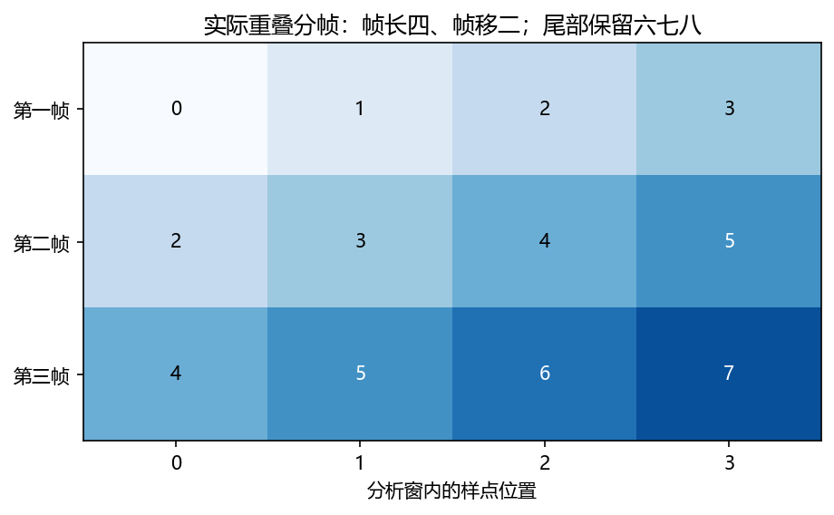

按行读图会看到 `[0,1,2,3]`、`[2,3,4,5]`、`[4,5,6,7]`。样点 2、3 同时出现在前两帧，不是重复读取错误，而是短时分析设计中的重叠。

第一块不产生完整帧，第二块产生两帧，第三块再产生一帧。最后三个样点还不足四点，本例故意留下它们。录音结束时要明确选择补零处理还是丢弃尾部，不能让尾音“自然消失”而不记录。

这是便于理解的数组实现，反复拼接和复制并不适合严苛实时回调。工程中通常使用预分配的环形缓冲区，读写指针循环移动；回调里尽量不进行磁盘访问、网络请求和大块内存分配。原则先学清楚，再优化实现。

## 3. RTF 小于 1，为什么用户仍觉得慢

实时因子 RTF 定义为处理耗时除以音频时长。10 秒录音用 2 秒处理，RTF 为 0.2，说明平均处理速度快于声音到达速度。但若必须先等用户讲完这 10 秒，第一条结果仍可能很晚。

延迟还包含等待凑帧、未来上下文、VAD 判断说完、服务排队、模型计算、生成和播放缓冲。假设一次串行交互在用户最后一个声音结束后，VAD 等 300 ms，ASR 提交用 40 ms，语言模型首段用 180 ms，TTS 首块用 90 ms，播放缓冲用 40 ms，用户听到回答约需 650 ms。

这是一次流程的示意加法，不是把各模块的 P95 直接相加就得到系统 P95。实际模块可能重叠执行，尾延迟也有关联。应给同一轮会话的关键事件加单调时钟时间戳，从真实记录计算端到端分布。

| 指标 | 它回答的问题 | 容易遗漏什么 |
|---|---|---|
| RTF | 长期吞吐能否跟上音频 | 凑帧、句末等待与首包 |
| 首字延迟 | 字幕多久出现第一段文字 | 后面是否不断改写 |
| 稳定文字延迟 | 多久得到不再改的结果 | 最终整句质量 |
| 首音频延迟 | 多久听到回答开始 | 中间是否断流 |
| P95 延迟 | 较慢的那部分请求有多慢 | 失败、超时是否被删除 |

CPU/GPU、线程、并发、精度、输入长度、预热次数都要写进测试条件。GPU 操作常异步提交，单纯测“发出任务”的时间会过短，需要正确同步或设备事件计时。不要把包含首次加载的耗时与预热后的耗时混在一张表里。

每种“首字/首音频延迟”还必须写清起止事件。例如从用户开始讲话计时、从用户说完计时、从服务器收到请求计时，测到的是不同的等待；收到音频数据也不等于扬声器已经播放。P95 是第95百分位，约有95%的已计入样本不超过它，不是“最慢5%样本的平均值”。同时报告样本量、失败率和超时处理方式，才知道这个数字覆盖了哪些请求。

## 4. 量化不是把 float 换个名字，而是改变数值刻度

用 $\Delta$ 表示量化刻度（代码里的 `scale`），对称量化的简化形式是：

$$
q=\operatorname{round}\!\left(\frac{x}{\Delta}\right)
$$

再把 $q$ 限制在整数范围，重建 $\hat{x}=q\Delta$。可以把它想成尺子的刻度变粗：存储和计算可能更省，但一些细小差异被舍入掉了。是否更快还取决于实际后端有没有高效整数算子。

手算四位对称教学例子：使用整数范围 $[-7,7]$，最大绝对值为 1.4，则 $\Delta=\frac{1.4}{7}=0.2$。输入 $x=0.31$ 对应 $\operatorname{round}(1.55)=2$，重建为 0.4，误差为 0.09。如果突然出现离群值 7，$\Delta$ 变成 1，0.31 就可能被舍入为 0，细节丢失更多。

```python
import numpy as np

x = np.array([-1.4, -0.31, 0., 0.31, 1.4])
limit = 7                                  # 教学用对称四位范围
scale = np.max(np.abs(x)) / limit
q = np.clip(np.rint(x/scale), -limit, limit) # 舍入，再限制整数范围
q = q.astype(np.int32)                      # 仅演示；并非真实四位打包
reconstructed = q * scale                  # 模拟反量化
print(q.tolist())                          # [-7, -2, 0, 2, 7]
print(np.round(reconstructed, 2).tolist())  # [-1.4,-0.4,0,0.4,1.4]
```

这里故意使用 `[-7,7]` 的对称窄范围，未使用四位有符号整数可表示的 `-8`；这是教学约定，不代表所有 INT4 格式都采用同一范围。示例中最大绝对值非零；处理全零张量时需要单独约定合法正刻度，避免 `scale=0` 后除零。

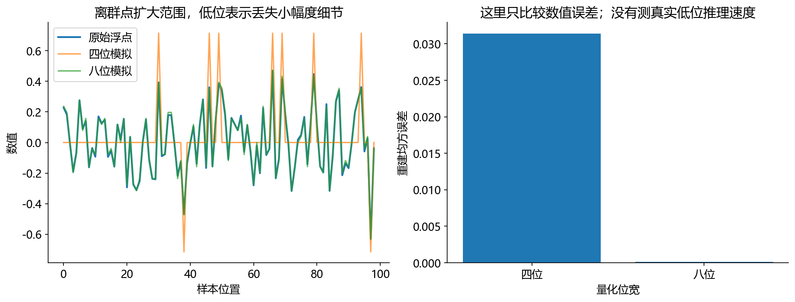

图由已执行的 [run_experiments.py](../code/run_experiments.py) 对一组含离群值的合成数值生成，不是上述五个点的直接绘图。看左图四位结果大量落在零或少数幅度刻度，再看右侧误差：较低位宽通常使刻度更粗。图能说明数值误差，不能直接推出 ASR 准确率或 TTS 音质，更不说明已经运行了真正 INT4 内核。

PTQ 是训练完成后转换；静态量化通常需要代表性标定数据来估计激活范围；动态量化可在运行时计算部分量化参数。QAT 在训练时模拟量化影响，让模型适应误差。逐张量和逐通道使用的刻度粒度也不同。后端支持、格式和性能注意事项查 [ONNX Runtime 官方量化文档](https://onnxruntime.ai/docs/performance/model-optimizations/quantization.html)，不要把某个版本的导出命令当作永久通用。

## 5. 导出 ONNX 后，要证明“还是同一个算法”

ONNX 是模型计算图交换形式之一，不意味着模型必然更快，也不会自动把非流式模型变成流式。第一步应使用固定输入，比较原框架与新后端的输出差异；随后再测短句、长句、静音、不同批次和动态长度。

音频系统尤其要核对：采样率、幅度标度、窗函数、FFT、Mel 配置、归一化与帧轴是否一致。若从第一个特征张量就不一致，后面的模型误差没有比较意义。对有状态模型还要核对缓存的输入输出，每一块是否接上了正确历史。

建议分层排错：波形→特征→模型浮点输出→缓存→后处理→文字或音频。先做数值一致性，再做任务指标一致性，最后比较速度和内存。一个很小的数值差异可能在阈值附近改变离散决定，因此“最大误差很小”不能替代最终业务回归集。

## 6. 语音助手的打断：清空队列为什么还不够

典型级联系统是 ASR→语言模型→TTS。端到端语音模型可以减少部分显式中间接口，但仍然需要输入输出缓存、轮次管理和质量评测。别把换成大模型理解为所有声学和工程问题都自动消失。

假设系统回答到一半，用户插话。你清空当前播放队列，但旧 TTS 任务还在后台生成，100 ms 后又返回一块旧音频。如果直接接收，系统又开始播放被打断的回答。

解决这个逻辑问题的一个办法是给每轮任务加编号：用户开始新一轮时编号递增，旧编号返回的结果一律拒收。下面的代码不接麦克风，也不调用模型，只验证状态与回调规则。

```python
from collections import deque

class Session:
    def __init__(self):
        self.turn = 0
        self.listening = False
        self.queue = deque()              # 尚未交给播放设备的音频块

    def user_starts(self):
        self.turn += 1                    # 旧任务从现在起失效
        self.listening = True
        self.queue.clear()                # 清理还没播放的旧结果
        return self.turn

    def user_finishes(self):
        self.listening = False

    def receive(self, turn, chunk):
        if turn != self.turn or self.listening:
            return False                  # 拒绝旧轮次或用户讲话期间的结果
        if len(self.queue) >= 8:
            raise BufferError("队列满，需要背压")
        self.queue.append(chunk)
        return True

s = Session()
old = s.user_starts(); s.user_finishes()
assert s.receive(old, "旧回答第一块")
new = s.user_starts()                      # 用户插话，旧队列被清空
assert not s.receive(old, "迟到的旧回答")
s.user_finishes()
assert s.receive(new, "新回答")
print(s.turn, list(s.queue))                # 2，['新回答']
```

队列有上限是为了暴露背压问题：如果生成长期快于播放或网络发送，不能无限积压，把内存和等待时间一起耗尽。真实系统还应取消旧计算、停止或冲刷声卡已排队的声音，并处理线程安全。上例的 Python 状态对象并不是可直接上线的多线程播放器。

更难的一半是判断“用户真的插话了”。设备自己播放的声音会被麦克风收回，需要 AEC、VAD 与轮次判断配合；背景咳嗽或电视声不应总触发打断。状态逻辑正确与打断检测准确是两种不同能力，应分别测试。

## 7. 练习答案与一次有用的故障调查

练习一：8 秒语音处理用 4 秒，RTF 是多少？答案：0.5；但如果整段结束才处理，首字仍可能很晚。练习二：320 点音频块在 16 kHz 下多长？答案：20 ms。练习三：量化后文件小了 50%，推理一定快 50% 吗？答案：不一定，算子支持、访存、转换开销和硬件都影响结果。练习四：旧回答回调应检查什么？答案：所属轮次、当前状态和队列容量，不能只看“是不是有声音”。

调查一次“回答声音越来越晚”的故障时，不要先改模型。记录每块音频的生成时间、入队时间、出队时间、播放时间与队列深度。如果生成耗时稳定而队列持续增长，瓶颈更可能在消费速度或背压；如果某轮旧结果重新入队，则是取消/轮次逻辑有误。

排错清单依次是：输入格式是否正确；缓存是否跨块连续；时钟单位是否统一；是否测了真实完成时间；失败请求是否遗漏；线程与并发是否一致；队列是否有界；新旧轮次是否隔离。一次有证据的故障定位，比背一串框架名字更能体现工程能力。

## 8. 你的实习交付，应该让别人一键复现

交付包至少包含数据清单说明、配置、推理入口、评测入口、质量—时延—内存对照表、环境版本及失败案例。压缩或导出项目要同时展示质量损失与收益；交互项目再增加误打断、漏打断和打断后残留播放时长。

你不必第一次就建完整平台。先让十段固定录音稳定跑通，再增加长录音与流式分块，最后加入并发、打断和故障注入。每增加一层，都保留上一层的回归测试。这样项目会逐步成为能解释、能维护的系统，而不是只能在演示当天成功一次的脚本。


---

# 第17课：把学习过程做成一个能讲清楚的实习项目

[返回目录](README.md)

这是一份项目路线图，不是要求你读到这里之前已经做完所有实验。初读可先看“前两周”安排；真正开始主项目前，至少学完第04—09课中的相关基础。训练小型网络还需要第12课，阵列方向还需要第10—11课。

## 先决定你要证明哪一种能力

初学者常想把3A、ASR、TTS、声纹、大模型都放进简历。问题是每个方向都需要数据、基线、错误分析和工程说明；同时开始很容易只留下几个调用模型的演示。

结合你的电子信息和水声背景，一个可执行选择是：增强或阵列做主项目，ASR作为补充了解。这里是基于已有背景作出的学习建议，不是对某家公司录取概率或薪资的预测。若真实导师任务偏定位、检测，优先把真实任务做扎实；若任务没有可公开材料，就另做合规公开数据项目。

你需要证明的不是“我见过很多模型”，而是“我能定义问题，处理数据，复现方法，解释结果，并定位失败”。这五件事也是下面验收表的主线。

## 项目方向一：从一条带噪波形开始做语音增强

第一步只定义输入输出：输入单声道带噪语音，输出同样长度、同样采样率的增强语音。暂时不要混入分离多人、回声消除、变声和识别。把问题缩小，才能知道改动影响了什么。

第二步建立数据清单。每条数据至少保存文件ID、说话人ID、时长、采样率、噪声来源、划分、许可说明。训练与测试不能只按随机切片划分；来自同一个人、同一次录音或同一段背景噪声的高度相似样本可能造成泄漏。具体隔离粒度要服务于你声称的泛化目标。

第三步分阶段建立对照：先保留原始带噪输入，再实现传统增强基线；学完第12课、能解释训练循环后，才增加小型网络，不要求新手第一天同时训练三种方法。保留原始输入很重要，否则你无法知道处理是否反而伤害语音。不同方法用同一测试集合、同一对齐规则、同一指标实现。

第四步进行一次有解释的消融。比如只比较有无因果约束，或者只比较两种损失；不要同时换数据量、网络规模和前处理，再把成绩提升全部归因于网络。记录参数量、计算设备、块长、速度和失败样本。

第五步写一段诚实结论：“该方法在哪些噪声上改善，在哪些条件下吞尾音，是否满足目标时延”。不用硬编新颖性；对一个实习项目，可靠复现和定位问题本身就有价值。

## 项目方向二：从合成双麦到真实阵列问题

先画清麦克风位置和角度定义。用已知延迟合成双通道，检查 GCC-PHAT 正负号；再把延迟换成方向。此时“定位正确”只说明公式和代码在该合成条件下正确。

然后一次加入一个困难：噪声、反射、阵元位置误差、声速误差、通道增益差异或采样时钟不同步。每次扫一个参数，用误差随条件变化的曲线解释方法边界。

如果导师提供真实水声数据，先确认能否用于个人研究、能否公开、能否写合作单位名称。只展示获准内容。声速、传播损耗、频带与阵列尺寸换了，空气声学中的常数不能直接照搬。

项目表述应当是你实际做的“阵列定位/检测/参数估计”。只有确实完成了语音任务，才写“语音识别”。所谓包装应理解为清楚表达真实贡献，而不是换个热门任务名。

## 交付目录与实验记录

一个可复现目录可以包含 `README`、`configs`、`data_manifest`、`src`、`tests`、`results`、`examples`。不必追求复杂工程框架，但要让别人知道从哪条命令开始。

| 记录项 | 一个合格的具体写法 | 不合格写法 |
|---|---|---|
| 任务 | 单声道增强；固定16 kHz；同长输出 | 做了音频算法 |
| 数据 | 划分规则、时长、来源和许可 | 网上下载的数据 |
| 基线 | 原始输入与传统方法，同一测试集 | 效果很好 |
| 结果 | 指标实现、分组、失败样本、速度条件 | 提升很多 |
| 个人贡献 | 负责数据、实现、评测中的具体部分 | 参与整个项目 |
| 限制 | 未覆盖远场、音乐或低功耗设备 | 基本没有问题 |

建议每个实验只写一页：问题、假设、改了什么、不变的条件、图、数字、解释、下一步。没有结果也能写有效记录，例如“模型无法过拟合10条样本，发现标签晚了1帧”。这比无说明地保存几十个检查点更能帮助你面试。

## 前两周细化到可完成的动作

先按每周约8—10小时试行，课业紧张时减量，不把排满日程当学习成果。第一次接触 Python 的同学，前几天只读图、手算并完成数组练习；学完第04课再运行完整音频实验。下面是起步节奏，不是必须按天赶完的进度承诺。

| 时间 | 阅读与操作 | 当天验收 |
|---|---|---|
| 第1天，45—60分钟 | 00与01前半；只读第一份实验的图，不要求运行 | 用图说清频率和幅度分别改变什么 |
| 第2天，60分钟 | 01后半与02；手算PCM数据量 | 解释采样率和音调频率，以及只改文件头的后果 |
| 第3天，60分钟 | 03的RMS、分贝与SNR；先完成纸笔例题 | 解释0 dB SNR为何不是静音 |
| 第4天，60—90分钟 | 04前半；变量、数组形状、切片和广播 | 打印一维音频和双声道数组的形状 |
| 第5天，60—90分钟 | 04后半；分帧，再运行声音数组实验 | 不看答案写出四帧矩阵；改频率和幅度后读图 |
| 周末，2—3小时 | 运行分贝与配噪实验；整理错误记录 | 重测指定SNR；交一页报告和三道口述题 |
| 第2周前半，3小时 | 05；卷积、FFT、窗与STFT，逐节改参 | 区分波形、频谱与声谱图的轴和单位 |
| 第2周后半，3小时 | 06；Mel、MFCC与F0；复习第04课数组轴 | 解释特征维和时间维，知道F0不等于共振峰 |
| 第2周末，1—2小时 | 闭卷复述与复盘；基础稳了再预习07 | 找出最薄弱一项；流式滤波实验留到学完07后 |

后续按里程碑推进：先做传统基线，再学第12课训练，再使用合规真实数据做主项目，最后补评测和简历。每个里程碑耗时取决于编程基础、数据可用性和课题组工作，不承诺固定周数一定完成。

## 面向2027年暑期的行动节点

不要等2027年7月才开始规划。现在的任务是形成基础和第一个小闭环；有一个能复现、能讲清的项目后，就可以关注并尝试与水平匹配的实习。春季应主动核对当年的暑期招聘安排、到岗要求和导师时间安排；具体公司发布时间需届时查官网。

短寒假不一定符合岗位要求的实习时长。提前核对每周到岗、连续月份、地点与远程政策，不能只看技术方向。这里不默认你必须已有某家中小厂实习，也不保证中小厂算法岗位更容易。

如果暂时没有合适岗位，就把真实课题或独立项目补成可展示证据，而不是为了“有实习”接受一个完全不积累目标能力的安排。是否读博也不需要现在用一个薪资传闻决定，先获取项目和岗位体验再判断。

## 简历与口述的两分钟版本

第一句讲问题和场景；第二句讲你做了什么；第三句讲在什么固定条件下有什么结果；最后一句讲限制和下一步。数字没有测出来就不填，不借用本教程的合成结果当个人真实语音成绩。

模板：“针对【实际问题】，整理【数据与划分】，实现【基线与方法】。在【测试协议】下比较【指标与时延】，负责【个人贡献】，定位【一个失败原因】。”

验收问自己：能现场画出数据流程吗？能解释核心函数每个数组轴吗？改一项参数前能预测影响吗？结果换一个测试分组还成立吗？有一个问题不知道时能说清准备怎样验证吗？这些问题的答案，比技能栏里多放五个缩写更能体现你是否真正做过。


---

# 第18课：容易混淆的概念与闭卷自测

[返回目录](README.md)

## 不要一次背完，碰到再查

这是随用随查的附录，不是另一套从头开始的课程。先在正文遇到概念，再回来核对一句话定义；下面的自测按“单位→代码→任务评价”逐步检查，不需要第一次就全部通过。

| 名词 | 用一句话解释 | 不等于什么 |
|---|---|---|
| 采样率 sample rate | 一秒记录多少个离散样本 | 不等于音调频率 |
| 位深 bit depth | 一个采样值可用多少位表示 | 不等于压缩码率 |
| 码率 bitrate | 每秒存储或传输多少比特 | 不等于采样率 |
| 帧 frame | 为局部处理截取的一小段 | 不必是不重叠片段 |
| 帧移 hop | 相邻帧起点间隔 | 不等于窗长 |
| 频谱 spectrum | 不同频率成分的表示 | 单张整段频谱没有时间定位 |
| 声谱图 spectrogram | 短时频谱沿时间排起来 | 颜色不一定是校准声压 |
| 相位 phase | 周期位置或频域角度关系 | 不可随意丢掉后期待无损重建 |
| FIR | 输出由有限个输入历史加权形成 | 不是所有FIR都是线性相位 |
| IIR | 具有反馈的常见递归滤波实现 | 不代表一定不稳定 |
| 因果 causal | 输出不使用未来输入 | 不代表没有等待时间 |
| AEC | 减去来自已知参考的回声估计 | 不是物理主动消声 |
| ANS/NS | 抑制不需要的噪声成分 | 不保证识别准确率一定提高 |
| AGC | 调节电平与动态变化 | 不是把噪声变成语音 |
| VAD | 判断何时有语音活动 | 不是识别说了什么 |
| KWS | 检测关键词或唤醒词 | 不等于完整ASR |
| ANC | 控制扬声器产生声音以降低某位置噪声 | 不是只对文件做数字降噪 |
| ASR | 声音到文字 | 不自动知道说话人身份 |
| TTS | 文字条件下生成语音 | 好听不代表内容一定正确 |
| 声纹验证 | 判断两段声音是否来自同一人 | 不等于转写 |
| 说话人日志 diarization | 谁在什么时候说话 | 聚类标签未必是真实姓名 |
| Mel | 一种非线性频率刻度及其滤波表示 | 不是某个神经网络 |
| MFCC | 通常对对数Mel滤波器组能量做离散余弦变换，再选取系数得到的特征 | 系数轴不是频率轴 |
| F0 | 周期性声源的基频估计 | 不等于共振峰 |
| 共振峰 formant | 声道共振造成的谱包络峰 | 不一定落在某个单独谐波频点 |
| batch | 一次送入模型的一组样本 | 不等于epoch |
| epoch | 一轮训练数据遍历的常用计数 | 不代表准确率提高一次 |
| 梯度 gradient | 损失对参数变化的局部敏感度 | 不保证一次更新就到最优 |
| CTC blank | 对齐机制中的空白符号 | 不简单等于静音声音 |
| CER / WER | 编辑错误数除以参考字符数 / 词数 | 不应混用计数单位；插入多时可超过100% |
| EER | 扫描阈值时误接受率与误拒率相等或按约定近似相等的错误率 | 不等于上线固定阈值的实际错误率 |
| DER | 按协议统计的说话人漏检、误检与混淆时间之和，除以参考说话人时间 | 不等于转写错字率 |
| RTF | 处理耗时除以音频时长 | 不足以描述首包与排队 |
| 首包延迟 | 从明确约定的输入事件到首个可用输出的等待 | 不等于整句耗时；收到音频包也不等于已播放 |
| P95 延迟 | 延迟的第95百分位 | 不是最慢5%样本的平均延迟 |
| RT60 | 能量衰减60 dB的混响时间描述 | 不是最后非零样本时间 |

## 数字与单位检查

1. 48 kHz、双声道、16位PCM，一秒裸数据多少字节？答案：$\frac{48000\times2\times16}{8}=192000$ 字节，不包含容器头。
2. 16 kHz下10毫秒有多少点？答案：160点。若计算得到160000，多半把毫秒当秒。
3. 频率1000 Hz，周期多少毫秒？答案：1毫秒。振幅变化不会直接改变这个周期。
4. 同一参考下功率翻倍，增加多少dB？答案：$10\log_{10}(2)\approx3.01\,\mathrm{dB}$；幅度翻倍对应功率四倍，约6.02 dB。
5. 一分钟音频处理用了30秒，RTF是多少？答案：0.5。但若等完整一分钟录完才开始，用户仍要等很久。
6. 16 kHz采样，512点FFT的格点间距是多少？答案：31.25 Hz。补零使格点更密不等于增加了观测时长。

## 情景题：先定位问题，不急着换模型

**情景一：两声道分别都能听见，平均后几乎没声。** 先检查极性与相位，尤其是否一边约等于另一边的负值；不要直接说“平均融合算法不行”。

**情景二：离线处理正常，实时每10毫秒出现咔哒声。** 检查滤波状态、重叠相加、增益平滑和块长度处理。第03练习本有实际边界错误图。

**情景三：训练损失很低，换个人就失败。** 检查说话人划分和分布差异；训练集成绩不是泛化成绩。增加层数不是唯一办法。

**情景四：降噪后更安静，但ASR错字更多。** 可能损伤了辅音、尾音或相位结构，或前处理与识别训练分布不匹配。同时看听感、波形、识别错误类别，不只看噪声能量。

**情景五：TTS把“2027”读得不合语境。** 检查文本规范化与上下文：年份、编号、金额的读法不同。声码器并不直接负责选择年份读法。

**情景六：波束形成角度完全反了。** 先检查坐标、通道顺序、互相关定义、时延符号、角度相对阵列轴还是法线，不要先断言模型失效。

## 给自己建立错题记录

每次只写四行：我原来怎么想；运行或查证看到什么；正确解释；下次怎样检查。例：“我以为把音频除以最大值就总能公平比较；实际上每段独立归一化改变了录音电平关系；评价时必须先定义协议；之后在配置里记录缩放策略。”

复习时不问“这章我看过没有”，而问“我能不用答案解释一张图吗”。先用两句话解释现象，再补公式，再指出代码中对应哪一行。最后能讲出一个失败条件，才算把知识从记忆变成了可使用的能力。

## 下一步

如果数值与单位题还容易错，回到第02—05课。若代码能跑却说不清形状，回到第04、12课。若懂算法却没有结果协议，回到第17课。学习不必线性向前，回退补一个前置概念通常比硬读十页新名词更快。
